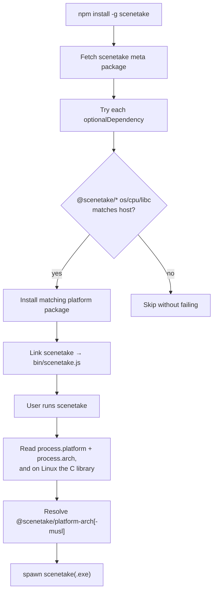

# Installation Specification

Status: **Implemented**

## Motivation

scenetake ships as a **native binary** (NativeAOT). Install channels differ in who they optimize for and how platform selection works, but **GitHub Release assets are the single source of truth** for prebuilt binaries. npm and Scoop repackage or reference those assets; they do not build scenetake themselves.

| Channel | Primary audience | Platform selection | Node.js required |
|---|---|---|---|
| [GitHub Releases](https://github.com/guitarrapc/scenetake/releases) | Anyone | User picks the archive | No |
| NuGet (`dotnet tool install -g scenetake`) | .NET developers | Automatic (install RID) | No |
| npm (`scenetake`) | Node / npm users | Automatic (`optionalDependencies`) | Yes (runtime wrapper only) |
| Scoop | Windows users | Automatic (`architecture` in manifest) | No |

## GitHub Releases

Each tagged release publishes eight archives plus checksum sidecars:

| Asset | Platform |
|---|---|
| `scenetake-linux-amd64.tar.gz` | Linux x64, glibc |
| `scenetake-linux-arm64.tar.gz` | Linux arm64, glibc |
| `scenetake-linux-musl-amd64.tar.gz` | Linux x64, musl (Alpine) |
| `scenetake-linux-musl-arm64.tar.gz` | Linux arm64, musl (Alpine) |
| `scenetake-osx-amd64.tar.gz` | macOS x64 |
| `scenetake-osx-arm64.tar.gz` | macOS arm64 |
| `scenetake-win-amd64.zip` | Windows x64 |
| `scenetake-win-arm64.zip` | Windows arm64 |

Linux archives contain `scenetake`. macOS archives contain `scenetake` and `minipty_spawn_helper`. Windows archives contain `scenetake.exe`.

Users download one archive, extract it, and run the binary directly. No installer or package manager is involved, and the binary needs nothing installed beside it: no .NET runtime and no ICU.

### Platform minimums

| Platform | Minimum | Held by |
|---|---|---|
| Linux, glibc | glibc 2.28: RHEL 8 and its rebuilds, Debian 10, Ubuntu 20.04, and later | Linked in AlmaLinux 8 (glibc 2.28) |
| Linux, musl | musl 1.2.3: Alpine 3.17 and later | Linked in Alpine 3.17 (musl 1.2.3) |
| macOS | macOS 12.0 | NativeAOT links for 12.0; MiniPty builds `minipty_spawn_helper` for 12.0 |
| Windows | Windows 10 1809 for PTY steps, MiniPty's ConPTY minimum | Not checked here |

glibc 2.28 is the oldest glibc .NET 10 supports, and MiniPty's files are built for glibc 2.27 and musl 1.2.3, so the floors are those of the runtime and the PTY library, not of scenetake.

**Symbol versions follow the glibc the binary is linked against.** The linker binds each libc symbol to the newest version the link-time glibc has. Up to 1.4.2, the Linux binaries were linked on the runner (Ubuntu 24.04, glibc 2.39) and required `GLIBC_2.38`: `pthread_*`, `dlopen`, and `__libc_start_main` bound to 2.34, and MiniPty 1.4's archive referenced glibc 2.38's `__isoc23_*` names. They did not start on RHEL 8 or 9, Debian 12, or Ubuntu 22.04. Linked in AlmaLinux 8, every symbol binds to a version glibc 2.28 already has (the x64 binary needs `GLIBC_2.17` at most). Linking on a newer host cannot be made safe by editing calls; the link has to see the old glibc.

**The binaries do not need ICU.** scenetake builds with `InvariantGlobalization`. It formats with the invariant culture and compares ordinally, so no output depends on culture data. Up to 1.4.2 the binary loaded ICU at start and aborted where libicu was missing, which is the default on Alpine and in minimal container images.

**macOS 12.0 is declared, not run.** Hosted runners go back only to macOS 15, so CI checks the `minos` each Mach-O file declares and runs the binaries built on macOS 26 on macOS 15. In 1.4.2, `minipty_spawn_helper` declared macOS 26.0, because MiniPty up to 1.4 built it on macOS 26 without a deployment target; MiniPty 1.5.0 builds it for 12.0.

### Verification

Build and release CI hold the minimums for the binary that ships:

- `scripts/publish-linux.sh` links each Linux binary in a container of the floor's distribution, on a runner of its own architecture. The images have no ICU.
- `scripts/check-binary-floor.sh` fails a binary that requires a glibc version above 2.28, links a library outside the C library (Linux) or outside `/usr/lib` and `/System/Library` (macOS), declares a macOS other than 12.0, or has MiniPty's shim beside it instead of linked in.
- `scripts/smoke-binary.sh` records scenarios, renders SVG, and runs the integration tests that start the binary. It runs in the floor container, so at glibc 2.28 and musl 1.2.3; on the runners, where the glibc binary also meets glibc 2.39; and on macOS 15 for the binaries built on macOS 26. The musl binaries run only in their container.

The containers have no `matrix`, `ffmpeg`, or `docker`, so the cases that need them skip there and run on the runners. They do get a font, because mp4 rendering stops before it starts ffmpeg when no font is installed, and four `mp4_ffmpeg_test` cases that expect the encoder to fail fail instead.

### Binary size

The binary is kept small only in ways that do not slow it down. `scenetake.cs` sets two Native AOT properties, so every publish command uses them without extra flags:

| Setting | What it does |
|---|---|
| `OptimizationPreference=Size` | Compiles for size. On Windows it also dehydrates runtime data, which ILCompiler does by default only off Windows. |
| `IlcFoldIdenticalMethodBodies=true` | Folds every set of identical method bodies into one, not only generic instantiations. |

The unknown-key check reads the key names from the schema VYaml's source generator emits, not by serializing an empty instance. Nothing else in scenetake serializes YAML, so the binary no longer contains VYaml's serializer and emitter.

Measured in 1.4.2 (7950X3D, NativeAOT 10.0.x, interleaved runs):

| | Before | After |
|---|---|---|
| win-x64 | 5,062,144 B (gzip 2,259,716) | 4,076,032 B, −19.5% (gzip 2,025,864, −10.3%) |
| linux-x64 | 5,392,992 B (gzip 2,543,268) | 4,802,624 B, −10.9% (gzip 2,316,750, −8.9%) |

Linux gains less because its binaries were already dehydrated.

Speed was unchanged within run-to-run noise (±1–2%), and every output was byte-identical. Windows was checked with SVG from 200×60 and 384×108 matrix casts and with scenetake's own CPU cycles while rendering mp4 frames. Linux was checked with the 200×60 SVG (2.11 s against 2.12 s). arm64 was not measured. On Windows, `--version` takes about 0.6 ms longer (21.5 ms instead of 20.9 ms) and uses 1 MB more working set, because the runtime data is rehydrated at start.

**Lessons learned and alternatives not chosen** (win-x64):

- One `YamlSerializer.Serialize` call, used only to list keys, kept 333 KB (6.6% of the binary). As long as anything serializes, the serialize side of every built-in formatter, the emitter, and the CoreLib code only they use stay in the binary.
- Dehydration alone saves 9.4% on disk but only 1.9% after gzip, because it is a form of compression. It shrinks the installed binary more than the download.
- `StackTraceSupport=false` would save another 275 KB (6.8% of the chosen build) with no speed cost. Not chosen: exceptions lose their method names, and `--verbose` prints the stack of an error that stops the run.
- `UseSystemResourceKeys=true` saves 13 KB. Not chosen: scenetake prints framework exception messages after `Error:`, and they would become resource keys.
- `IlcScanReflection=false` saves 26 KB. Not chosen: little gain, and it can drop members that are found by reflection.
- A narrower VYaml resolver saves 15 KB. VYaml's built-in resolver keeps every formatter it knows, including `Uri`, `BigInteger`, and `Type`. But the `YamlSerializerOptions` constructor references that resolver, so the formatters stay even when a parse never uses them. Avoiding that needs a change in VYaml.

---

## NuGet (dotnet global tool)

### Motivation

.NET developers often prefer `dotnet tool install -g scenetake`. Unlike GitHub Releases and npm (which ship **NativeAOT** binaries), the NuGet package is a **framework-dependent** global tool: it installs via the standard `dotnet tool` workflow (requires the .NET 10 SDK) and requires the [.NET 10 runtime](https://dotnet.microsoft.com/download) to run.
MiniPty native assets are resolved at install time for the host RID, same as any other .NET app with native dependencies.

### Install

```sh
dotnet tool install -g scenetake
scenetake --help
```

Update with `dotnet tool update -g scenetake`.

### Package layout

| Item | Value |
|---|---|
| Package ID | `scenetake` |
| Command | `scenetake` (`ToolCommandName`) |
| Version source | `Directory.Build.props` → MSBuild `Version` |
| Build | `dotnet pack scenetake.cs -c Release` (framework-dependent, not NativeAOT) |

Packaging metadata lives in `Directory.Build.props` (`PackAsTool`, `ToolCommandName`, `PackageId`, etc.).

### Publish (release CI)

The `nuget-publish` job runs **after** the `release` job (GitHub Release created), in parallel with `npm-stage`. NativeAOT builds and smoke tests must succeed first; a failed matrix build or release step blocks NuGet push.

```
verify → publish (matrix) → release → nuget-publish
                                    └→ npm-stage
```

Steps in `nuget-publish`:

1. `dotnet pack scenetake.cs -c Release`
2. `NuGet/login@v1` exchanges the GitHub OIDC token for a short-lived NuGet API key ([trusted publishing](https://learn.microsoft.com/en-us/nuget/nuget-org/trusted-publishing))
3. `dotnet nuget push` to `https://api.nuget.org/v3/index.json`

**Prerequisites (maintainer):**

- Register a [trusted publisher](https://www.nuget.org/manage/package/settings) on nuget.org for `guitarrapc/scenetake`, workflow file `release.yaml`
- Set repository secret `NUGET_USER` to the nuget.org **username** (profile name, not email)
- Reserve the `scenetake` package ID on nuget.org before the first automated push

Unlike npm staged publishing, NuGet push from CI is immediate once trusted publishing is configured.

### Relationship to other channels

| | NuGet tool | GitHub Release / npm |
|---|---|---|
| Deployment | Framework-dependent | NativeAOT self-contained |
| .NET runtime | Required (.NET 10) | Not required |
| Binary source | Built from source in CI | Prebuilt per-RID NativeAOT archives |
| Best for | .NET developers already on SDK/runtime | Standalone CLI, no runtime install |

---

## npm

### Motivation

Many users expect `npm install -g scenetake`. npm cannot execute arbitrary native code at install time in a portable way — especially from npm v12 onward, when lifecycle scripts (`postinstall`, etc.) are **off by default** unless explicitly approved.

scenetake therefore uses the **optionalDependencies + per-platform package** pattern (same family as esbuild and `@next/swc-*`): the registry hosts prebuilt binaries inside platform packages; npm selects the matching one at install time; a thin JavaScript `bin` wrapper spawns the native executable at runtime. **No install scripts.**

### Package layout

Nine packages are published under the [`@scenetake` npm organization](https://www.npmjs.com/org/scenetake):

| Package | Role | Contents |
|---|---|---|
| `scenetake` | Meta package users install | `bin/scenetake.js` wrapper only |
| `@scenetake/linux-x64` | Platform binary, glibc | `scenetake` |
| `@scenetake/linux-arm64` | Platform binary, glibc | `scenetake` |
| `@scenetake/linux-x64-musl` | Platform binary, musl | `scenetake` |
| `@scenetake/linux-arm64-musl` | Platform binary, musl | `scenetake` |
| `@scenetake/darwin-x64` | Platform binary | `scenetake`, `minipty_spawn_helper` |
| `@scenetake/darwin-arm64` | Platform binary | `scenetake`, `minipty_spawn_helper` |
| `@scenetake/win32-x64` | Platform binary | `scenetake.exe` |
| `@scenetake/win32-arm64` | Platform binary | `scenetake.exe` |

Package definitions live under `npm/packages/` in the repository. Binaries are **not** committed; release CI or maintainers assemble them from GitHub Release assets before publish.

The meta package lists all eight platform packages in `optionalDependencies` at the same semver as itself.

### Resolution overview

Install-time selection and runtime execution are separate phases. npm picks the platform package; the `bin` wrapper locates and spawns it on each run.



### Install-time resolution

When the user runs `npm install -g scenetake` (or adds `scenetake` as a dependency):

1. npm downloads the `scenetake` meta package.
2. npm attempts each entry in `optionalDependencies`.
3. For each `@scenetake/*` package, npm reads that package's `os`, `cpu`, and `libc` fields. Only the Linux packages have `libc` (`glibc` or `musl`).
4. Packages whose fields **do not match** the host are skipped without failing the install.
5. The **one matching** platform package is downloaded and extracted next to the meta package under `node_modules`. An npm that ignores `libc` installs both Linux packages for the architecture, and the wrapper picks one at run time.
6. npm links the `scenetake` command to `bin/scenetake.js` from the meta package.

Mapping from Node's view of the host to the optional package name:

| `process.platform` | `process.arch` | C library | Optional package |
|---|---|---|---|
| `linux` | `x64` | glibc | `@scenetake/linux-x64` |
| `linux` | `arm64` | glibc | `@scenetake/linux-arm64` |
| `linux` | `x64` | musl | `@scenetake/linux-x64-musl` |
| `linux` | `arm64` | musl | `@scenetake/linux-arm64-musl` |
| `darwin` | `x64` | | `@scenetake/darwin-x64` |
| `darwin` | `arm64` | | `@scenetake/darwin-arm64` |
| `win32` | `x64` | | `@scenetake/win32-x64` |
| `win32` | `arm64` | | `@scenetake/win32-arm64` |

Because selection is driven by npm's `os` / `cpu` / `libc` metadata, **no `postinstall` download script is required**. This remains valid when npm v12 disables lifecycle scripts by default.

After a global install, layout is conceptually:

```
<npm-global>/lib/node_modules/
  scenetake/                 ← meta (JS wrapper)
  @scenetake/
    win32-x64/                 ← example: only the host match is present
      scenetake.exe
      package.json
```

### Runtime resolution

The `scenetake` command runs `bin/scenetake.js` (Node). On each invocation:

1. Read `process.platform` and `process.arch`. On Linux, also find the host's C library: a Node built against glibc reports the glibc it runs on in `process.report`, and a musl Node reports none. Without a report, the wrapper reads `/usr/bin/ldd`, which names musl on musl systems.
2. Build the package name `@scenetake/<platform>-<arch>`, with `-musl` on a musl host.
3. Resolve that package's directory via Node module resolution (`createRequire`).
4. Spawn `scenetake` or `scenetake.exe` inside that directory with the user's CLI arguments.

If the matching platform package is missing (wrong machine, partial install, or optional install skipped), the wrapper exits with a clear error asking the user to reinstall for their platform.

Install-time and runtime use the **same naming rule**, so a successful install implies a successful first run. Build CI checks the Linux rule with `npm/scripts/test-wrapper.sh`: with both Linux packages installed, the wrapper starts the glibc one on the runner and the musl one in an Alpine container.

### Publishing and release integration

On tag push, the release workflow:

1. Builds and uploads the eight GitHub Release archives (see above).
2. Assembles nine npm package directories from those archives (`npm/scripts/assemble-packages.sh`).
3. Runs `npm stage publish` for each platform package, then the meta package (`npm/scripts/stage-all.sh`). A package that is not on the registry yet is packed with `npm pack` instead, and the tarball is uploaded as the `npm-first-publish` workflow artifact.

Staged publishing defers 2FA to a human maintainer: CI stages tarballs on the registry in a non-public state; the maintainer runs `npm stage approve <stage-id>` locally with 2FA to publish.

**Approve platform packages before the meta package** — the meta package's `optionalDependencies` point at registry versions that must already exist (or be staged and approved in order).

**First release of a package** requires a one-time manual `npm publish --access public`, because staged publishing expects the package to already exist on the registry. That held for all packages on the new scope, and holds again for `@scenetake/linux-x64-musl` and `@scenetake/linux-arm64-musl`, which were added later. `stage-all.sh` checks each package with `npm view` first. On a 404 it packs the package and goes on, so the other packages are still staged. Before this check, the first such package stopped the script and left every package after it unstaged. Any other `npm view` failure stops the script, so a registry outage cannot drop a package from the release. The maintainer publishes the packed tarball, then approves the meta package, then sets up trusted publishing for the new package so that the next release can stage it. Subsequent versions use stage + approve.

The tarball is packed in CI rather than on the maintainer's machine because the package carries a Linux binary, and Windows file systems have no executable bit: packed there, the binary would ship without it, and the wrapper spawns it directly. `npm publish <tarball>` uploads the tarball as packed, so publishing it from any OS keeps the mode.

Trusted publishing on the `@scenetake` org should allow `npm stage publish` from GitHub Actions while keeping direct `npm publish` off for automation tokens.

### npm v12 note

Earlier scenetake npm versions used a `postinstall` script to download binaries from GitHub Releases. That breaks when `allowScripts` defaults to off in npm v12. The optionalDependencies layout is the supported model going forward.

---

## Scoop

### Motivation

Windows users who prefer a package manager over npm can install scenetake via [Scoop](https://scoop.sh/). Scoop downloads the **same GitHub Release zip** as a direct install would, verifies a hash, and places `scenetake.exe` on the PATH. No Node.js wrapper is involved.

### Bucket and manifest

Manifest: [`guitarrapc/scoop-bucket` → `bucket/scenetake.json`](https://github.com/guitarrapc/scoop-bucket/blob/master/bucket/scenetake.json)

```powershell
scoop bucket add guitarrapc https://github.com/guitarrapc/scoop-bucket
scoop install scenetake
```

### Install-time resolution

Scoop reads the manifest's `architecture` block:

| Host (Scoop) | Archive | Binary |
|---|---|---|
| `64bit` | `scenetake-win-amd64.zip` | `scenetake.exe` |
| `arm64` | `scenetake-win-arm64.zip` | `scenetake.exe` |

For each install Scoop:

1. Selects the URL and `hash` for the host CPU architecture.
2. Downloads the zip from `https://github.com/guitarrapc/scenetake/releases/download/v<version>/...`.
3. Verifies the SHA-256 hash from the manifest.
4. Extracts `scenetake.exe` and exposes it via Scoop shims (`bin` in the manifest).

`checkver: github` and the `autoupdate` section track new GitHub releases so `scoop update scenetake` can bump the manifest version and URLs when the bucket is updated.

### Relationship to npm

| | Scoop | npm |
|---|---|---|
| OS | Windows only | Linux, macOS, Windows |
| Binary source | GitHub Release zip | Same archives, repackaged into `@scenetake/*` |
| CLI entry | `scenetake.exe` directly | Node wrapper → native binary |
| Update | `scoop update` + bucket manifest | `npm update -g scenetake` |

Both channels should reference the **same release version** as GitHub tags (`v*`) and `Directory.Build.props` / npm package versions.

---

## Version alignment

Release versions must stay consistent across:

- Git tag (`v1.4.0`)
- `Directory.Build.props` (`1.4.0`) — also drives NuGet package version
- All `npm/packages/*/package.json` versions and meta `optionalDependencies` pins
- Scoop manifest `version` and download URLs
- GitHub Release asset names (`.../v1.4.0/...`)

The release workflow `verify` job and `scripts/set_version.cs` enforce npm / props alignment at tag time. The Scoop bucket manifest is updated separately when publishing a Windows release (typically bump `version`, URLs, and `hash` in `scenetake.json`).

## See also

- User-facing quick start: [README.md](../../README.md)
- npm maintainer scripts: [npm/README.md](../../npm/README.md)
- Release workflow: [.github/workflows/release.yaml](../workflows/release.yaml)
- CLI usage after install: [spec_cli.md](spec_cli.md)
