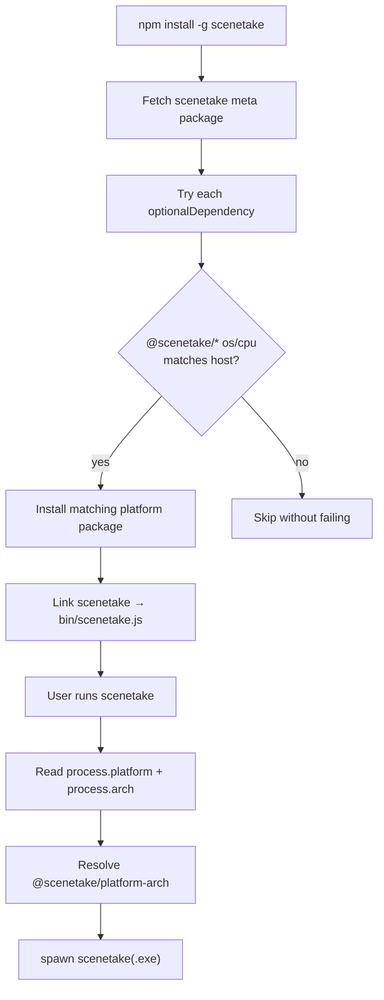

# Installation Specification

Status: **Implemented**

## Motivation

scenetake ships as a **native binary** (NativeAOT). Install channels differ in who they optimize for and how platform selection works, but **GitHub Release assets are the single source of truth** for prebuilt binaries. npm and Scoop repackage or reference those assets; they do not build scenetake themselves.

| Channel | Primary audience | Platform selection | Node.js required |
|---|---|---|---|
| [GitHub Releases](https://github.com/guitarrapc/scenetake/releases) | Anyone | User picks the archive | No |
| npm (`scenetake`) | Node / npm users | Automatic (`optionalDependencies`) | Yes (runtime wrapper only) |
| Scoop | Windows users | Automatic (`architecture` in manifest) | No |

## GitHub Releases

Each tagged release publishes six archives plus checksum sidecars:

| Asset | Platform |
|---|---|
| `scenetake-linux-amd64.tar.gz` | Linux x64 |
| `scenetake-linux-arm64.tar.gz` | Linux arm64 |
| `scenetake-osx-amd64.tar.gz` | macOS x64 |
| `scenetake-osx-arm64.tar.gz` | macOS arm64 |
| `scenetake-win-amd64.zip` | Windows x64 |
| `scenetake-win-arm64.zip` | Windows arm64 |

Linux archives contain `scenetake`. macOS archives contain `scenetake` and `minipty_spawn_helper`. Windows archives contain `scenetake.exe`.

Users download one archive, extract it, and run the binary directly. No installer or package manager is involved.

---

## npm

### Motivation

Many users expect `npm install -g scenetake`. npm cannot execute arbitrary native code at install time in a portable way — especially from npm v12 onward, when lifecycle scripts (`postinstall`, etc.) are **off by default** unless explicitly approved.

scenetake therefore uses the **optionalDependencies + per-platform package** pattern (same family as esbuild and `@next/swc-*`): the registry hosts prebuilt binaries inside platform packages; npm selects the matching one at install time; a thin JavaScript `bin` wrapper spawns the native executable at runtime. **No install scripts.**

### Package layout

Seven packages are published under the [`@scenetake` npm organization](https://www.npmjs.com/org/scenetake):

| Package | Role | Contents |
|---|---|---|
| `scenetake` | Meta package users install | `bin/scenetake.js` wrapper only |
| `@scenetake/linux-x64` | Platform binary | `scenetake` |
| `@scenetake/linux-arm64` | Platform binary | `scenetake` |
| `@scenetake/darwin-x64` | Platform binary | `scenetake`, `minipty_spawn_helper` |
| `@scenetake/darwin-arm64` | Platform binary | `scenetake`, `minipty_spawn_helper` |
| `@scenetake/win32-x64` | Platform binary | `scenetake.exe` |
| `@scenetake/win32-arm64` | Platform binary | `scenetake.exe` |

Package definitions live under `npm/packages/` in the repository. Binaries are **not** committed; release CI or maintainers assemble them from GitHub Release assets before publish.

The meta package lists all six platform packages in `optionalDependencies` at the same semver as itself.

### Resolution overview

Install-time selection and runtime execution are separate phases. npm picks the platform package; the `bin` wrapper locates and spawns it on each run.



### Install-time resolution

When the user runs `npm install -g scenetake` (or adds `scenetake` as a dependency):

1. npm downloads the `scenetake` meta package.
2. npm attempts each entry in `optionalDependencies`.
3. For each `@scenetake/<platform>-<arch>` package, npm reads that package's `os` and `cpu` fields.
4. Packages whose `os` / `cpu` **do not match** the host are skipped without failing the install.
5. The **one matching** platform package is downloaded and extracted next to the meta package under `node_modules`.
6. npm links the `scenetake` command to `bin/scenetake.js` from the meta package.

Mapping from Node's view of the host to the optional package name:

| `process.platform` | `process.arch` | Optional package |
|---|---|---|
| `linux` | `x64` | `@scenetake/linux-x64` |
| `linux` | `arm64` | `@scenetake/linux-arm64` |
| `darwin` | `x64` | `@scenetake/darwin-x64` |
| `darwin` | `arm64` | `@scenetake/darwin-arm64` |
| `win32` | `x64` | `@scenetake/win32-x64` |
| `win32` | `arm64` | `@scenetake/win32-arm64` |

Because selection is driven by npm's `os` / `cpu` metadata, **no `postinstall` download script is required**. This remains valid when npm v12 disables lifecycle scripts by default.

After a global install, layout is conceptually:

```
<npm-global>/lib/node_modules/
  scenetake/                 ← meta (JS wrapper)
  @scenetake/
    win32-x64/                 ← example: only the host match is present
      scenetake.exe
      package.json
```

### Runtime resolution

The `scenetake` command runs `bin/scenetake.js` (Node). On each invocation:

1. Read `process.platform` and `process.arch`.
2. Build the package name `@scenetake/<platform>-<arch>`.
3. Resolve that package's directory via Node module resolution (`createRequire`).
4. Spawn `scenetake` or `scenetake.exe` inside that directory with the user's CLI arguments.

If the matching platform package is missing (wrong machine, partial install, or optional install skipped), the wrapper exits with a clear error asking the user to reinstall for their platform.

Install-time and runtime use the **same naming rule**, so a successful install implies a successful first run.

### Publishing and release integration

On tag push, the release workflow:

1. Builds and uploads the six GitHub Release archives (see above).
2. Assembles seven npm package directories from those archives (`npm/scripts/assemble-packages.sh`).
3. Runs `npm stage publish` for each platform package, then the meta package (`npm/scripts/stage-all.sh`).

Staged publishing defers 2FA to a human maintainer: CI stages tarballs on the registry in a non-public state; the maintainer runs `npm stage approve <stage-id>` locally with 2FA to publish.

**Approve platform packages before the meta package** — the meta package's `optionalDependencies` point at registry versions that must already exist (or be staged and approved in order).

**First release on a new scope** requires a one-time manual `npm publish --access public` for all seven packages, because staged publishing expects packages to already exist on the registry. Subsequent versions use stage + approve.

Trusted publishing on the `@scenetake` org should allow `npm stage publish` from GitHub Actions while keeping direct `npm publish` off for automation tokens.

### npm v12 note

Earlier scenetake npm versions used a `postinstall` script to download binaries from GitHub Releases. That breaks when `allowScripts` defaults to off in npm v12. The optionalDependencies layout is the supported model going forward.

---

## Scoop

### Motivation

Windows users who prefer a package manager over npm can install scenetake via [Scoop](https://scoop.sh/). Scoop downloads the **same GitHub Release zip** as a direct install would, verifies a hash, and places `scenetake.exe` on the PATH. No Node.js wrapper is involved.

### Bucket and manifest

Manifest: [`guitarrapc/scoop-bucket` → `bucket/scenetake.json`](https://github.com/guitarrapc/scoop-bucket/blob/master/bucket/scenetake.json)

```powershell
scoop bucket add guitarrapc https://github.com/guitarrapc/scoop-bucket
scoop install scenetake
```

### Install-time resolution

Scoop reads the manifest's `architecture` block:

| Host (Scoop) | Archive | Binary |
|---|---|---|
| `64bit` | `scenetake-win-amd64.zip` | `scenetake.exe` |
| `arm64` | `scenetake-win-arm64.zip` | `scenetake.exe` |

For each install Scoop:

1. Selects the URL and `hash` for the host CPU architecture.
2. Downloads the zip from `https://github.com/guitarrapc/scenetake/releases/download/v<version>/...`.
3. Verifies the SHA-256 hash from the manifest.
4. Extracts `scenetake.exe` and exposes it via Scoop shims (`bin` in the manifest).

`checkver: github` and the `autoupdate` section track new GitHub releases so `scoop update scenetake` can bump the manifest version and URLs when the bucket is updated.

### Relationship to npm

| | Scoop | npm |
|---|---|---|
| OS | Windows only | Linux, macOS, Windows |
| Binary source | GitHub Release zip | Same archives, repackaged into `@scenetake/*` |
| CLI entry | `scenetake.exe` directly | Node wrapper → native binary |
| Update | `scoop update` + bucket manifest | `npm update -g scenetake` |

Both channels should reference the **same release version** as GitHub tags (`v*`) and `Directory.Build.props` / npm package versions.

---

## Version alignment

Release versions must stay consistent across:

- Git tag (`v1.4.0`)
- `Directory.Build.props` (`1.4.0`)
- All `npm/packages/*/package.json` versions and meta `optionalDependencies` pins
- Scoop manifest `version` and download URLs
- GitHub Release asset names (`.../v1.4.0/...`)

The release workflow `verify` job and `scripts/set_version.cs` enforce npm / props alignment at tag time. The Scoop bucket manifest is updated separately when publishing a Windows release (typically bump `version`, URLs, and `hash` in `scenetake.json`).

## See also

- User-facing quick start: [README.md](../../README.md)
- npm maintainer scripts: [npm/README.md](../../npm/README.md)
- Release workflow: [.github/workflows/release.yaml](../workflows/release.yaml)
- CLI usage after install: [spec_cli.md](spec_cli.md)
