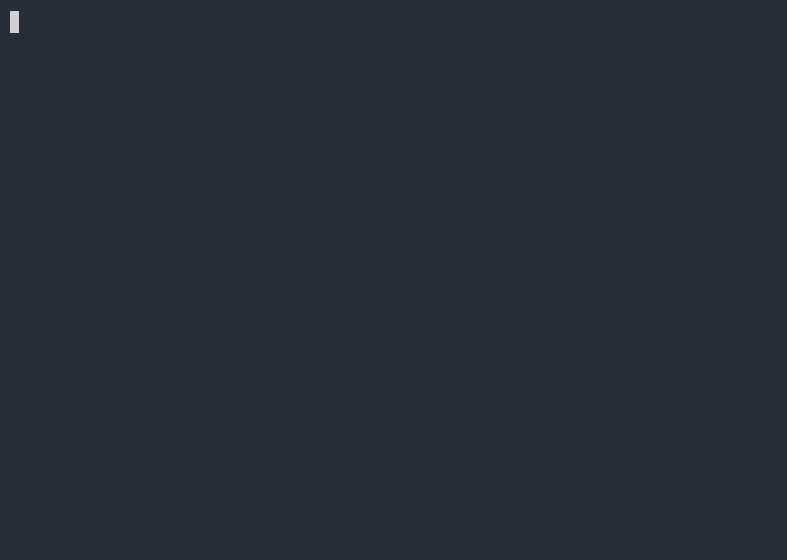

[](https://github.com/guitarrapc/scenetake/actions/workflows/build.yaml)

[](LICENSE)
[](https://www.nuget.org/packages/scenetake)
[](https://www.npmjs.com/package/scenetake)

# scenetake

[English](README.md) | 日本語

YAML **scenario** を実行し、ターミナルの scene take（[asciinema v3 `.cast`](https://docs.asciinema.org/manual/asciicast/v3/)、アニメーション `.svg`）を記録するツールです。`asciinema`をインストール・起動する必要はありません。step を並べた YAML を書くだけで、実際にコマンドを実行し、その出力を `.cast`（任意で `.svg`、`.mp4`、`.gif`、1 画面の `.png` も）として記録します。通常の step はタイピング演出付き、`pty: true` の step は端末ストリームをリアルタイムで記録します。

サンプルシナリオ `samples/basic.yaml` から `.cast` と `.svg` を生成すると、こんな見た目になります。タイプを頑張る必要もないし、実際にコマンドも走るので、リアルなターミナル記録が簡単に作れます。

```yaml
title: "Basic Demo"
width: 80
height: 24
shell: bash

settings:
  prompt: "$ "
  typing-speed: 0.02 # average seconds per keystroke
  typing-jitter: 0.01 # random variance (±) per keystroke
  pre-delay: 0.4 # pause before typing starts
  post-delay: 1.0 # pause after output before next step

steps:
  - echo "Hello, World!"
  - name: Name of the step
    run: echo "Current directory:"
  - name: Coloring stdout
    run: curl -sI https://google.com
    highlight:
      - color: green
        at:
          - "1"
      - color: gray
        at:
          - "2-12"
  - echo "Wait for 2 seconds..."
  - run: sleep 2
    execution-duration: 1.0
  - echo "stderr output is red by default" 1>&2
  - echo "Done!"
```

| GIF | SVG |
| --- | --- |
|  |  |

SVG と mp4 の出力では、フォント、カラーテーマ（後述）のほか、ターミナルを囲むウィンドウを次の設定で変えられます。どれもシナリオの `render` キーとコマンドラインのフラグの両方で指定できます。

| `render` キー | フラグ | 設定する内容 |
| --- | --- | --- |
| `window` | `--window` | macOS か Windows のタイトルバー（`macos` / `windows`） |
| `window-title` | `--window-title` | タイトルバーの文字。既定はシナリオの `title`。`""` で非表示 |
| `background` | `--background` | ウィンドウの周りを埋めるもの。1 色（`"#1e3c72"`）、左上から右下へのグラデーションになる 2〜4 色（`"#1e3c72 #2a5298"`）、または `.png`、`.jpg`、`.gif`、`.webp` の画像ファイル |
| `margin` | `--margin` | ウィンドウの周りの余白（ピクセル、0〜200）。背景があるときの既定は 32 |
| `padding` | `--padding` | ターミナルの端と文字の間の余白（ピクセル、0〜100） |
| `opacity` | `--opacity` | ターミナルの背景とタイトルバーが背景をどれだけ覆うか（0〜1）。既定は 1。文字は透けません |
| `blur` | `--blur` | `opacity` が 1 未満のウィンドウ越しに見える背景のぼかし（ピクセル、0〜50） |

`background` を指定しなければ、見えるのはウィンドウだけです。SVG の余白は透明で、mp4 はウィンドウだけの映像になります。背景は、作ったページの外へ持ち出すときに役立ちます。

- **X や Reddit に投稿する動画。** 背景付きの mp4 や GIF は、ターミナルを切り抜いた映像ではなく、デスクトップのスクリーンショットのように見えます（agg で作る GIF にはウィンドウ枠も背景も付きません）。
- **サイズを決めた動画。** `--size 1920x1080` では、余った部分をターミナルの背景色ではなく背景で埋め、ウィンドウを中央に置きます。
- **置き先の色がわからないページ。** GitHub の README は、読む人の設定でライトにもダークにもなります。背景を付ければ、どちらでも同じ見た目になります。

README の本文に並べるデモは、たいてい背景なしで十分です。ページの色になじみ、ファイルも小さく済みます。画像の背景は SVG ごとに埋め込まれるので、横幅 1000〜1600 ピクセル程度の WebP か JPEG を使ってください。

画像の背景では、`opacity` で背景が透けるターミナルのようにウィンドウ越しに画像を見せ、`blur` で透けた部分をぼかせます。半透明になるのはターミナルの背景とタイトルバーだけで、文字とプログラムが色を付けたセルは透けません。明るい画像なら 0.85 以上、暗い画像なら 0.7 程度が目安です。

デモの終わり方も同じように指定できます。

| `render` キー | フラグ | 設定する内容 |
| --- | --- | --- |
| `loop` | `--no-loop` / `--loop` | `false` で SVG を 1 回だけ再生し、最後の画面で止めます。既定は `true`。mp4 にループはなく、再生するプレイヤーが決めます |
| `end-hold` | `--end-hold` | 最後の画面を表示し続ける秒数（0〜60）。その後 SVG は最初に戻り、mp4 は終わります。既定は最後の出力の前の間と同じ長さ |
| `fade-out` | `--fade-out` | `end-hold` の後に文字を消していく秒数（0〜10）。ループが空のターミナルから始まり直します。ウィンドウと背景は残ります |

| macOS | Windows |
| --- | --- |
|  |  |

カラーテーマは `render.theme.preset` か `--theme` に名前で指定します。`render.theme` の `fg`、`bg`、`palette` で、その上から個別の色を変えられます。どのテーマも、各プロジェクトが公開しているターミナル用の配色を使っています。Apple はターミナルの配色を公開していないため、macOS の 2 テーマは macOS のシステムカラーを使っています。

| 暗い背景 | |
| --- | --- |
|  |  |
|  |  |
|  |  |
|  |  |
|  |  |
| **明るい背景** | |
|  |  |
|  |  |

## ギャラリー

以下の録画は、どれも [`samples/showcase`](samples/showcase) のシナリオを Linux で実行したものです。[`record.sh`](samples/showcase/record.sh) が、ツールを入れたコンテナ（[`Dockerfile`](samples/showcase/Dockerfile)）の中で録画します。

| [fastfetch](samples/showcase/fetch.yaml) | [bat、git、jq](samples/showcase/devtools.yaml) |
| --- | --- |
|  |  |
| [**figlet、lolcat、toilet**](samples/showcase/logo.yaml) | [**sl**](samples/showcase/sl.yaml) |
|  |  |
| [**`keys` で操作する vim と git diff（背景は画像）**](samples/showcase/vim.yaml) | |
|  | |

[nyancat](samples/showcase/nyancat.yaml)（96 × 26 セルのトゥルーカラーアニメーション、`timeout` で停止）:



## モチベーション

「コマンドをキャプチャしたいけど、コマンドのタイピングを頑張りたくない」、scenetakeはこんな動機で作ったツールです。asciinemaの周辺に様々なツールがありますが、シェルスクリプトに寄っていたり、asciinema 本体を前提にしていたり、実行パスがcastに出力されたり、実行せずにそれっぽい出力だけを作るものだったりして、どれも欲しい形とはずれています。欲しいのは、シナリオを素直に書けて、コマンドを実際に実行し、その結果から cast ファイルを直接生成できるものです。

scenetake は、asciinema を介さずシナリオから `.cast`（任意で `.svg` も）を直接生成するクロスプラットフォームツールです。

1. 実行するコマンドをシナリオに書く
2. 通常の step は一定の間隔で入力しているように cast イベントを生成する。`pty: true` の step は端末ストリームをリアルタイムで記録する
3. コマンドを実際に実行し、その出力を cast に書き出す

## クイックスタート

GitHub の Releases ページから利用 OS 向けアセットをダウンロードし、`scenetake`（Windows は `scenetake.exe`）を任意の場所に配置します。バイナリの実行に .NET ランタイムと ICU は不要です。

| アセット | 動作環境 |
|---|---|
| `scenetake-linux-amd64.tar.gz`, `scenetake-linux-arm64.tar.gz` | glibc 2.28 以降の Linux（RHEL 8、Debian 10、Ubuntu 20.04 以降） |
| `scenetake-linux-musl-amd64.tar.gz`, `scenetake-linux-musl-arm64.tar.gz` | musl 1.2.3 以降の Linux（Alpine 3.17 以降） |
| `scenetake-osx-amd64.tar.gz`, `scenetake-osx-arm64.tar.gz` | macOS 12.0 以降 |
| `scenetake-win-amd64.zip`, `scenetake-win-arm64.zip` | Windows 10 1809 以降 |

```sh
# .NET グローバルツール（インストールには .NET 10 SDK が必要。実行には .NET 10 ランタイムが必要）
dotnet tool install -g scenetake

# npm
npm install -g scenetake

# Windows (Scoop)
scoop bucket add guitarrapc https://github.com/guitarrapc/scoop-bucket
scoop install scenetake
```


```bash
# macOS/Linux は必要に応じて実行権限を付与
chmod +x ./scenetake

# 現在のディレクトリにスターターシナリオを作成
scenetake init

# OS 既定のシェル (Windows は pwsh、それ以外は $SHELL) ではなく bash 向けにスターターを作成
scenetake init --shell bash

# シナリオを実行して cast ファイルを生成
scenetake scenario.yaml

# cast とアニメーション SVG を一度に生成
scenetake --format svg scenario.yaml

# シナリオファイルなしで 1 コマンドを録画する。この場所に git.svg と git.cast を書き出す（PTY で動くので色も出る）
scenetake capture -- git log --oneline -5
scenetake capture --window macos -o help -- mycli --help

# シナリオファイルとしても保存する。--window は render.window として書き込まれる
scenetake capture --window macos --save-scenario help.yaml -- mycli --help

# SVG のスタイル: フォント、テーマ、ウィンドウ枠、フレーム上限
scenetake --format svg scenario.yaml --font-size 20 --font-family "'Noto Sans Mono', ui-monospace" --theme light --window macos

# タイトル付きのウィンドウをグラデーションの上に置き、文字の周りの余白を広げる
scenetake --format svg scenario.yaml --window macos --window-title "my-cli demo" --background "#1e3c72 #2a5298" --padding 16

# 画像の上に半透明のウィンドウを置き、文字の後ろの画像をぼかす
scenetake --format svg scenario.yaml --window macos --background wallpaper.webp --opacity 0.85 --blur 8

# 内容より下の空いた行は既定で描かない（render.fit: height）。幅も詰める、端末全体を描く、
# 端から行を切り取る（render.crop-*）
scenetake --format svg scenario.yaml --fit both
scenetake --format svg scenario.yaml --fit none
scenetake png scenario.cast --crop-top 1

# 最後の画面を 3 秒表示し、1 秒かけて文字を消してからループの最初に戻る
scenetake --format svg scenario.yaml --end-hold 3 --fade-out 1

# 既存の cast ファイルを SVG に変換（v2 / v3 対応）
scenetake svg scenario.cast

# svg サブコマンドでも同じスタイルフラグが使える
scenetake svg scenario.cast --theme light --window windows --max-fps 30

# 1 画面を PNG にする（ffmpeg 不要）。最後の画面、または開始 2.5 秒後の画面
scenetake png scenario.cast
scenetake png scenario.cast --at 2.5 --window macos

# cast と PNG を一度に生成
scenetake --format png scenario.yaml

# 最後の画面をアニメーションなしの静止 SVG にする
scenetake svg scenario.cast --at end

# cast ファイルを mp4（H.264、ffmpeg が必要）に変換。全画面 TUI や共有に向く
scenetake mp4 scenario.cast

# X (Twitter) の動画アップロード制限に収める
scenetake mp4 scenario.cast --max-size 1280x1024

# mp4 をちょうど 1920x1080 にする。動画編集やクリップの連結に向く
scenetake mp4 scenario.cast --size 1920x1080

# cast と mp4 を一度に生成
scenetake --format mp4 scenario.yaml

# cast ファイルを GIF アニメーションに変換（ffmpeg が必要。どのビルドでもよい）。X、Reddit、Zenn に向く
scenetake gif scenario.cast

# Zenn の 3MB に収める。フォントを小さくすると文字がにじまず、フレームを減らすと全画面 TUI が小さくなる
scenetake gif scenario.cast --font-size 12 --fps 10

# cast と GIF を一度に生成
scenetake --format gif scenario.yaml

# cast 生成時に正常な pre/post 実行ログも表示
scenetake --verbose scenario.yaml

# asciinemaで再生
asciinema play scenario.cast

# agg で gif に変換することもできる (Linux/macOS) — v3 cast には agg 1.6.0 以降が必要
docker run --rm -v "${PWD}:/data" ghcr.io/asciinema/agg /data/scenario.cast /data/scenario.gif --font-size 20 --last-frame-duration 0

# agg で gif に変換することもできる (Windows PowerShell)
# GIF はコンテナ内に書き出してから取り出す。Windows の Docker Desktop でバインドマウントに直接書くと GIF が壊れることがある
$id = docker create -v "$($PWD.Path):/data:ro" ghcr.io/asciinema/agg /data/scenario.cast /tmp/scenario.gif --font-size 20 --last-frame-duration 0
docker start -a $id
docker cp "${id}:/tmp/scenario.gif" scenario.gif
docker rm $id
```

**Usage**

`scenetake --help` は全コマンドとオプションの値の範囲・既定値を表示します。各コマンドのオプションは `scenetake svg --help`、`scenetake mp4 --help`、`scenetake png --help`、`scenetake gif --help`、`scenetake capture --help`、`scenetake init --help` で確認できます。

```bash
# 新しいシナリオファイルを初期化
scenetake init [--shell bash|pwsh|powershell] [scenario.yaml]

# シナリオファイルなしで 1 コマンドを録画（既定は SVG と cast）
# --format とスタイルのオプションも使える
scenetake capture [--width N] [--height N] [--shell NAME] [--pipe] [--timeout N]
  [-o NAME] [--save-scenario FILE] -- <command>

# シナリオを実行して cast（既定）、cast + SVG、cast + mp4、cast + PNG、または cast + GIF を生成
scenetake [--verbose] [--strict] [--format cast|svg|mp4|png|gif] [--save-keys FILE] [--at TIME]
  [--save-outputs FILE] [--replay FILE]
  [--font-size N] [--font-family FAMILIES] [--theme NAME]
  [--window none|macos|windows] [--max-fps N]
  [--fps N] [--crf N] [--max-size WxH | --size WxH] [--font-file PATH]
  scenario.yaml [output]

# 既存の cast ファイルを SVG に変換（--at TIME で 1 画面の静止 SVG になる）
scenetake svg [--at TIME] [--font-size N] [--font-family FAMILIES] [--theme NAME]
  [--window none|macos|windows] [--max-fps N]
  <input.cast> [output.svg]

# 既存の cast ファイルを mp4 に変換
scenetake mp4 [--font-size N] [--font-family FAMILIES] [--font-file PATH] [--theme NAME]
  [--window none|macos|windows] [--fps N] [--crf N] [--max-size WxH | --size WxH]
  <input.cast> [output.mp4]

# 既存の cast ファイルの 1 画面を PNG にする（最後の画面、または --at TIME の画面）
scenetake png [--at TIME] [--font-size N] [--font-family FAMILIES] [--font-file PATH] [--theme NAME]
  [--window none|macos|windows]
  <input.cast> [output.png]

# 既存の cast ファイルを GIF アニメーションに変換（ffmpeg が必要）
scenetake gif [--fps N] [--max-size WxH | --size WxH] [--no-loop] [--font-size N] [--font-family FAMILIES]
  [--font-file PATH] [--theme NAME] [--window none|macos|windows]
  <input.cast> [output.gif]
```

`--format` に指定できる形式は 1 つです。同じ録画からほかの形式を作るときは、`scenetake gif scenario.cast` のように cast を変換します。

`--max-fps` は SVG アニメーションのフレームレート上限です（`0` = オフ、cast のタイミングをそのまま使用）。`--format svg` 時と `svg` サブコマンドで有効です。

`--strict` は CI 向けです。`continue-on-error: true` を指定していない録画ステップが 0 以外で終了すると、録画を停止します。後続のステップは実行せず、`--save-keys` のファイル以外の出力は書きません。前回の出力ファイルはそのまま残し、`post` を実行します。終了コードは通常 `1` です。`post` のコマンドが失敗した場合は、そのコマンドの終了コードを返します。

エラーには、そのステップが最後に出力した数行を表示します。エラーのデモのように失敗するのが正しいステップには `continue-on-error: true` を付けます。

mp4 用のオプションは `--format mp4` 時と `mp4` サブコマンドで有効です。

- `--fps`: フレームレート（既定 `30`、最大 `60`）
- `--crf`: 画質（既定 `23`。大きいほど小さいファイル）
- `--max-size`: この範囲に収まるよう縮小（X 向けなら `1280x1024`）
- `--size`: 動画をちょうどこのサイズにする（たとえば `1920x1080`。後述の「ターミナルサイズと解像度」を参照）。`--max-size` とは同時に使えません
- `--font-file`: 使うフォントファイル

**SVG と mp4 の使い分け**

タイピング中心や短い出力なら、たいてい SVG が最も小さく（mp4 の半分程度になることも多い）、README に埋め込めて、拡大しても文字がぼけません。毎フレーム画面全体を描き直す全画面 TUI（`matrix`、`btop` など）は、SVG や GIF だと非常に大きくなります。こうした録画や、X・Slack での共有には mp4 を使ってください。たとえば `matrix --fps 60` を 200×60 で 7.5 秒録ると、SVG は 17.0MB、mp4 は 4.4MB（`--max-size 1280x1024` なら 2.8MB）です。SVG が 10MB を超えると、scenetake は警告を表示します。

mp4 出力は、libx264 入りの [ffmpeg](https://ffmpeg.org/) を別プログラムとして呼び出します。インストール方法は次のとおりです。

- Windows: `winget install Gyan.FFmpeg` または `scoop install ffmpeg`
- macOS: `brew install ffmpeg`
- Debian/Ubuntu: `sudo apt install ffmpeg`

特定の ffmpeg を使うときは `SCENETAKE_FFMPEG` にそのパスを指定します。

mp4 は手元にインストールされたフォントで描画します。`font-family` の一覧を順に探し、見つからない文字は日本語などの CJK フォントや記号フォントで補います。フォントを固定したいときは `--font-file` を指定してください。`--window` を付けると、SVG と同じタイトルバーを描画します（外側の余白と影はありません）。

**ターミナルサイズと解像度**

`width` と `height` はターミナルの列数と行数です（cast ファイルでは `term.cols` と `term.rows`）。出力のピクセルサイズはこの値で決まります。

既定（`render.fit: height`）では出力より下の空き行を描かないため、下の表の `height` は録画で使った行数になります。16:9 の動画などでターミナル全体を描くときは `--fit none` を指定します。SVG と mp4 のサイズは録画のあとに表示されます。

X や Reddit など 16:9 のプレイヤー向けには、`--fit none` で 80 × 23 にします。mp4 は 820×468 で 16:9 に近く、余白がほとんど出ません。

既定の `font-size` 16 では次のとおりです。

| 出力 | 幅（px） | 高さ（px） |
| --- | --- | --- |
| mp4 | `width × 10 + 20` | `height × 20 + 8` |
| mp4（`--window` あり） | `width × 10 + 20` | `height × 20 + 42` |
| SVG | `width × 9.92 + 36` | `height × 20 + 24` |
| SVG（`--window` あり） | `width × 9.92 + 44` | `height × 20 + 66` |

動画の解像度いっぱいに使うときは、`--fit none` を指定し、収まる最大の `width` × `height` にします。`font-size` 16 での値は次のとおりです。

| 解像度 | `width` × `height` → mp4 のサイズ | `--window` あり |
| --- | --- | --- |
| 1280×720（HD） | 126 × 35 → 1280×708 | 126 × 33 → 1280×702 |
| 1280×1024（X のアップロード上限） | 126 × 50 → 1280×1008 | 126 × 49 → 1280×1022 |
| 1920×1080（フル HD） | 190 × 53 → 1920×1068 | 190 × 51 → 1920×1062 |
| 2560×1440（WQHD） | 254 × 71 → 2560×1428 | 254 × 69 → 2560×1422 |
| 3840×2160（4K） | 382 × 107 → 3840×2148 | 382 × 105 → 3840×2142 |

- `--fit none` のとき、デフォルト`80×24`は、mp4で`820×488`、SVGで`829.6×504`です。1920×1080動画を作るときは、列を増やすのではなく`--font-size` を上げます。`80×22`を`--font-size 36` にすると`1792×1006`でほぼ中央になります。
- 1 行は 20 ピクセルなので、高さはたいてい解像度より少し小さくなります。残りは `--size` で埋められます（後述）。
- はじめから収まるサイズで録ると、大きく録って `--max-size` や `--size` で縮小するより文字がくっきりします。
- `font-size` を大きくするとセルも大きくなり、収まる列数と行数は減ります。セルは幅 `font-size × 0.62`、高さ `font-size × 1.25` で、mp4 では整数ピクセルに丸めます。余白も `font-size` に応じて変わります。詳しくは [spec_mp4.md](.github/docs/spec_mp4.md#layout) の Layout を参照してください。
- SVG は拡大縮小してもぼけないため、ピクセルサイズは最初に表示される大きさを決めるだけです。
- 録画中にサイズが変わる場合は、その中で最大のサイズを使います。

`--size WxH` を付けると、mp4 はちょうど `W×H` になります。幅と高さはどちらも偶数にしてください。録画したターミナルは変わらず、変わるのは周りの動画の枠だけです。

- 収まるターミナルは中央に置き、残りをテーマの背景色で埋めます。190 × 53 を `--size 1920x1080` にすると、上下に 6 ピクセルずつ足します。`--window` のタイトルバーは上端に残ります。
- 大きいターミナルは、その縦横比まで余白を足してから縮小します。200 × 60（2020×1208）は、文字が 89% に縮小され、左右に約 57 ピクセルずつ余白のある 1920×1080 になります。
- 小さいターミナルは拡大しません。80 × 24 は枠の中央に置かれます。文字を大きくしたいときは `--font-size` を上げてください。

**Notes**

- `shell`:
  - Linux/macOS の既定シェルは `$SHELL`、なければ `bash`
  - Windows の既定シェルは `pwsh`、なければ `powershell`、Windows で `shell: bash` を指定した場合は Git Bash / MSYS の `bash` を使います
  - Windows で `C:/tools/pwsh-preview/pwsh.exe` のようにパスを書くと、そのファイルを起動します。WSL の `bash` はパスで指定しても使いません
  - 名前で指定したシェルは、カレントディレクトリにある同名ファイルを起動しません。Windows ではそのファイルを無視します。Linux/macOS ではエラーで停止するので、別のディレクトリから実行するか、シェルをフルパスで指定してください
- `cwd` は `pre`、`steps`、`post` の作業フォルダです。相対パスは scenario ファイルのフォルダからの相対で、scenetake をどこから実行しても同じフォルダで動きます。`cwd` を書かなければ、scenetake を実行したフォルダで動きます。フォルダは実行前に存在している必要があります
- `settings` でpromptとtiming の既定値を設定できます
- `render` は cast ヘッダーの表示メタデータ（`st:font-size` タグ、`term.theme`）と SVG 出力を制御します。詳細は [.github/docs/spec_cast.md](.github/docs/spec_cast.md) と [.github/docs/spec_svg.md](.github/docs/spec_svg.md)
- `pre` / `post` は録画フロー外で setup / teardown コマンドを実行します。stdout/stderr は CLI に表示されますが、cast ファイルには一切書き込まれません。
- `steps`:
  - 実際に実行されるため、ファイル変更や外部システムを操作するような副作用のあるコマンドは慎重に使ってください
  - `: ` を含むコマンドは `run: 'echo "answer: $a"'` のように引用符で囲んでください。囲まないと YAML のエラーになります
  - ターミナルを必要とするコマンドは `pty: true` で pseudo-terminal capture を有効化できます。詳細は [PTY 録画](#pty-録画)。
  - 実行時間が長いコマンドは `execution-duration` で見やすく調整できます
  - 長い出力を自然にリプレイしたい場合（`docker build` や `sleep` を挟むステップなど）は、その step に `stream-output: true` と必要なら `max-duration` を指定します。デフォルトの pipe emit はタイピング演出のため一括表示のままです
  - 0 以外で終了したステップは警告を出し、録画を続けます。想定した失敗には `continue-on-error: true` で警告を抑制できます。CI では前述の `--strict` を使います。

**GIF で日本語などの CJK 文字を使う**

`ghcr.io/asciinema/agg` イメージには CJK フォントが入っていません。agg はどのフォントにもない文字を何も描画しないため、日本語・中国語・韓国語の文字（全角カタカナなど）は空白になります。`fonts/` などのフォルダに CJK フォントを置いて `--font-dir` で渡し、`--text-font-family` の欧文等幅フォントの後ろにそのファミリー名を追加してください。先頭のフォントがセル幅の基準になります。

```bash
# Linux/macOS
docker run --rm -v "${PWD}:/data" ghcr.io/asciinema/agg /data/scenario.cast /data/scenario.gif --font-size 20 --last-frame-duration 0 --font-dir /data/fonts --text-font-family "JetBrains Mono,BIZ UDGothic"

# Windows PowerShell
# フォントのフォルダはコンテナにコピーする。Windows の Docker Desktop ではバインドマウント上のフォントを読み込めない（Input/output error）
$id = docker create -v "$($PWD.Path):/data:ro" ghcr.io/asciinema/agg /data/scenario.cast /tmp/scenario.gif --font-size 20 --last-frame-duration 0 --font-dir /fonts --text-font-family "JetBrains Mono,BIZ UDGothic"
docker cp .\fonts "${id}:/fonts"
docker start -a $id
docker cp "${id}:/tmp/scenario.gif" scenario.gif
docker rm $id
```

`BIZ UDGothic`（OFL、Google Fonts で配布）は一例です。ほかの CJK フォントでも、そのファミリー名を指定すれば使えます。

## ステップをひと続きのセッションとして書く

`shell: bash`、`zsh`、PowerShell では、ステップがひと続きのターミナルセッションとして動きます。あるステップの `cd`、`export`、変数、関数、エイリアスは、後のステップと `post` にも引き継がれます。`pre` も同じなので、`pre` で `source .venv/bin/activate` すれば録画するステップでも効きます。`sh`（dash、ash、ksh）では `cd` と変数を引き継ぎ、関数とエイリアスは引き継ぎません。ほかのシェル（fish、cmd）では、ステップごとに新しいシェルで始まります。

セッションの組み立てには、次のキーを使います。

```yaml
steps:
  - run: git clone https://github.com/me/app && cd app && npm install
    show: none              # 録画せずに実行する（場面の間の準備）
  - run: npm run dev
    background: true        # 起動して、動かしたまま次へ進む（後のステップが呼ぶサーバー）
    wait: "Local:"          # 出力にこの文字が出たら次のステップを始める
  - curl -s localhost:5173/api/hello   # 前のステップの続き（app フォルダ）で実行される
  - run: figlet "Deploy"
    show: output            # プロンプトと入力を出さず、出力だけ見せる
  - clear: true             # コマンドを入力せずに画面を消す
    name: "Scene 2"         # 消した画面の先頭に出すコメント（省略可）
  - ./deploy.sh
```

- `show: none` は録画せずに実行し、録画の時間も使いません。失敗すると `pre` と同じく録画を止めます。失敗してもよい場合は `continue-on-error: true` を付けてください。
- `background: true` はコマンドを起動し、録画せずに動かしたままにします。`wait` を付けると、その文字が出力に出るまで最大 `wait-timeout` 秒（既定 30 秒）待ってから次のステップを始めます。先に終了したり文字が出なかったりすると、録画を止めます。最後のステップの後、`post` の前に、そのコマンドが起動したものごと終了させます。
- `show: output` は、プロンプトと入力したコマンドを出さずに出力だけを見せます。タイトル、バナー、すでに開いている画面に使います。
- `clear: true` は画面を消します。`TERM` も `clear` コマンドも要らないので、CI でも同じように動きます。

詳しくは [spec_scenario.md](.github/docs/spec_scenario.md#shell-state-across-steps) の Shell state across steps を参照してください。

## 実行し直さずに見た目を変える

`--save-outputs` で一度録画しておけば、`--replay` で入力速度、コメント、色付け、テーマ、出力形式を何度でも調整できます。replay はコマンドを実行しないので、遅いビルド、外部 API、毎回変わる出力も録画したときのままです。

```bash
scenetake --save-outputs demo.outputs.json demo.yaml                 # コマンドを一度だけ実行する
scenetake --replay demo.outputs.json --format svg demo.yaml          # 何も実行しない
scenetake --replay demo.outputs.json --format mp4 --theme dracula demo.yaml
```

- YAML を変えなければ、録画したときと同じ cast がバイト単位で同じに出ます。
- ステップは `run` の文字列で記録と対応づけます。`run` を変えたステップや新しいステップがあると、そのステップの一覧を出して止まります。それらは録画し直してください。
- replay では `pre`、`post`、`show: none` のステップ、`background` のステップは実行しません。
- outputs ファイルは cast と同じく秘密情報を隠してあるので、YAML と並べてコミットできます。

## 撮り直しても差分を出さない

同じファイルに撮り直すと、すでにある cast とステップごとに比べます。前回と同じ出力のステップは、前回の出力とタイミングをそのまま使います。PTY の出力は実時間で記録されますが、出力が変わっていなければ cast も SVG も前回と同じになります。差分が出るのは出力が変わったステップだけで、scenetake はそのステップを表示します。

```text
Compared with the earlier cast: 4 of 5 steps printed the same, 1 changed
  changed: step 3: npm test
```

日付、コミットハッシュ、ランダムな ID のように毎回変わる出力は、前回の出力を使い続けられます。

```yaml
steps:
  - run: date
    keep-output: true       # 前回の録画の出力を表示する。コマンドは実行する
```

- 前回の録画は、出力先にある cast です。SVG と一緒にコミットしておくと、CI でも比べられます。全ステップを撮り直すときは cast を消してください。
- `keep-output` は、そのステップの色付けとタイミングも前回のままにします。新しい出力にしたいときは、一度だけキーを外して撮ってください。失敗したステップは今まで通り警告を出し、`--strict` では録画を止めます。あとから追加した `mask` は効きます。前回の出力にマスク対象の文字列があれば、今回の出力に置き換えます。
- 端末サイズが違う cast とは比べません。`--save-outputs` を付けた録画も、その回の出力だけで作るので比べません。どちらも実行時に表示します。
- ステップは `run` の文字列で前回と対応づけます。`run` を変えたステップは撮り直しになります。
- 値そのものを固定できれば、ステップを最新のまま保てます。たとえば `show: none` のステップで `GIT_AUTHOR_DATE` と `GIT_COMMITTER_DATE` を export すると、同じ内容のコミットは毎回同じハッシュになり、`TZ` でタイムゾーンを固定できます。

詳しくは [spec_scenario.md](.github/docs/spec_scenario.md#recording-again) の Recording again を参照してください。

## 出力モード

出力モードは、通常出力、ストリーム出力、TUI出力、対話型アプリケーション出力の4種類があります。モードはstepごとに切り替えられます。

### 通常出力

通常のstepは、コマンドの stdout/stderr をキャプチャしてタイピング演出付きで記録します。このモードは単発出力のコマンドや、TTYを必要としないコマンドに適しています。出力に色がついていなくても、`highlight` や `stderr-color` で色を付けることができます。出力は、実際の出力に関わらず、一瞬で表示されます。

通常のステップには入力がありません。`read` や `[y/N]` の確認のように入力を求めるコマンドは、空の答えを受け取ります。答えを入力するには `pty: true` と `keys` を使います（[TUI 出力](#tui-出力)）。

ANSI 色指定のない stderr は既定で赤く表示します。git のブランチ変更、curl の進捗、`docker build` など、通常のメッセージを stderr に出すツールもあります。通常の文字色にするには、`settings` またはステップに `stderr-color: none` を指定してください。

```yaml
steps:
  - name: comment color is cyan
    run: echo hello
  - name: "[yellow] comment color override"
    run: echo world
  - name: run & stdout color default
    run: date
  - name: run color override
    run: date
    run-highlight: "bold underline green"
```

| GIF | SVG |
| --- | --- |
|  |  |

### ストリーム出力

出力が間欠的に発生するコマンドは、`stream-output: true` を指定することで、キャプチャしたタイミングをそのまま再生できます。`max-duration` を指定すると、step の出力タイムラインを制限し、長時間の idle gap を stream emit で圧縮できます。

```yaml
steps:
  - name: "stream-output (ping, staggered replay)"
    run: ping -n 4 127.0.0.1
    stream-output: true
```

| GIF | SVG |
| --- | --- |
|  |  |

### TUI 出力

ターミナル UI やリアルタイムアニメーション（`matrix`、プログレスバーなど）をキャプチャする場合、`pty: true` を指定します。PTY が有効になり、子プロセスの実行中に端末バイトストリームを記録します。PTY サイズはシナリオの `width` / `height` を用います。

```yaml
steps:
  - run: matrix --duration 5
    pty: true               # TTY依存コマンドの出力をリアルタイムでキャプチャ。対話しないならこれだけでOK
```

| GIF | SVG |
| --- | --- |
|  |  |

> [!WARNING] `pty: true` では stdout と stderr はバイトストリームに統合されるため、その step に `stderr-color` やパイプ向けの `highlight` は適用されません。[samples/pty.yaml](samples/pty.yaml) と [spec_pty.md](.github/docs/spec_pty.md) を参照してください。

scenetake はすべてのコマンドを `COLORTERM=truecolor` 付きで実行します。そのため環境変数から色数を決めるツールも、24bit カラーで記録されます。

録画は DECDLD ソフトフォントも描画しますが、PTY の内側のプログラムからはそれを確かめられません。シナリオで指定してください。たとえば `matrix --mode movie --soft-font` です。

キーを押すまで終わらない TUI や、メニューを選ぶデモは `keys` で操作を書けるので、録画中にキーボードの前にいる必要はありません。`timeout` は終わらないコマンドを止めます。PTY ではまず Ctrl+C を押すので、プログラムは画面を元に戻せます。

```yaml
steps:
  - run: vim greet.py
    pty: true
    timeout: 30             # 保険。30 秒たったら Ctrl+C
    keys:                   # 上から順に PTY へ書き込む
      - wait: "greet.py"    # 出力にこの文字が出るまで待つ
        type: "/return\n"   # 文字列。タイピングの間隔で 1 文字ずつ送る。改行は Enter
      - sleep: 0.5          # 先に待つ秒数
        type: "O# Say hello"
      - key: escape         # enter、tab、up、page-down、f1、ctrl+c、alt+x など
      - type: ":wq\n"
  - run: nyancat
    pty: true
    timeout: 5              # nyancat は止めるまで動き続ける
```

| 種類 | 使えるキー名（大文字小文字は区別しない） |
| --- | --- |
| 名前付き | `enter`、`tab`、`space`、`backspace`、`escape`（`esc`）、`up`、`down`、`left`、`right`、`home`、`end`、`page-up`、`page-down`、`insert`、`delete`、`f1`〜`f12` |
| 組み合わせ | `ctrl+` と英字 1 文字（例：`ctrl+c`）、`alt+` と ASCII 文字 1 文字（例：`alt+x`） |

`wait` は、前のキーより後にプログラムが出力した文字から、色などのエスケープシーケンスを除いて探します。改行と続いた空白は 1 つの空白として扱います。プログラムにかかる時間は環境で変わるので、`sleep` で見込むより `wait` のほうがキーを送る時機がずれません。`timeout` がないステップでは、10 秒待っても出なければ警告を出して先へ進みます。

[samples/showcase/vim.yaml](samples/showcase/vim.yaml) と [spec_pty.md](.github/docs/spec_pty.md#keys-and-timeout) の Keys and timeout を参照してください。

### 対話型アプリケーション出力

対話型アプリケーション（`vim`、`copilot` など）をキャプチャする場合、`pty: true` と `interactive: true` を指定します。PTY が有効になり、子プロセスでの対話を可能にします。`normalize-typing: true` を指定すると、バナーやヘルプなどの出力は実時間のまま、ユーザー入力のタイピングだけを読みやすく再タイミングします。

```yaml
steps:
  - name: "Copilot CLI with banner"
    run: copilot --banner
    pty: true               # TTY依存コマンドの出力をリアルタイムでキャプチャ
    interactive: true       # 対話アプリケーション用
    normalize-typing: true  # バナーは実時間のまま、入力タイピングだけ読みやすく再タイミング

  - name: "edit in vim"
    run: vim README.md
    pty: true               # TTY依存コマンドの出力をリアルタイムでキャプチャ
    interactive: true       # 対話アプリケーション用
```

| GIF | SVG |
| --- | --- |
|  |  |

`--save-keys` で入力したキーを保存すると、次からは人がいなくても同じ操作で録れます。

```bash
scenetake --save-keys keys.yaml demo.yaml
```

対話ステップごとに、押したキーを `keys` の形で `keys.yaml` に書き出します。続けて打った文字は 1 つの `type`、それ以外のキーは `key`、間は `sleep` になります。ステップの `interactive: true` をこれに置き換えると、次の実行からは保存した操作を再生します。時間が一定しない処理を待つところは、`sleep` を出力の文字を待つ `wait` に変えてください。

```yaml
  - run: "vim README.md"
    pty: true
    keys:
      - sleep: 1.2
        type: "Go"
      - sleep: 0.8
        type: "Edited with scenetake"
      - key: escape
      - sleep: 0.6
        type: ":wq\n"
```

> [!NOTE] Unix では、プログラムがパスワードを読んでいる間のキーは保存せず、その位置にコメントを残します。パスワードを書き足すときは、`wait: "Password:"` のようにプロンプトを待ってから入力してください。先に送ると、エコーが止まる前に端末へ届いて表示されます。Windows ではパスワードを読んでいるかどうかが scenetake に分からないため、パスワードも含めてすべてのキーを保存します。

> [!WARNING] `pty: true` では stdout と stderr はバイトストリームに統合されるため、その step に `stderr-color` やパイプ向けの `highlight` は適用されません。[samples/interactive-pty.yaml](samples/interactive-pty.yaml) と [spec_pty.md](.github/docs/spec_pty.md) の Interactive PTY を参照してください。


## シナリオファイル形式

必須キーは `steps` だけです。他のトップレベルキーは任意です。不明なキー（`hightlight` など）には警告を出し、候補があれば正しいキー名を示します。

以下は実行可能なサンプルです。正本は [samples/scenario_format.yaml](samples/scenario_format.yaml) です。

- フィールド定義: [spec_scenario.md](.github/docs/spec_scenario.md)
- 色・スタイル構文: [spec_highlight.md](.github/docs/spec_highlight.md)
- `pre` / `post` の挙動: [spec_pre_post.md](.github/docs/spec_pre_post.md)
- 色の追加例: [samples/highlight.yaml](samples/highlight.yaml)


```yaml
# Scenario format reference — runnable demo (samples/scenario_format.yaml).
# Required: steps only. Everything else is optional.

title: "Scenario Format Demo"  # Optional cast title
width: 80                        # Default: 80
height: 24                       # Default: 24
# cwd: /your/project             # Optional working directory for all commands
shell: bash                      # bash | pwsh | powershell | path. Windows: Git Bash when bash

render:                          # Optional display metadata for cast header and SVG
  font-size: 16
  font-family: ui-monospace, monospace
  theme:
    preset: dark                 # dark, light, nord, dracula, and more, with optional fg / bg / palette overrides
  window: macos                  # none | macos | windows
  window-title: "scenario_format.yaml"  # title bar text; default: the top-level title, "" for none
  background: "#0f2027 #2c5364"  # one color, 2-4 colors for a gradient, or a .png/.jpg/.gif/.webp file
  margin: 24                     # px around the window (default 8, 12 with a window, 32 with a background)
  padding: 12                    # px between the terminal edge and its text (default from font-size)

settings:                        # Defaults for all steps; map-form steps can override per key
  prompt: "$ "
  typing-speed: 0.04             # Average seconds per typed character
  typing-jitter: 0.01            # Random variance (+/- seconds) per character
  pre-delay: 0.5                 # Pause before typing each step
  post-delay: 1.0                # Pause after output before the next step
  execution-duration: 0.1        # Cast wait after command execution
  stderr-color: red              # When stderr has no ANSI SGR sequences
  # stream-output: false         # When true, replay captured chunk times in the cast
  # max-duration: 15             # Cap step output timeline, and also enables stream emit
  # silence-threshold: 2.0       # Stream mode: collapse idle gaps longer than this (seconds)
  # max-idle: 0.2                # Stream mode: collapsed idle gap duration (seconds)
  # mask:                        # Texts to hide wherever the recording shows them, as *
  #   - "internal.example.com"
  # mask-auto: true              # Also hide tokens, secret KEY=value values, URL passwords, secret env values

# Optional setup; runs before steps, not recorded in cast
pre:
  - echo "environment check (not recorded)"

steps:
  # String form - uses settings defaults
  - echo "Hello, World!"

  # Map form - comment line, per-step timing
  - name: "[cyan]Project status"
    run: printf 'name\tversion\nscenetake\t1.0\n'
    post-delay: 1.5

  - name: "Per-step timing overrides"
    run: printf 'typing slowly...\n'
    typing-speed: 0.12
    pre-delay: 0.8
    post-delay: 1.2

  - name: "execution-duration"
    run: sleep 1
    execution-duration: 0.5

  - name: "instant emit (ping, one blob)"
    run: bash -c 'case "$(uname -s)" in MINGW*|MSYS*|CYGWIN*) ping -n 4 127.0.0.1 ;; *) ping -c 4 127.0.0.1 ;; esac'
    execution-duration: 0.2

  - name: "stream-output (ping, staggered replay)"
    run: bash -c 'case "$(uname -s)" in MINGW*|MSYS*|CYGWIN*) ping -n 4 127.0.0.1 ;; *) ping -c 4 127.0.0.1 ;; esac'
    stream-output: true
    silence-threshold: 2.0
    max-idle: 0.2

  - name: "pty demo"
    run: echo "This command runs in a PTY, so output appears immediately and can include interactive features like colors and progress bars."
    pty: true

  - name: "keys and timeout"
    run: read -r -p "Your name? " name; echo "Hello, $name"
    pty: true                    # keys need a PTY to type into
    timeout: 10                  # seconds; then Ctrl+C, as a person would press it
    keys:                        # sleep (seconds), then type (text) or key (enter, up, esc, ctrl+c, f1...)
      - sleep: 0.5
        type: "scenetake"
      - key: enter

  - name: "run-highlight colors the typed command"
    run: printf 'done\n'
    run-highlight: bright-cyan

  - name: "stdout highlight"
    run: printf 'line1 alpha\nline2 beta gamma\nline3\n'
    highlight:
      - color: yellow
        at: "1"
      - color: red
        at: "2:7-10"
      - color: bright-cyan
        at: "2:12-"
      - color: underline fg:bright-white bg:blue
        at: "3"

  - name: "stderr (default red)"
    run: echo "plain stderr" 1>&2

  - name: "stderr-color override"
    run: echo "bright yellow stderr" 1>&2
    stderr-color: bright-yellow

  - echo "Done!"

# Optional teardown; runs last, not recorded
post:
  - echo "demo complete (not recorded)"
```

### 秘密情報のマスク

録画は共有するためのものなので、scenetake は書き出す前に秘密情報を隠します。cast、SVG、mp4、PNG、GIF のどれにも表示されません。隠した文字は 1 文字ずつ `*` になるので、行の幅も全画面アプリの画面も崩れません。

```yaml
settings:
  mask:
    - "internal.example.com"   # 出てきた場所すべてで隠す
  mask-auto: true              # 既定値
```

- `mask` には、社内のホスト名など隠したい文字列を並べます。
- `mask-auto`（既定でオン）は、さらに次のものを隠します。既知の形式のトークン（`ghp_…`、`github_pat_…`、`AKIA…`、`sk-…`、`xoxb-…`、`npm_…` など）、キー名が秘密を表すペアの値（`API_KEY=…`、`"password": "…"`、`Authorization: Bearer …`）、URL 中のパスワード、JSON Web Token、秘密鍵のブロック、そして `GITHUB_TOKEN` などの秘密の環境変数の値（コマンドがどこに出力しても）です。
- scenetake は隠したものを `Masked 2 secrets: 1 GitHub token, 1 key=value secret` のように表示します。`mask-auto: false` にすると、並べた文字列だけを隠します。

## Development

`dotnet` を使ってローカル実行・ビルドする場合は以下を利用します。

- .NET 10 SDK（C# file-based app 実行のため）

```bash
# ローカル実行
dotnet run scenetake.cs -- <scenario.yaml> [output.cast]
dotnet run scenetake.cs -- svg <scenario.cast> [output.svg]

# ビルド
dotnet publish scenetake.cs --self-contained true -p:PublishAot=true -p:StripSymbols=true -p:DebugType=None
```

各シナリオの目的とプレビュー（GIF / SVG）は [samples/README-ja.md](samples/README-ja.md) を参照してください。

サンプルシナリオを `.cast`、`.svg`、`.gif` に変換するには、以下のようにします（GIF は `scenetake gif` で作るため ffmpeg が必要です）。

```bash
dotnet run samples/regenerate.cs

# GIF だけを今ある cast から作る
dotnet run samples/regenerate.cs -- --gifs
```

### Release

タグを打つ前に、`Directory.Build.props` と `npm/packages/` 配下の npm パッケージをまとめて更新します。スクリプトは最新の `v*` git タグを基準にします（タグがない場合はファイル上の現在値を使います）。

```bash
dotnet run scripts/set_version.cs -- patch   # 例: v1.3.0 -> 1.3.1
dotnet run scripts/set_version.cs -- minor   # 例: v1.3.0 -> 1.4.0
dotnet run scripts/set_version.cs -- major   # 例: v1.3.0 -> 2.0.0
```

バージョン更新をコミットしたあと、新しいバージョンに対応するタグ（例: `v1.4.0`）を作成して push します。タグの push で release workflow が走り、ネイティブバイナリのビルド、GitHub Release の作成、`scenetake` と `@scenetake/*` プラットフォームパッケージの stage が行われます。

workflow 完了後、ローカルで 2FA を使って staged パッケージを approve します。

```bash
npm stage list
npm stage approve <stage-id>
```

staged publishing は registry 上にパッケージが既に存在していることが前提なので、各 npm パッケージの初回リリースだけは手動の `npm publish` が必要です。後から追加したプラットフォームパッケージ（`@scenetake/linux-x64-musl`、`@scenetake/linux-arm64-musl`）も同様です。workflow はこのようなパッケージを stage せずに pack し、tarball を `npm-first-publish` artifact としてアップロードします。実行するコマンドは run の summary に出ます。

```bash
gh run download <run-id> --repo guitarrapc/scenetake --name npm-first-publish --dir npm-first-publish
npm publish --access public npm-first-publish/scenetake-linux-x64-musl-<version>.tgz
```

そのあと npmjs.com で新しいパッケージの trusted publishing を設定してください。次のリリースから stage できるようになります。

メインの `scenetake` より先に、プラットフォームパッケージ（`@scenetake/linux-x64` など）を approve または publish してください。
