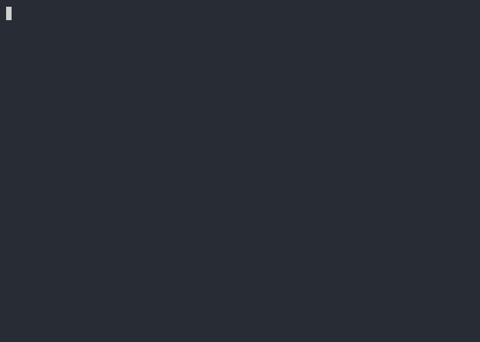

[](https://github.com/guitarrapc/scenetake/actions/workflows/build.yaml)

# scenetake

[English](README.md) | 日本語

YAML **scenario** を実行し、ターミナルの scene take（[asciinema v3 `.cast`](https://docs.asciinema.org/manual/asciicast/v3/)、アニメーション `.svg`）を記録するツールです。`asciinema`をインストール・起動する必要はありません。step を並べた YAML を書くだけで、実際にコマンドを実行し、その出力を `.cast`（任意で `.svg` も）として記録します。通常の step はタイピング演出付き、`pty: true` の step は端末ストリームをリアルタイムで記録します。

サンプルシナリオ `samples/basic.yaml` から `.cast` と `.svg` を生成すると、こんな見た目になります。タイプを頑張る必要もないし、実際にコマンドも走るので、リアルなターミナル記録が簡単に作れます。

```yaml
title: "Basic Demo"
width: 80
height: 24
shell: bash

settings:
  prompt: "$ "
  typing-speed: 0.02 # average seconds per keystroke
  typing-jitter: 0.01 # random variance (±) per keystroke
  pre-delay: 0.4 # pause before typing starts
  post-delay: 1.0 # pause after output before next step

steps:
  - echo "Hello, World!"
  - name: Name of the step
    run: echo "Current directory:"
  - name: Coloring stdout
    run: curl -I https://google.com
    highlight:
      - color: green
        at:
          - "1"
      - color: gray
        at:
          - "2-12"
  - echo "Wait for 2 seconds..."
  - run: sleep 2
    execution-duration: 1.0
  - echo "stderr output is red by default" 1>&2
  - echo "Done!"
```

| GIF | SVG |
| --- | --- |
|  |  |

SVG 出力ではフォント、ライト/ダークテーマ、ウィンドウ枠（`macos` / `windows`）を指定できます。

| macOS | Windows |
| --- | --- |
|  |  |

## できること

| やりたいこと | 方法 |
|---|---|
| コマンド一覧からターミナルデモを録画する（手入力なし） | YAML シナリオを書いて `scenetake scenario.yaml` |
| README やドキュメント用のアニメーション SVG を作る | `scenetake --format svg scenario.yaml` |
| 既存の asciinema `.cast` を SVG に変換する | `scenetake svg recording.cast` |
| フォント・テーマ・ウィンドウ枠を調整する | YAML の `render`、または `--font-size` / `--font-family` / `--theme` / `--window` |
| 非 TTY 実行で CLI が色を出さない出力を着色する | step の `highlight` / `run-highlight` / `stderr-color` — [samples/highlight.yaml](samples/highlight.yaml) を参照 |
| TTY 依存コマンド（`matrix`、ターミナルアニメーションなど）を録画する | step に `pty: true` — [samples/pty.yaml](samples/pty.yaml) または [制限事項（シナリオ録画）](#制限事項シナリオ録画) |
| ユーザー入力が必要な完全対話（`vim` 操作、REPL など）を録画する | step に `pty: true` と `interactive: true` — [samples/interactive-pty.yaml](samples/interactive-pty.yaml)（実ターミナルが必要） |
| スターターシナリオを作る | `scenetake init` |
| サンプルとプレビューを見る | [samples/README-ja.md](samples/README-ja.md) |
| 仕様の詳細を読む | [.github/docs/spec_index.md](.github/docs/spec_index.md) |

**動機**

作りたいのはasciinemaのcastファイルであって、コマンドのレコードを頑張りたくない、scenetakeはこんな動機で作ったツールです。asciinemaの周辺に様々なツールがありますが、シェルスクリプトに寄っていたり、asciinema 本体を前提にしていたり、実行パスがcastに出力されたり、実行せずにそれっぽい出力だけを作るものだったりして、どれも欲しい形とはずれています。欲しいのは、シナリオを素直に書けて、列挙したコマンドを実際に実行し、その結果から cast ファイルを直接生成できるものです。

scenetake は、asciinema を介さずシナリオから `.cast`（任意で `.svg` も）を直接生成するクロスプラットフォームツールです。

1. 実行するコマンドをシナリオに書く
2. 通常の step は一定の間隔で入力しているように cast イベントを生成する。`pty: true` の step は端末ストリームをリアルタイムで記録する
3. コマンドを実際に実行し、その出力を cast に書き出す

## クイックスタート

GitHub の Releases ページから利用 OS 向けアセットをダウンロードし、`scenetake`（Windows は `scenetake.exe`）を任意の場所に配置します。

```sh
# npm
npm install -g scenetake

# Windows (Scoop)
scoop bucket add guitarrapc https://github.com/guitarrapc/scoop-bucket
scoop install scenetake
```


```bash
# macOS/Linux は必要に応じて実行権限を付与
chmod +x ./scenetake

# 現在のディレクトリにスターターシナリオを作成
scenetake init

# シナリオを実行して cast ファイルを生成
scenetake scenario.yaml

# cast とアニメーション SVG を一度に生成
scenetake --format svg scenario.yaml

# SVG のスタイル: フォント、テーマ、ウィンドウ枠、フレーム上限
scenetake --format svg scenario.yaml --font-size 20 --font-family "'Noto Sans Mono', ui-monospace" --theme light --window macos

# 既存の cast ファイルを SVG に変換（v2 / v3 対応）
scenetake svg scenario.cast

# svg サブコマンドでも同じスタイルフラグが使える
scenetake svg scenario.cast --theme light --window windows --max-fps 30

# cast 生成時に正常な pre/post 実行ログも表示
scenetake --verbose scenario.yaml

# asciinemaで再生
asciinema play scenario.cast

# agg で gif に変換 (Linux/macOS) — v3 cast には agg 1.6.0 以降が必要
docker run --rm -v "${PWD}:/data" ghcr.io/asciinema/agg /data/scenario.cast /data/scenario.gif --font-size 20 --last-frame-duration 0

# agg で gif に変換 (Windows PowerShell)
docker run --rm -v "$($PWD.Path):/data" ghcr.io/asciinema/agg /data/scenario.cast /data/scenario.gif --font-size 20 --last-frame-duration 0
```

**Usage**

```bash
# 新しいシナリオファイルを初期化
scenetake init [scenario.yaml]

# シナリオを実行して cast（既定）または cast + SVG を生成
scenetake [--verbose] [--format cast|svg]
  [--font-size N] [--font-family FAMILIES] [--theme dark|light]
  [--window none|macos|windows] [--max-fps N]
  scenario.yaml [output]

# 既存の cast ファイルを SVG に変換
scenetake svg [--font-size N] [--font-family FAMILIES] [--theme dark|light]
  [--window none|macos|windows] [--max-fps N]
  <input.cast> [output.svg]
```

`--max-fps` は SVG アニメーションのフレームレート上限です（`0` = オフ、cast のタイミングをそのまま使用）。`--format svg` 時と `svg` サブコマンドで有効です。

**Notes**

- `shell`:
  - Linux/macOS の既定シェルは `$SHELL`、なければ `bash`
  - Windows の既定シェルは `pwsh`、なければ `powershell`、Windows で `shell: bash` を指定した場合は Git Bash / MSYS の `bash` を使います
- `settings` でpromptとtiming の既定値を設定できます
- `render` は cast ヘッダーの表示メタデータ（`st:font-size` タグ、`term.theme`）と SVG 出力を制御します。詳細は [.github/docs/spec_cast.md](.github/docs/spec_cast.md) と [.github/docs/spec_svg.md](.github/docs/spec_svg.md)
- `pre` / `post` は録画フロー外で setup / teardown コマンドを実行します。stdout/stderr は CLI に表示されますが、cast ファイルには一切書き込まれません。
- `steps`:
  - 実際に実行されるため、ファイル変更や外部システムを操作するような副作用のあるコマンドは慎重に使ってください
  - ターミナルを必要とするコマンドは `pty: true` で pseudo-terminal capture を有効化できます。詳細は [制限事項（シナリオ録画）](#制限事項シナリオ録画)。
  - 実行時間が長いコマンドは `execution-duration` で見やすく調整できます
  - 長い出力を自然にリプレイしたい場合（`docker build` や `sleep` を挟むステップなど）は、その step に `stream-output: true` と必要なら `max-duration` を指定します。デフォルトの pipe emit はタイピング演出のため一括表示のままです

## 制限事項（シナリオ録画）

シナリオ録画は通常 PTY を使わずコマンドを実行し、各コマンドの出力は終了後にまとめて取得します。ターミナル対応コマンドでは、map form step に `pty: true` を指定できます。PTY サイズはシナリオの `width` / `height` です。

```yaml
steps:
  - run: matrix --duration 5
    pty: true
```

`pty: true` はターミナル UI コマンドやリアルタイムのターミナルアニメーション向けです。端末ストリームをそのまま記録するため、stdout と stderr は分離されず、その step では `stderr-color` は適用されません。ホスト端末で TUI を操作する対話録画（`vim` やバナーデモなど）には、同じ step に `interactive: true` を追加します — [samples/interactive-pty.yaml](samples/interactive-pty.yaml) と [spec_pty.md](.github/docs/spec_pty.md) の Interactive PTY を参照してください。

## シナリオファイル形式

必須なのは `steps` のみで、他の top-level キーはすべて任意です。以下は実行可能なサンプルです。正本は [samples/scenario_format.yaml](samples/scenario_format.yaml)。フィールド定義の詳細は [.github/docs/spec_scenario.md](.github/docs/spec_scenario.md)。色・スタイル構文は [spec_highlight.md](.github/docs/spec_highlight.md)。pre/post の挙動は [spec_pre_post.md](.github/docs/spec_pre_post.md)。色の追加例は [samples/highlight.yaml](samples/highlight.yaml)。


```yaml
# Scenario format reference — runnable demo (samples/scenario_format.yaml).
# Required: steps only. Everything else is optional.

title: "Scenario Format Demo"  # Optional cast title
width: 80                        # Default: 120
height: 24                       # Default: 24
# cwd: /your/project             # Optional working directory for all commands
shell: bash                      # bash | pwsh | powershell | path. Windows: Git Bash when bash

render:                          # Optional display metadata for cast header and SVG
  font-size: 16
  font-family: ui-monospace, monospace
  theme:
    preset: dark                 # dark | light; optional fg / bg / palette overrides
  window: macos                  # none | macos | windows

settings:                        # Defaults for all steps; map-form steps can override per key
  prompt: "$ "
  typing-speed: 0.04             # Average seconds per typed character
  typing-jitter: 0.01            # Random variance (+/- seconds) per character
  pre-delay: 0.5                 # Pause before typing each step
  post-delay: 1.0                # Pause after output before the next step
  execution-duration: 0.1        # Cast wait after command execution
  stderr-color: red              # When stderr has no ANSI SGR sequences
  # stream-output: false         # When true, replay captured chunk times in the cast
  # max-duration: 15             # Cap step output timeline; also enables stream emit
  # silence-threshold: 2.0       # Stream mode: collapse idle gaps longer than this (seconds)
  # max-idle: 0.2                # Stream mode: collapsed idle gap duration (seconds)

# Optional setup; runs before steps, not recorded in cast
pre:
  - echo "environment check (not recorded)"

steps:
  # String form - uses settings defaults
  - echo "Hello, World!"

  # Map form - comment line, per-step timing
  - name: "[cyan]Project status"
    run: printf 'name\tversion\nscenetake\t1.0\n'
    post-delay: 1.5

  - name: "Per-step timing overrides"
    run: printf 'typing slowly...\n'
    typing-speed: 0.12
    pre-delay: 0.8
    post-delay: 1.2

  - name: "execution-duration"
    run: sleep 1
    execution-duration: 0.5

  - name: "instant emit (ping, one blob)"
    run: bash -c 'case "$(uname -s)" in MINGW*|MSYS*|CYGWIN*) ping -n 4 127.0.0.1 ;; *) ping -c 4 127.0.0.1 ;; esac'
    execution-duration: 0.2

  - name: "stream-output (ping, staggered replay)"
    run: bash -c 'case "$(uname -s)" in MINGW*|MSYS*|CYGWIN*) ping -n 4 127.0.0.1 ;; *) ping -c 4 127.0.0.1 ;; esac'
    stream-output: true
    silence-threshold: 2.0
    max-idle: 0.2

  - name: "pty demo"
    run: echo "This command runs in a PTY, so output appears immediately and can include interactive features like colors and progress bars."
    pty: true

  - name: "run-highlight colors the typed command"
    run: printf 'done\n'
    run-highlight: bright-cyan

  - name: "stdout highlight"
    run: printf 'line1 alpha\nline2 beta gamma\nline3\n'
    highlight:
      - color: yellow
        at: "1"
      - color: red
        at: "2:7-10"
      - color: bright-cyan
        at: "2:12-"
      - color: underline fg:bright-white bg:blue
        at: "3"

  - name: "stderr (default red)"
    run: echo "plain stderr" 1>&2

  - name: "stderr-color override"
    run: echo "bright yellow stderr" 1>&2
    stderr-color: bright-yellow

  - echo "Done!"

# Optional teardown; runs after cast is written, not recorded
post:
  - echo "demo complete (not recorded)"
```

## Development

`dotnet` を使ってローカル実行・ビルドする場合は以下を利用します。

- .NET 10 SDK（C# file-based app 実行のため）

```bash
# ローカル実行
dotnet run scenetake.cs -- <scenario.yaml> [output.cast]
dotnet run scenetake.cs -- svg <scenario.cast> [output.svg]

# ビルド
dotnet publish scenetake.cs --self-contained true -p:PublishAot=true -p:StripSymbols=true -p:DebugType=None
```

各シナリオの目的とプレビュー（GIF / SVG）は [samples/README-ja.md](samples/README-ja.md) を参照してください。

サンプルシナリオを `.cast` と `.gif` に変換するには、以下のようにします。

```bash
dotnet run samples/regenerate.cs
foreach ($file in Get-ChildItem samples/*.cast) {
  docker run --rm -v "$($PWD.Path):/data" ghcr.io/asciinema/agg /data/samples/$($file.BaseName).cast /data/samples/$($file.BaseName).gif  --last-frame-duration 0
}
```
