[](https://github.com/guitarrapc/scenetake/actions/workflows/build.yaml)

[](LICENSE.md)
[](https://www.nuget.org/packages/scenetake)
[](https://www.npmjs.com/package/scenetake)

# scenetake

[English](README.md) | 日本語

scenetakeは、コマンドをYAMLシナリオに書いてターミナル録画を作るツールです。コマンドを自動入力するので何度も録画するのが簡単で、TUIや対話型のアプリもキー操作を指示できます。


```yaml
title: "Basic Demo"
width: 80
height: 24
shell: bash

settings:
  prompt: "$ "
  typing-speed: 0.02 # average seconds per keystroke
  typing-jitter: 0.01 # random variance (±) per keystroke
  pre-delay: 0.4 # pause before typing starts
  post-delay: 1.0 # pause after output before next step

steps:
  - echo "Hello, World!"
  - name: Name of the step
    run: echo "Current directory:"
  - name: Coloring stdout
    run: curl -sI https://google.com
    highlight:
      - color: green
        at:
          - "1"
      - color: gray
        at:
          - "2-12"
  - echo "Wait for 2 seconds..."
  - run: sleep 2
    execution-duration: 1.0
  - echo "stderr output is red by default" 1>&2
  - echo "Done!"
```

| GIF | SVG |
| --- | --- |
|  |  |

## ギャラリー

| [fastfetch](samples/showcase/fetch.yaml) | [bat、git、jq](samples/showcase/devtools.yaml) |
| --- | --- |
|  |  |
| [figlet、lolcat、toilet](samples/showcase/logo.yaml) | [sl](samples/showcase/sl.yaml) |
|  |  |
| [`keys`で操作するvimとgit diff（背景は画像）](samples/showcase/vim.yaml) | [トークンとパスワードを自動で隠す](samples/showcase/secrets.yaml) |
|  |  |


## クイックスタート

[Releases](https://github.com/guitarrapc/scenetake/releases)からLinux、macOS、Windows向けのバイナリをダウンロードするか、次のいずれかでインストールします。asciinemaや.NETランタイムは不要です。

```sh
# dotnet tool
dotnet tool install -g scenetake

# npm
npm install -g scenetake

# scoop
scoop bucket add guitarrapc https://github.com/guitarrapc/scoop-bucket
scoop install scenetake
```


```bash
# シナリオなしで1コマンドを録画する
scenetake capture -- git log --oneline -5

# コマンドからシナリオを作成する
scenetake capture --save-scenario help.yaml -- mycli --help

# シナリオファイルscenario.yamlを作る
scenetake init

# シナリオを実行してscenario.svgで録画する (scenario.castも作成します)
scenetake --format svg scenario.yaml

# フォルダ内のシナリオをまとめて録画する
scenetake --format svg demos/*.yaml

# 全オプションを確認する
scenetake --help
```

## 出力形式

| 形式 | 作り方 | 備考 |
| --- | --- | --- |
| `.cast` | `scenetake scenario.yaml` | asciinema v3形式。`asciinema play`や[agg](https://docs.asciinema.org/manual/agg/)でも使えます |
| `.svg` | `--format svg`、`scenetake svg scenario.cast` | アニメーション。`--at`で1画面の静止画 |
| `.png` | `--format png`、`scenetake png scenario.cast` | 1画面の静止画 |
| `.mp4` | `--format mp4`、`scenetake mp4 scenario.cast` | [ffmpeg](https://ffmpeg.org/)が必要 |
| `.gif` | `--format gif`、`scenetake gif scenario.cast` | [ffmpeg](https://ffmpeg.org/)が必要 |

ffmpegは`winget install Gyan.FFmpeg`、`brew install ffmpeg`、`sudo apt install ffmpeg`などでインストールできます。

1回で複数フォーマットを出力する時は`outputs`キーを使います。

```yaml
outputs:
  - format: svg                # demo.svg（README用）
  - format: svg
    theme: github-light
    file: demo-light.svg
  - format: gif                # Zenn用（3MB以下）
    font-size: 12
    fps: 10
  - format: mp4                # X用
    max-size: 1280x1024
```

## 見た目の調整

シナリオの`render`キーか、同じ名前のフラグ（`--window macos`など）で指定します。

| キー | 内容 |
| --- | --- |
| `window`、`window-title` | タイトルバー（`macos` / `windows`）とその文字 |
| `background` | ウィンドウの周り。色、グラデーション（`"#1e3c72 #2a5298"`）、画像 |
| `opacity`、`blur` | 画像の背景を透かす、ぼかす |
| `margin`、`padding` | 余白（px） |
| `loop`、`end-hold`、`fade-out` | 1回だけ再生（`--no-loop`）、最後の画面を表示する秒数、文字を消す秒数 |

| macOS | Windows |
| --- | --- |
|  |  |

既定では出力より下の空き行を描きません。動画の解像度そのままにするには`--fit none`を指定します。`--fit none`のとき、デフォルト`80×24`は、mp4で`820×488`、SVGで`829.6×504`です。1920×1080動画を作るときは、`--font-size`を上げると読みやすく解像度もちょうどよくなります。

カラーテーマは`render.theme.preset`か`--theme`で指定します。

| 暗い背景 | |
| --- | --- |
| 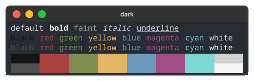 | 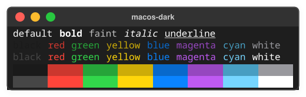 |
| 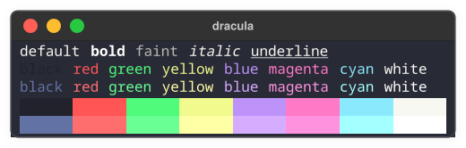 | 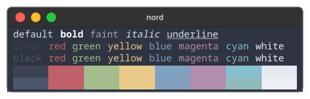 |
| 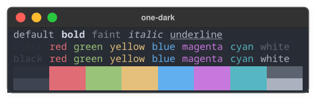 |  |
|  | 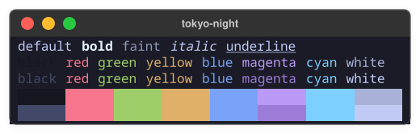 |
| 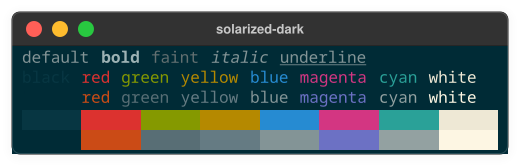 | 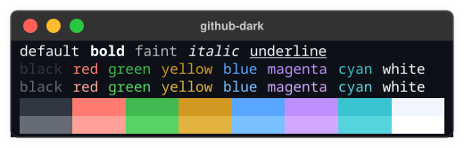 |
| 明るい背景 | |
| 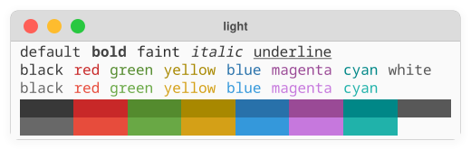 | 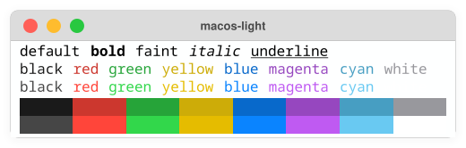 |
| 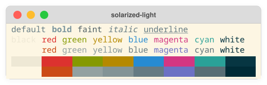 | 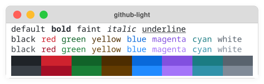 |

## 出力モード

### 通常出力

コマンドの入力に続けて出力を記録します。`highlight`で色を付けられます。

```yaml
steps:
  - name: comment color is cyan
    run: echo hello
  - name: run color override
    run: date
    run-highlight: "bold underline green"
```

| GIF | SVG |
| --- | --- |
|  |  |

### ストリーム出力

`stream-output: true`で、出力を実際のタイミングで再生します。

```yaml
steps:
  - run: ping -n 4 127.0.0.1
    stream-output: true
```

| GIF | SVG |
| --- | --- |
|  |  |

### TUI出力

`pty: true`でTUIやプログレスバーを記録します。

```yaml
steps:
  - run: matrix --duration 5
    pty: true
```

| GIF | SVG |
| --- | --- |
| 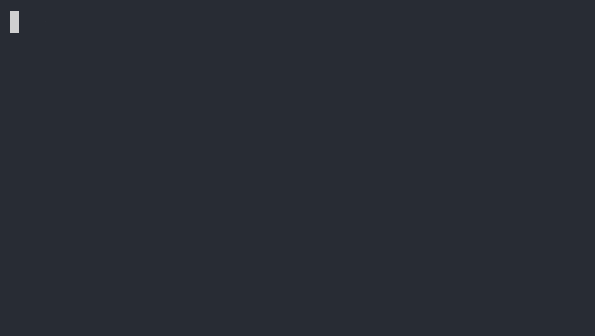 |  |

`keys`でキー操作をTUIに送り、`timeout`で止めるまでの時間を書けます。

```yaml
steps:
  - run: vim greet.py
    pty: true
    timeout: 30             # 30秒たったらCtrl+C
    keys:
      - wait: "greet.py"    # 出力にこの文字が出るまで待つ
        type: "/return\n"   # 1文字ずつ入力する。改行はEnter
      - key: escape         # enter、tab、up、f1、ctrl+c、alt+xなど
      - type: ":wq\n"
```

### 対話型アプリケーション出力

`interactive: true`で、自分で操作しながら録画します。

```yaml
steps:
  - run: vim README.md
    pty: true
    interactive: true
```

| GIF | SVG |
| --- | --- |
|  |  |

`--save-keys`で操作を`keys`として保存しておけば、次からは同じ操作を自動で再生して録画できます。Windowsではパスワードも保存されます。

```bash
scenetake --save-keys keys.yaml demo.yaml
```

## 便利機能

### ステップをまたぐ

bash、zsh、PowerShellでは、`cd`や`export`が後のステップにも引き継がれます。

```yaml
steps:
  - run: cd app && npm install
    show: none              # 録画せずに実行する
  - run: npm run dev
    background: true        # 動かしたまま次へ進む
    wait: "Local:"          # この文字が出たら次へ
  - curl -s localhost:5173/api/hello
  - clear: true             # 画面を消す
```

### タイトル画面とプロンプト

`card`ステップは、ウィンドウ中央寄せでオープニング表示します。`prompt`に`{dir}`を指定するとステップごとにそのフォルダ名を表示します。

```yaml
settings:
  prompt:
    - text: "{dir}"
      color: "fg:cyan"
    - " $ "
steps:
  - card:
      - "[bold fg:bright-cyan]my-app"
      - "Fast JSON diffs in your terminal"
    post-delay: 2.5
  - my-app diff a.json b.json
  - card: "[fg:yellow]npm install -g my-app"
```

### 実行し直さず見た目だけ変える

`--replay`と`--save-outputs`を組み合わせて、一度録画した出力ファイルを再利用してテーマや出力形式だけ変えられます。

```bash
scenetake --save-outputs demo.outputs.json demo.yaml
scenetake --replay demo.outputs.json --format mp4 --theme dracula demo.yaml
```

### 撮り直しても差分を出さない

撮り直したとき、出力が前回と同じステップは前回の録画をそのまま使います。`date`のように毎回変わる出力でも前回の出力を再利用するには`keep-output: true`を指定します。

```text
Compared with the earlier cast: 4 of 5 steps printed the same, 1 changed
  changed: step 3: npm test
```

### 秘密情報のマスク

トークン、`API_KEY=…`の値、URL中のパスワード、秘密鍵、`GITHUB_TOKEN`などの環境変数の値は、自動で`*`に置き換えます。ほかに隠したい文字列は`mask`で指定します。

```yaml
settings:
  mask:
    - "internal.example.com"
```

### CI

製品が変わったら、GitHub Actionsでデモを撮り直します。出力が変わらないデモは同じファイルになるので、差分に出るのは変わったデモだけです。

```yaml
# .github/workflows/demos.yaml
name: Update demos
on:
  workflow_dispatch:
  release:
    types: [published]
permissions:
  contents: write
  pull-requests: write
jobs:
  record:
    runs-on: ubuntu-24.04
    steps:
      - uses: actions/checkout@9c091bb21b7c1c1d1991bb908d89e4e9dddfe3e0 # v7.0.0
        with:
          # releaseはタグをチェックアウトし、そこからはPRを作れない
          ref: ${{ github.event_name == 'release' && github.event.repository.default_branch || github.ref }}
      # デモで見せる製品をここでインストールする
      - run: sudo apt-get update && sudo apt-get install -y ffmpeg # gifとmp4を出力するときだけ
      - run: npx -y scenetake --strict docs/demos/*.yaml
      # リポジトリ設定の「Allow GitHub Actions to create and approve pull requests」が必要
      - uses: peter-evans/create-pull-request@3ffccacd46053766916f087ce41d627c0b8cf2d1 # v8.1.3
        with:
          title: Update demos
          branch: update-demos
```

デモが古いままのPRを落とすには、撮り直してからcastを比べます。`git add -N`で、まだコミットしていないcastも差分に出します。

```bash
npx -y scenetake --strict docs/demos/*.yaml
git add -N docs/demos
git diff --exit-code -- 'docs/demos/*.cast'
```

- 手元でもCIと同じシェル（Linuxのbashなど）で撮ります。Windowsのpwshで撮ったデモは、CIで最初に撮り直したときに全部変わります。
- 比べるのはcastです。GIFとmp4はffmpegのバージョンでバイトが変わります。
- `interactive: true`のステップはCIでは撮れません。`keys`のステップは撮れます。
- `--strict`を付けると、ステップのコマンドが0以外で終了したときにエラーにできます。失敗するのが正しいステップには`continue-on-error: true`を付けます。

## シナリオファイル形式

`steps`キーのみ必須です。`: `を含むコマンドは`run: 'echo "answer: $a"'`のように引用符で囲んでください。キーの詳細は[spec_scenario.md](.github/docs/spec_scenario.md)にあります。


```yaml
# Scenario format reference — runnable demo (samples/scenario_format.yaml).
# Required: steps only. Everything else is optional.

title: "Scenario Format Demo"  # Optional cast title
width: 80                        # Default: 80
height: 24                       # Default: 24
# cwd: /your/project             # Optional working directory for all commands
shell: bash                      # bash | pwsh | powershell | path. Windows: Git Bash when bash

render:                          # Optional display metadata for cast header and SVG
  font-size: 16
  font-family: ui-monospace, monospace
  theme:
    preset: dark                 # dark, light, nord, dracula, and more, with optional fg / bg / palette overrides
  window: macos                  # none | macos | windows
  window-title: "scenario_format.yaml"  # title bar text; default: the top-level title, "" for none
  background: "#0f2027 #2c5364"  # one color, 2-4 colors for a gradient, or a .png/.jpg/.gif/.webp file
  margin: 24                     # px around the window (default 8, 12 with a window, 32 with a background)
  padding: 12                    # px between the terminal edge and its text (default from font-size)

# outputs:                       # Files to write besides the cast, when no --format is given
#   - format: svg
#   - format: svg                # A light copy, for a README that follows the reader's light or dark mode
#     theme: light
#     file: scenario_format-light.svg
#   - format: gif                # Needs ffmpeg
#     fps: 10

settings:                        # Defaults for all steps; map-form steps can override per key
  prompt:                        # Text ("$ "), or parts with a color each. {dir} is the folder the step starts in
    - text: "{dir}"
      color: cyan
    - " $ "
  typing-speed: 0.04             # Average seconds per typed character
  typing-jitter: 0.01            # Random variance (+/- seconds) per character
  pre-delay: 0.5                 # Pause before typing each step
  post-delay: 1.0                # Pause after output before the next step
  execution-duration: 0.1        # Cast wait after command execution
  stderr-color: red              # When stderr has no ANSI SGR sequences
  # stream-output: false         # When true, replay captured chunk times in the cast
  # max-duration: 15             # Cap step output timeline, and also enables stream emit
  # silence-threshold: 2.0       # Stream mode: collapse idle gaps longer than this (seconds)
  # max-idle: 0.2                # Stream mode: collapsed idle gap duration (seconds)
  # mask:                        # Texts to hide wherever the recording shows them, as *
  #   - "internal.example.com"
  # mask-auto: true              # Also hide tokens, secret KEY=value values, URL passwords, secret env values

# Optional setup; runs before steps, not recorded in cast
pre:
  - echo "environment check (not recorded)"

steps:
  # A card shows centered lines on a cleared screen and runs nothing: a title, or an install line at the end
  - card:
      - "[bold fg:bright-cyan]Scenario Format Demo"
      - "every key, recorded"
    post-delay: 2

  # String form - uses settings defaults
  - echo "Hello, World!"

  # Map form - comment line, per-step timing
  - name: "[cyan]Project status"
    run: printf 'name\tversion\nscenetake\t1.0\n'
    post-delay: 1.5

  - name: "Per-step timing overrides"
    run: printf 'typing slowly...\n'
    typing-speed: 0.12
    pre-delay: 0.8
    post-delay: 1.2

  - name: "execution-duration"
    run: sleep 1
    execution-duration: 0.5

  - name: "instant emit (ping, one blob)"
    run: bash -c 'case "$(uname -s)" in MINGW*|MSYS*|CYGWIN*) ping -n 4 127.0.0.1 ;; *) ping -c 4 127.0.0.1 ;; esac'
    execution-duration: 0.2

  - name: "stream-output (ping, staggered replay)"
    run: bash -c 'case "$(uname -s)" in MINGW*|MSYS*|CYGWIN*) ping -n 4 127.0.0.1 ;; *) ping -c 4 127.0.0.1 ;; esac'
    stream-output: true
    silence-threshold: 2.0
    max-idle: 0.2

  - name: "pty demo"
    run: echo "This command runs in a PTY, so output appears immediately and can include interactive features like colors and progress bars."
    pty: true

  - name: "keys and timeout"
    run: read -r -p "Your name? " name; echo "Hello, $name"
    pty: true                    # keys need a PTY to type into
    timeout: 10                  # seconds; then Ctrl+C, as a person would press it
    keys:                        # sleep (seconds), then type (text) or key (enter, up, esc, ctrl+c, f1...)
      - sleep: 0.5
        type: "scenetake"
      - key: enter

  - name: "run-highlight colors the typed command"
    run: printf 'done\n'
    run-highlight: bright-cyan

  - name: "stdout highlight"
    run: printf 'line1 alpha\nline2 beta gamma\nline3\n'
    highlight:
      - color: yellow
        at: "1"
      - color: red
        at: "2:7-10"
      - color: bright-cyan
        at: "2:12-"
      - color: underline fg:bright-white bg:blue
        at: "3"

  - name: "stderr (default red)"
    run: echo "plain stderr" 1>&2

  - name: "stderr-color override"
    run: echo "bright yellow stderr" 1>&2
    stderr-color: bright-yellow

  - echo "Done!"

# Optional teardown; runs last, not recorded
post:
  - echo "demo complete (not recorded)"
```
