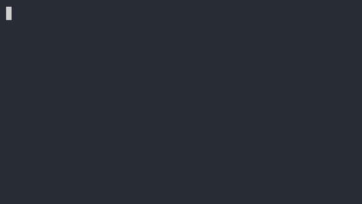
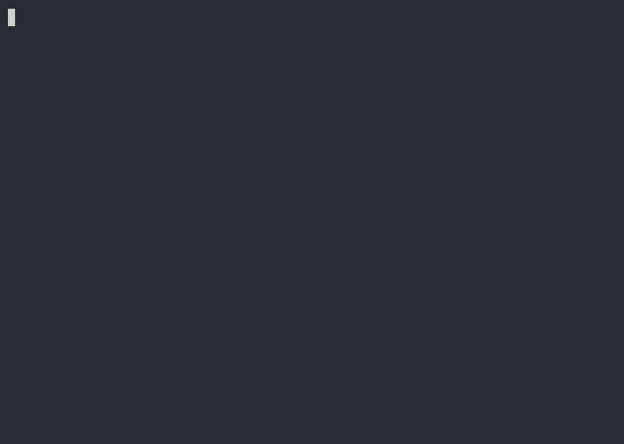

[](https://github.com/guitarrapc/scenetake/actions/workflows/build.yaml)

[](LICENSE)
[](https://www.nuget.org/packages/scenetake)
[](https://www.npmjs.com/package/scenetake)

# scenetake

English | [日本語](README-ja.md)

Run commands from a YAML **scenario** and record their output as [asciinema v3 `.cast`](https://docs.asciinema.org/manual/asciicast/v3/). Optionally generate animated SVG or mp4. No asciinema installation is required. Ordinary steps use simulated typing. Steps with `pty: true` record terminal output in real time.

The scenario in `samples/basic.yaml` runs real commands and generates the `.cast` and `.svg` recordings below. You do not need to type the commands during recording.

```yaml
title: "Basic Demo"
width: 80
height: 24
shell: bash

settings:
  prompt: "$ "
  typing-speed: 0.02 # average seconds per keystroke
  typing-jitter: 0.01 # random variance (±) per keystroke
  pre-delay: 0.4 # pause before typing starts
  post-delay: 1.0 # pause after output before next step

steps:
  - echo "Hello, World!"
  - name: Name of the step
    run: echo "Current directory:"
  - name: Coloring stdout
    run: curl -I https://google.com
    highlight:
      - color: green
        at:
          - "1"
      - color: gray
        at:
          - "2-12"
  - echo "Wait for 2 seconds..."
  - run: sleep 2
    execution-duration: 1.0
  - echo "stderr output is red by default" 1>&2
  - echo "Done!"
```

| GIF | SVG |
| --- | --- |
|  |  |

SVG output supports custom font, light/dark theme, and optional window chrome (`macos` / `windows`).

| macOS | Windows |
| --- | --- |
|  |  |

## Motivation

I wanted to record real commands from a scenario without typing each command by hand. Other tools depend on shell scripts or asciinema, expose execution paths, or simulate output without running commands.

scenetake runs on multiple platforms and writes `.cast` files directly, with optional SVG output.

1. Write the commands in a YAML scenario.
2. Use ordinary steps for simulated typing or `pty: true` for terminal output with real timing.
3. Run the scenario to execute the commands and record their output.

## Quick Start

Download the asset for your OS from GitHub Releases. Place `scenetake` (`scenetake.exe` on Windows) in your preferred folder. The binaries require neither a .NET runtime nor ICU.

| Asset | Runs on |
|---|---|
| `scenetake-linux-amd64.tar.gz`, `scenetake-linux-arm64.tar.gz` | Linux with glibc 2.28+ (RHEL 8, Debian 10, Ubuntu 20.04, and later) |
| `scenetake-linux-musl-amd64.tar.gz`, `scenetake-linux-musl-arm64.tar.gz` | Linux with musl 1.2.3+ (Alpine 3.17 and later) |
| `scenetake-osx-amd64.tar.gz`, `scenetake-osx-arm64.tar.gz` | macOS 12.0+ |
| `scenetake-win-amd64.zip`, `scenetake-win-arm64.zip` | Windows 10 1809+ |

```sh
# .NET global tool (.NET 10 SDK required; .NET 10 runtime required to run)
dotnet tool install -g scenetake

# npm
npm install -g scenetake

# Windows (Scoop)
scoop bucket add guitarrapc https://github.com/guitarrapc/scoop-bucket
scoop install scenetake
```


```bash
# On macOS/Linux, add execute permission if needed.
chmod +x ./scenetake

# Create a starter scenario file in the current directory
scenetake init

# Write the starter steps for bash instead of the OS default shell (pwsh on Windows, $SHELL elsewhere)
scenetake init --shell bash

# Run the scenario to generate a cast file
scenetake scenario.yaml

# Generate cast and animated SVG in one command
scenetake --format svg scenario.yaml

# SVG styling: font, theme, window chrome, frame cap
scenetake --format svg scenario.yaml --font-size 20 --font-family "'Noto Sans Mono', ui-monospace" --theme light --window macos

# Convert an existing cast file to SVG (v2 or v3)
scenetake svg scenario.cast

# Same styling flags work on the svg subcommand
scenetake svg scenario.cast --theme light --window windows --max-fps 30

# Convert a cast file to mp4 (H.264, needs ffmpeg) — best for full-screen TUIs and sharing
scenetake mp4 scenario.cast

# Fit X (Twitter) video upload limits
scenetake mp4 scenario.cast --max-size 1280x1024

# Make the mp4 exactly 1920x1080, for video editors and joining clips
scenetake mp4 scenario.cast --size 1920x1080

# Generate cast and mp4 in one command
scenetake --format mp4 scenario.yaml

# Show normal pre/post execution logs while generating a cast file
scenetake --verbose scenario.yaml

# Play with asciinema
asciinema play scenario.cast

# Convert to gif with agg (Linux/macOS) — requires agg 1.6.0+ for v3 cast files
docker run --rm -v "${PWD}:/data" ghcr.io/asciinema/agg /data/scenario.cast /data/scenario.gif --font-size 20 --last-frame-duration 0

# Convert to gif with agg (Windows PowerShell)
# Write the GIF inside the container and copy it out: Docker Desktop on Windows can corrupt a GIF written straight to a bind mount
$id = docker create -v "$($PWD.Path):/data:ro" ghcr.io/asciinema/agg /data/scenario.cast /tmp/scenario.gif --font-size 20 --last-frame-duration 0
docker start -a $id
docker cp "${id}:/tmp/scenario.gif" scenario.gif
docker rm $id
```

**Usage**

`scenetake --help` lists all commands and options, including ranges and defaults. Use `scenetake svg --help`, `scenetake mp4 --help`, or `scenetake init --help` for command-specific options.

```bash
# Initialize a new scenario file
scenetake init [--shell bash|pwsh|powershell] [scenario.yaml]

# Run scenario to generate cast (default), cast + SVG, or cast + mp4
scenetake [--verbose] [--strict] [--format cast|svg|mp4]
  [--font-size N] [--font-family FAMILIES] [--theme dark|light]
  [--window none|macos|windows] [--max-fps N]
  [--fps N] [--crf N] [--max-size WxH | --size WxH] [--font-file PATH]
  scenario.yaml [output]

# Convert an existing cast file to SVG
scenetake svg [--font-size N] [--font-family FAMILIES] [--theme dark|light]
  [--window none|macos|windows] [--max-fps N]
  <input.cast> [output.svg]

# Convert an existing cast file to mp4
scenetake mp4 [--font-size N] [--font-family FAMILIES] [--font-file PATH] [--theme dark|light]
  [--window none|macos|windows] [--fps N] [--crf N] [--max-size WxH | --size WxH]
  <input.cast> [output.mp4]
```

`--max-fps` caps SVG animation frame rate (`0` = off, use full cast timing). It applies when `--format svg` is set or on the `svg` subcommand.

`--strict` is for CI. Unless a step sets `continue-on-error: true`, scenetake stops at the first recorded step that exits non-zero. Later steps do not run, and scenetake writes no output. Existing output files stay, and `post` runs. Scenetake exits `1` unless a `post` command fails, in which case it returns that command's exit code.

The error shows the last lines the step printed. Set `continue-on-error: true` on a step that is meant to fail, such as an error demo.

mp4 options apply with `--format mp4` or the `mp4` subcommand:

- `--fps` sets the frame rate (default `30`, maximum `60`).
- `--crf` sets quality (default `23`). Higher values produce smaller files.
- `--max-size` reduces the video to fit a limit, such as `1280x1024` for X.
- `--size` sets exact dimensions, such as `1920x1080`. See Terminal size and resolution below.
- `--font-file` selects a font file.

`--size` and `--max-size` cannot be used together.

**SVG or mp4**

SVG is usually smallest for typing and short output, often half the size of mp4. It embeds in a README and stays sharp at any zoom. Full-screen TUIs that redraw each frame (`matrix`, `btop`) produce large SVG and GIF files. Use mp4 for these recordings and for sharing on X or Slack.

For example, `matrix --fps 60` at 200×60 for 7.5 seconds produces 17.0MB of SVG or 4.4MB of mp4. With `--max-size 1280x1024`, the mp4 is 2.8MB. Scenetake warns when an SVG exceeds 10MB.

mp4 output runs [ffmpeg](https://ffmpeg.org/) with libx264 as a separate program. Install it with `winget install Gyan.FFmpeg` or `scoop install ffmpeg` (Windows), `brew install ffmpeg` (macOS), or `sudo apt install ffmpeg` (Debian/Ubuntu). Set `SCENETAKE_FFMPEG` to use a specific binary. Mp4 uses fonts installed on your machine: the `font-family` list first, then CJK and symbol fonts. Pass `--font-file` to pin one. `--window` adds the same title bar as SVG, without the outer margin and shadow.

**Terminal size and resolution**

`width` and `height` set the terminal size in columns and rows (`term.cols` and `term.rows` in a cast file). The output's pixel size follows from them. At the default `font-size` of 16:

| Output | Pixel width | Pixel height |
| --- | --- | --- |
| mp4 | `width × 10 + 20` | `height × 20 + 8` |
| mp4 with `--window` | `width × 10 + 20` | `height × 20 + 42` |
| SVG | `width × 9.92 + 36` | `height × 20 + 24` |
| SVG with `--window` | `width × 9.92 + 44` | `height × 20 + 66` |

For example, the default 120×24 is 1220×488 as mp4 and 1226.4×504 as SVG.

To fill a video resolution, use the largest `width` × `height` that fits. At `font-size` 16:

| Resolution | `width` × `height` → mp4 size | With `--window` |
| --- | --- | --- |
| 1280×720 (HD) | 126 × 35 → 1280×708 | 126 × 33 → 1280×702 |
| 1280×1024 (X upload limit) | 126 × 50 → 1280×1008 | 126 × 49 → 1280×1022 |
| 1920×1080 (Full HD) | 190 × 53 → 1920×1068 | 190 × 51 → 1920×1062 |
| 2560×1440 (WQHD) | 254 × 71 → 2560×1428 | 254 × 69 → 2560×1422 |
| 3840×2160 (4K) | 382 × 107 → 3840×2148 | 382 × 105 → 3840×2142 |

- A row is 20 pixels tall, so the height usually ends a little short of the resolution. `--size` fills the rest (below).
- Text stays sharper when the recording already fits than when `--max-size` or `--size` scales a larger one down.
- A larger `font-size` makes each cell larger, so fewer columns and rows fit. A cell is `font-size × 0.62` wide and `font-size × 1.25` tall, rounded to whole pixels in mp4, and the padding also changes with `font-size`. See Layout in [spec_mp4.md](.github/docs/spec_mp4.md#layout).
- SVG does not blur when scaled, so its pixel size only sets the size it is first shown at.
- A recording that resizes uses its largest size.

`--size WxH` makes the mp4 exactly `W×H`. Both sides must be even. The recorded terminal does not change. Only the video frame around it does.

- A terminal that fits is centered, and the rest is the theme background. 190 × 53 at `--size 1920x1080` gets 6 pixels above and 6 below. The `--window` title bar stays at the top edge.
- A larger terminal is padded to that shape, then scaled down. 200 × 60 (2020×1208) becomes 1920×1080 with about 57 pixels on each side, its text scaled to 89%.
- A smaller terminal is not enlarged. 80 × 24 sits in the middle of the frame. Use a larger `--font-size` for larger text.

**Notes**

- `shell`:
  - Linux/macOS default shell is `$SHELL`, with `bash` as fallback.
  - Windows default shell is `pwsh`, with `powershell` as fallback. On Windows, `shell: bash` uses Git Bash / MSYS `bash` when available.
  - On Windows a path such as `C:/tools/pwsh-preview/pwsh.exe` starts that file. WSL `bash` is not used, even by path.
  - A shell given by name never starts a file from the current directory. Windows skips such a file. On Linux/macOS the run stops with an error, so run scenetake from another directory or give the shell as a full path.
- `cwd` is the working directory for `pre`, `steps`, and `post`. A relative `cwd` is relative to the scenario file's folder, so the scenario runs in the same folder wherever you start scenetake. Without `cwd`, commands run in the folder you start scenetake from. The folder must exist before the run starts.
- `settings` provides defaults for prompt and timing.
- `render` controls cast header display metadata (`st:font-size` tag, `term.theme`) and SVG output. See [.github/docs/spec_cast.md](.github/docs/spec_cast.md) and [.github/docs/spec_svg.md](.github/docs/spec_svg.md).
- `pre` / `post` run setup and teardown commands outside the recording flow. Their stdout/stderr are printed to the CLI, but are never written to the cast file.
- `steps`:
  - Steps are executed for real, so use caution with commands that modify files or affect external systems.
  - Commands that need a terminal can opt into pseudo-terminal capture with `pty: true`. See [PTY recording](#pty-recording).
  - For long-running commands, use `execution-duration` to keep playback readable.
  - For natural replay of long output (`docker build`, staged `sleep`, …), set `stream-output: true` and optionally `max-duration` on that step. Default pipe emit stays instant for typing and short demos.
  - Non-zero step exits warn and recording continues. `continue-on-error: true` suppresses the warning for expected failures. For CI, use `--strict` as described above.

**CJK text in GIFs**

The `ghcr.io/asciinema/agg` image has no CJK font. Characters absent from all available fonts appear as empty cells, including Japanese, Chinese, and Korean text.

Place a CJK font in a folder such as `fonts/`. Pass the folder with `--font-dir`. Add the font family after the Latin monospace font in `--text-font-family`. The first family sets the cell width.

```bash
# Linux/macOS
docker run --rm -v "${PWD}:/data" ghcr.io/asciinema/agg /data/scenario.cast /data/scenario.gif --font-size 20 --last-frame-duration 0 --font-dir /data/fonts --text-font-family "JetBrains Mono,BIZ UDGothic"

# Windows PowerShell
# Copy the font folder into the container: Docker Desktop on Windows fails to read a font from a bind mount (Input/output error)
$id = docker create -v "$($PWD.Path):/data:ro" ghcr.io/asciinema/agg /data/scenario.cast /tmp/scenario.gif --font-size 20 --last-frame-duration 0 --font-dir /fonts --text-font-family "JetBrains Mono,BIZ UDGothic"
docker cp .\fonts "${id}:/fonts"
docker start -a $id
docker cp "${id}:/tmp/scenario.gif" scenario.gif
docker rm $id
```

`BIZ UDGothic` (OFL, available on Google Fonts) is one example. Any CJK font works when you pass its family name.

## Output modes

There are four output modes: ordinary output, stream output, TUI output, and interactive application output. You can switch mode per step.

### Ordinary output

Ordinary steps capture command stdout/stderr and record them with simulated typing. This mode is suitable for one-shot commands and commands that do not require a TTY. Even if output has no color, you can apply color with `highlight` and `stderr-color`. Output appears instantly regardless of how long the real command took to print.

stderr without ANSI colors is red by default. Tools also use stderr for ordinary messages, such as git branch changes, curl progress, and `docker build` output. Set `stderr-color: none` under `settings` or on a step to use the normal text color.

```yaml
steps:
  - name: comment color is cyan
    run: echo hello
  - name: "[yellow] comment color override"
    run: echo world
  - name: run & stdout color default
    run: date
  - name: run color override
    run: date
    run-highlight: "bold underline green"
```

| GIF | SVG |
| --- | --- |
|  |  |

### Stream output

Set `stream-output: true` to replay intermittent output at its recorded timing. `max-duration` limits the output timeline. Stream output can also compress long idle gaps.

```yaml
steps:
  - name: "stream-output (ping, staggered replay)"
    run: ping -n 4 127.0.0.1
    stream-output: true
```

| GIF | SVG |
| --- | --- |
|  |  |

### TUI output

To capture terminal UIs or real-time animation (`matrix`, progress bars, etc.), set `pty: true`. PTY mode records the terminal byte stream while the child process is running. PTY size comes from the scenario `width` / `height`.

```yaml
steps:
  - run: matrix --duration 5
    pty: true               # Capture TTY-dependent output in real time; enough when no interaction is needed
```

| GIF | SVG |
| --- | --- |
|  |  |

> [!WARNING] With `pty: true`, stdout and stderr are merged into one byte stream, so `stderr-color` and pipe-style `highlight` do not apply to that step. See [samples/pty.yaml](samples/pty.yaml) and [spec_pty.md](.github/docs/spec_pty.md).

scenetake runs every command with `COLORTERM=truecolor`, so tools that pick their color depth from the environment will use true color.

Recordings also draw DECDLD soft fonts, but a program behind the PTY cannot detect that. Tell it in the scenario, for example `matrix --mode movie --soft-font`.

### Interactive application output

For interactive applications (`vim`, `copilot`), set `pty: true` and `interactive: true`. This lets you send input to the child process. Add `normalize-typing: true` to adjust typing speed while banners and help output retain their original timing.

```yaml
steps:
  - name: "Copilot CLI with banner"
    run: copilot --banner
    pty: true               # Capture TTY-dependent output in real time
    interactive: true       # For interactive applications
    normalize-typing: true  # Keep banner timing; re-time typed input only for readability

  - name: "edit in vim"
    run: vim README.md
    pty: true               # Capture TTY-dependent output in real time
    interactive: true       # For interactive applications
```

| GIF | SVG |
| --- | --- |
|  |  |

> [!WARNING] With `pty: true`, stdout and stderr are merged into one byte stream, so `stderr-color` and pipe-style `highlight` do not apply to that step. See [samples/interactive-pty.yaml](samples/interactive-pty.yaml) and Interactive PTY in [spec_pty.md](.github/docs/spec_pty.md).

## Scenario Format

Only `steps` is required. All other top-level keys are optional. Unknown keys, such as `hightlight`, produce a warning with a suggested key when available.

The example below runs as a scenario. Its source is [samples/scenario_format.yaml](samples/scenario_format.yaml).

- Field definitions: [spec_scenario.md](.github/docs/spec_scenario.md).
- Color and style syntax: [spec_highlight.md](.github/docs/spec_highlight.md).
- Setup and cleanup: [spec_pre_post.md](.github/docs/spec_pre_post.md).
- More color examples: [samples/highlight.yaml](samples/highlight.yaml).


```yaml
# Scenario format reference — runnable demo (samples/scenario_format.yaml).
# Required: steps only. Everything else is optional.

title: "Scenario Format Demo"  # Optional cast title
width: 80                        # Default: 120
height: 24                       # Default: 24
# cwd: /your/project             # Optional working directory for all commands
shell: bash                      # bash | pwsh | powershell | path. Windows: Git Bash when bash

render:                          # Optional display metadata for cast header and SVG
  font-size: 16
  font-family: ui-monospace, monospace
  theme:
    preset: dark                 # dark | light; optional fg / bg / palette overrides
  window: macos                  # none | macos | windows

settings:                        # Defaults for all steps; map-form steps can override per key
  prompt: "$ "
  typing-speed: 0.04             # Average seconds per typed character
  typing-jitter: 0.01            # Random variance (+/- seconds) per character
  pre-delay: 0.5                 # Pause before typing each step
  post-delay: 1.0                # Pause after output before the next step
  execution-duration: 0.1        # Cast wait after command execution
  stderr-color: red              # When stderr has no ANSI SGR sequences
  # stream-output: false         # When true, replay captured chunk times in the cast
  # max-duration: 15             # Cap step output timeline; also enables stream emit
  # silence-threshold: 2.0       # Stream mode: collapse idle gaps longer than this (seconds)
  # max-idle: 0.2                # Stream mode: collapsed idle gap duration (seconds)

# Optional setup; runs before steps, not recorded in cast
pre:
  - echo "environment check (not recorded)"

steps:
  # String form - uses settings defaults
  - echo "Hello, World!"

  # Map form - comment line, per-step timing
  - name: "[cyan]Project status"
    run: printf 'name\tversion\nscenetake\t1.0\n'
    post-delay: 1.5

  - name: "Per-step timing overrides"
    run: printf 'typing slowly...\n'
    typing-speed: 0.12
    pre-delay: 0.8
    post-delay: 1.2

  - name: "execution-duration"
    run: sleep 1
    execution-duration: 0.5

  - name: "instant emit (ping, one blob)"
    run: bash -c 'case "$(uname -s)" in MINGW*|MSYS*|CYGWIN*) ping -n 4 127.0.0.1 ;; *) ping -c 4 127.0.0.1 ;; esac'
    execution-duration: 0.2

  - name: "stream-output (ping, staggered replay)"
    run: bash -c 'case "$(uname -s)" in MINGW*|MSYS*|CYGWIN*) ping -n 4 127.0.0.1 ;; *) ping -c 4 127.0.0.1 ;; esac'
    stream-output: true
    silence-threshold: 2.0
    max-idle: 0.2

  - name: "pty demo"
    run: echo "This command runs in a PTY, so output appears immediately and can include interactive features like colors and progress bars."
    pty: true

  - name: "run-highlight colors the typed command"
    run: printf 'done\n'
    run-highlight: bright-cyan

  - name: "stdout highlight"
    run: printf 'line1 alpha\nline2 beta gamma\nline3\n'
    highlight:
      - color: yellow
        at: "1"
      - color: red
        at: "2:7-10"
      - color: bright-cyan
        at: "2:12-"
      - color: underline fg:bright-white bg:blue
        at: "3"

  - name: "stderr (default red)"
    run: echo "plain stderr" 1>&2

  - name: "stderr-color override"
    run: echo "bright yellow stderr" 1>&2
    stderr-color: bright-yellow

  - echo "Done!"

# Optional teardown; runs last, not recorded
post:
  - echo "demo complete (not recorded)"
```

## Development

Use `dotnet` for local development, debugging, or publishing.

- .NET 10 SDK (file-based C# app)

```bash
# Local run
dotnet run scenetake.cs -- <scenario.yaml> [output.cast]
dotnet run scenetake.cs -- svg <scenario.cast> [output.svg]

# build
dotnet publish scenetake.cs --self-contained true -p:PublishAot=true -p:StripSymbols=true -p:DebugType=None
```

See [samples/README.md](samples/README.md) for each scenario’s purpose and preview (GIF / SVG).

Regenerate samples cast/svg files:

```bash
dotnet run samples/regenerate.cs
# GIFs are written inside the container and copied out; see the Windows agg note in Quick Start
foreach ($file in Get-ChildItem samples/*.cast) {
  $id = docker create -v "$($PWD.Path):/data:ro" ghcr.io/asciinema/agg /data/samples/$($file.BaseName).cast /tmp/out.gif --last-frame-duration 0
  docker start -a $id
  docker cp "${id}:/tmp/out.gif" samples/$($file.BaseName).gif
  docker rm $id
}
```

### Release

Before tagging, update `Directory.Build.props` and all npm packages under `npm/packages/` to the same version. The script calculates the version from the latest `v*` git tag. If no tag exists, it uses the current files.

```bash
dotnet run scripts/set_version.cs -- patch   # e.g. v1.3.0 -> 1.3.1
dotnet run scripts/set_version.cs -- minor   # e.g. v1.3.0 -> 1.4.0
dotnet run scripts/set_version.cs -- major   # e.g. v1.3.0 -> 2.0.0
```

Commit the version change. Create a matching tag, such as `v1.4.0`. Push the tag to start the release workflow. The workflow builds native binaries, creates a GitHub Release, and stages `scenetake` and `@scenetake/*` npm packages.

After the workflow finishes, approve the staged npm packages locally with 2FA:

```bash
npm stage list
npm stage approve <stage-id>
```

Publish each npm package manually with `npm publish` for its first release. Staged publishing requires an existing package. This also applies to platform packages added later, such as `@scenetake/linux-x64-musl` and `@scenetake/linux-arm64-musl`. Approve platform packages before the main `scenetake` package.
