[](https://github.com/guitarrapc/scenetake/actions/workflows/build.yaml)

[](LICENSE.md)
[](https://www.nuget.org/packages/scenetake)
[](https://www.npmjs.com/package/scenetake)

# scenetake

English | [日本語](README-ja.md)

scenetake makes terminal recordings from commands you write in a YAML scenario. It types the commands for you, so recording again and again is easy, and you can tell it which keys to press in TUIs and interactive apps.


```yaml
title: "Basic Demo"
width: 80
height: 24
shell: bash

settings:
  prompt: "$ "
  typing-speed: 0.02 # average seconds per keystroke
  typing-jitter: 0.01 # random variance (±) per keystroke
  pre-delay: 0.4 # pause before typing starts
  post-delay: 1.0 # pause after output before next step

steps:
  - echo "Hello, World!"
  - name: Name of the step
    run: echo "Current directory:"
  - name: Coloring stdout
    run: curl -sI https://google.com
    highlight:
      - color: green
        at:
          - "1"
      - color: gray
        at:
          - "2-12"
  - echo "Wait for 2 seconds..."
  - run: sleep 2
    execution-duration: 1.0
  - echo "stderr output is red by default" 1>&2
  - echo "Done!"
```

| GIF | SVG |
| --- | --- |
|  |  |

## Gallery

| [fastfetch](samples/showcase/fetch.yaml) | [bat, git, and jq](samples/showcase/devtools.yaml) |
| --- | --- |
|  |  |
| [figlet, lolcat, and toilet](samples/showcase/logo.yaml) | [sl](samples/showcase/sl.yaml) |
|  |  |
| [vim and git diff, typed by `keys`, on an image background](samples/showcase/vim.yaml) | [Tokens and passwords, masked](samples/showcase/secrets.yaml) |
|  |  |


## Quick Start

Download a binary for Linux, macOS, or Windows from [Releases](https://github.com/guitarrapc/scenetake/releases), or install it with one of these. You do not need asciinema or a .NET runtime.

```sh
# dotnet tool
dotnet tool install -g scenetake

# npm
npm install -g scenetake

# scoop
scoop bucket add guitarrapc https://github.com/guitarrapc/scoop-bucket
scoop install scenetake
```


```bash
# Record one command without a scenario
scenetake capture -- git log --oneline -5

# Make a scenario from a command
scenetake capture --save-scenario help.yaml -- mycli --help

# Make a scenario file, scenario.yaml
scenetake init

# Run the scenario and record it as scenario.svg (scenario.cast is written too)
scenetake --format svg scenario.yaml

# See every option
scenetake --help
```

## Output formats

| Format | How | Notes |
| --- | --- | --- |
| `.cast` | `scenetake scenario.yaml` | asciinema v3. Also plays in `asciinema play` and converts with [agg](https://docs.asciinema.org/manual/agg/) |
| `.svg` | `--format svg`, `scenetake svg scenario.cast` | Animated. `--at` makes a still of one screen |
| `.png` | `--format png`, `scenetake png scenario.cast` | A still of one screen |
| `.mp4` | `--format mp4`, `scenetake mp4 scenario.cast` | Needs [ffmpeg](https://ffmpeg.org/) |
| `.gif` | `--format gif`, `scenetake gif scenario.cast` | Needs [ffmpeg](https://ffmpeg.org/) |

Install ffmpeg with `winget install Gyan.FFmpeg`, `brew install ffmpeg`, or `sudo apt install ffmpeg`.

To write several formats in one run, use the `outputs` key.

```yaml
outputs:
  - format: svg                # demo.svg, for the README
  - format: svg
    theme: github-light
    file: demo-light.svg
  - format: gif                # For Zenn (under 3 MB)
    font-size: 12
    fps: 10
  - format: mp4                # For X
    max-size: 1280x1024
```

## Customize the look

Set these with a `render` key in the scenario, or with the flag of the same name, such as `--window macos`.

| Key | What it sets |
| --- | --- |
| `window`, `window-title` | A title bar (`macos` / `windows`) and its text |
| `background` | Around the window: a color, a gradient (`"#1e3c72 #2a5298"`), or an image |
| `opacity`, `blur` | Show an image background through the window, and blur it |
| `margin`, `padding` | Space in pixels |
| `loop`, `end-hold`, `fade-out` | Play once (`--no-loop`), seconds on the final screen, seconds to fade the text out |

| macOS | Windows |
| --- | --- |
|  |  |

By default, empty rows below the output are left out. To keep the video at the full resolution, use `--fit none`. With `--fit none`, the default `80×24` is 820×488 as mp4 and 829.6×504 as SVG. For a 1920×1080 video, raise `--font-size`: the text is easier to read, and the size comes close to the resolution.

Set the color theme with `render.theme.preset` or `--theme`.

| Dark background | |
| --- | --- |
| 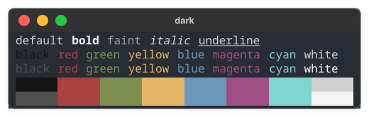 |  |
| 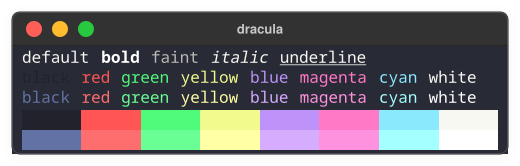 | 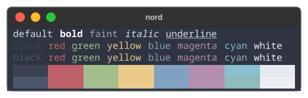 |
|  | 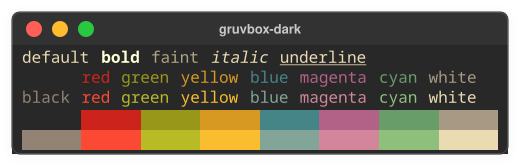 |
| 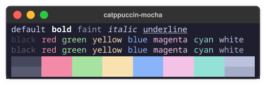 |  |
| 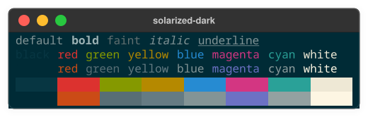 |  |
| Light background | |
|  | 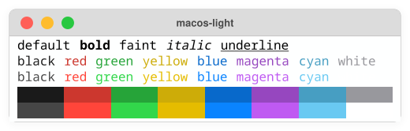 |
|  | 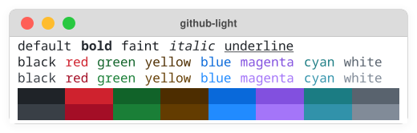 |

## Output modes

### Ordinary output

The output follows the typed command. `highlight` adds colors.

```yaml
steps:
  - name: comment color is cyan
    run: echo hello
  - name: run color override
    run: date
    run-highlight: "bold underline green"
```

| GIF | SVG |
| --- | --- |
|  |  |

### Stream output

`stream-output: true` plays the output at its real timing.

```yaml
steps:
  - run: ping -n 4 127.0.0.1
    stream-output: true
```

| GIF | SVG |
| --- | --- |
| 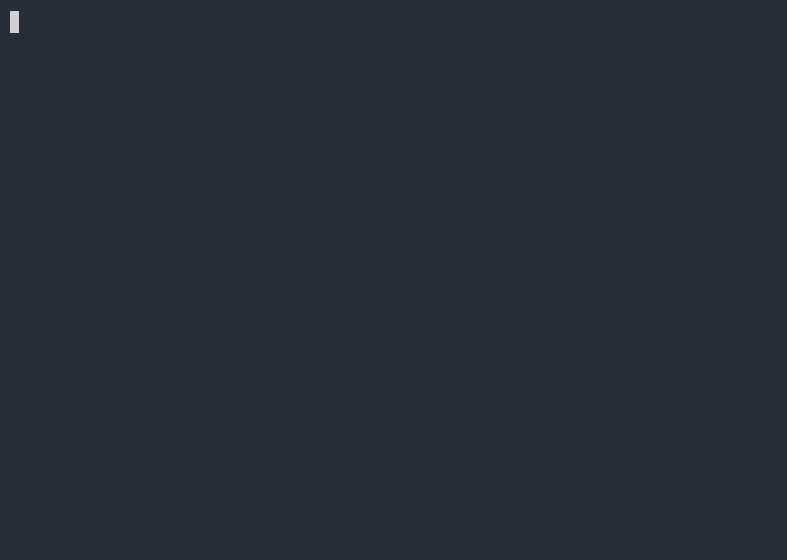 |  |

### TUI output

`pty: true` records a TUI or a progress bar.

```yaml
steps:
  - run: matrix --duration 5
    pty: true
```

| GIF | SVG |
| --- | --- |
| 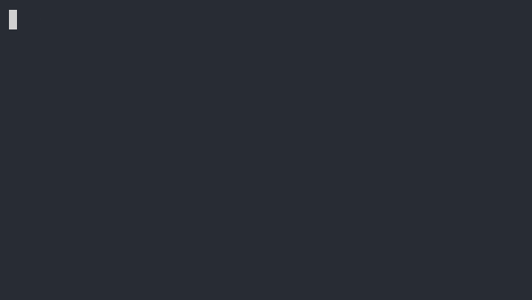 |  |

`keys` sends keystrokes to the TUI, and `timeout` sets when to stop it.

```yaml
steps:
  - run: vim greet.py
    pty: true
    timeout: 30             # Ctrl+C after 30 seconds
    keys:
      - wait: "greet.py"    # Wait until the output shows this text
        type: "/return\n"   # Typed one character at a time. A line break is Enter
      - key: escape         # enter, tab, up, f1, ctrl+c, alt+x...
      - type: ":wq\n"
```

### Interactive application output

`interactive: true` records you using the app.

```yaml
steps:
  - run: vim README.md
    pty: true
    interactive: true
```

| GIF | SVG |
| --- | --- |
|  |  |

Save your keys with `--save-keys`, and later recordings play them back for you. On Windows, a password is saved too.

```bash
scenetake --save-keys keys.yaml demo.yaml
```

## More features

### Across steps

With bash, zsh, or PowerShell, a `cd` or an `export` carries to the steps after it.

```yaml
steps:
  - run: cd app && npm install
    show: none              # Run without recording it
  - run: npm run dev
    background: true        # Keep it running and go on
    wait: "Local:"          # Go on when the output shows this
  - curl -s localhost:5173/api/hello
  - clear: true             # Clear the screen
```

### Title cards and the prompt

A `card` step shows an opening screen, centered in the window. With `{dir}` in `prompt`, each step shows the name of its folder.

```yaml
settings:
  prompt:
    - text: "{dir}"
      color: "fg:cyan"
    - " $ "
steps:
  - card:
      - "[bold fg:bright-cyan]my-app"
      - "Fast JSON diffs in your terminal"
    post-delay: 2.5
  - my-app diff a.json b.json
  - card: "[fg:yellow]npm install -g my-app"
```

### Change only the look, without running again

Combine `--save-outputs` and `--replay` to reuse the outputs of one recording and change only the theme or the format.

```bash
scenetake --save-outputs demo.outputs.json demo.yaml
scenetake --replay demo.outputs.json --format mp4 --theme dracula demo.yaml
```

### Record again without noise

When you record again, a step whose output did not change reuses the earlier recording. To reuse the earlier output even for output that changes every run, such as `date`, set `keep-output: true`.

```text
Compared with the earlier cast: 4 of 5 steps printed the same, 1 changed
  changed: step 3: npm test
```

### Masking secrets

scenetake replaces tokens, `API_KEY=…` values, passwords in URLs, private keys, and the values of secret environment variables such as `GITHUB_TOKEN` with `*`. Specify other texts to hide with `mask`.

```yaml
settings:
  mask:
    - "internal.example.com"
```

### CI

Add `--strict` to make a non-zero exit from a step's command an error. Set `continue-on-error: true` on a step that is meant to fail.

## Scenario Format

Only the `steps` key is required. Quote a command that contains `: `, for example `run: 'echo "answer: $a"'`. See [spec_scenario.md](.github/docs/spec_scenario.md) for every key.


```yaml
# Scenario format reference — runnable demo (samples/scenario_format.yaml).
# Required: steps only. Everything else is optional.

title: "Scenario Format Demo"  # Optional cast title
width: 80                        # Default: 80
height: 24                       # Default: 24
# cwd: /your/project             # Optional working directory for all commands
shell: bash                      # bash | pwsh | powershell | path. Windows: Git Bash when bash

render:                          # Optional display metadata for cast header and SVG
  font-size: 16
  font-family: ui-monospace, monospace
  theme:
    preset: dark                 # dark, light, nord, dracula, and more, with optional fg / bg / palette overrides
  window: macos                  # none | macos | windows
  window-title: "scenario_format.yaml"  # title bar text; default: the top-level title, "" for none
  background: "#0f2027 #2c5364"  # one color, 2-4 colors for a gradient, or a .png/.jpg/.gif/.webp file
  margin: 24                     # px around the window (default 8, 12 with a window, 32 with a background)
  padding: 12                    # px between the terminal edge and its text (default from font-size)

# outputs:                       # Files to write besides the cast, when no --format is given
#   - format: svg
#   - format: svg                # A light copy, for a README that follows the reader's light or dark mode
#     theme: light
#     file: scenario_format-light.svg
#   - format: gif                # Needs ffmpeg
#     fps: 10

settings:                        # Defaults for all steps; map-form steps can override per key
  prompt:                        # Text ("$ "), or parts with a color each. {dir} is the folder the step starts in
    - text: "{dir}"
      color: cyan
    - " $ "
  typing-speed: 0.04             # Average seconds per typed character
  typing-jitter: 0.01            # Random variance (+/- seconds) per character
  pre-delay: 0.5                 # Pause before typing each step
  post-delay: 1.0                # Pause after output before the next step
  execution-duration: 0.1        # Cast wait after command execution
  stderr-color: red              # When stderr has no ANSI SGR sequences
  # stream-output: false         # When true, replay captured chunk times in the cast
  # max-duration: 15             # Cap step output timeline, and also enables stream emit
  # silence-threshold: 2.0       # Stream mode: collapse idle gaps longer than this (seconds)
  # max-idle: 0.2                # Stream mode: collapsed idle gap duration (seconds)
  # mask:                        # Texts to hide wherever the recording shows them, as *
  #   - "internal.example.com"
  # mask-auto: true              # Also hide tokens, secret KEY=value values, URL passwords, secret env values

# Optional setup; runs before steps, not recorded in cast
pre:
  - echo "environment check (not recorded)"

steps:
  # A card shows centered lines on a cleared screen and runs nothing: a title, or an install line at the end
  - card:
      - "[bold fg:bright-cyan]Scenario Format Demo"
      - "every key, recorded"
    post-delay: 2

  # String form - uses settings defaults
  - echo "Hello, World!"

  # Map form - comment line, per-step timing
  - name: "[cyan]Project status"
    run: printf 'name\tversion\nscenetake\t1.0\n'
    post-delay: 1.5

  - name: "Per-step timing overrides"
    run: printf 'typing slowly...\n'
    typing-speed: 0.12
    pre-delay: 0.8
    post-delay: 1.2

  - name: "execution-duration"
    run: sleep 1
    execution-duration: 0.5

  - name: "instant emit (ping, one blob)"
    run: bash -c 'case "$(uname -s)" in MINGW*|MSYS*|CYGWIN*) ping -n 4 127.0.0.1 ;; *) ping -c 4 127.0.0.1 ;; esac'
    execution-duration: 0.2

  - name: "stream-output (ping, staggered replay)"
    run: bash -c 'case "$(uname -s)" in MINGW*|MSYS*|CYGWIN*) ping -n 4 127.0.0.1 ;; *) ping -c 4 127.0.0.1 ;; esac'
    stream-output: true
    silence-threshold: 2.0
    max-idle: 0.2

  - name: "pty demo"
    run: echo "This command runs in a PTY, so output appears immediately and can include interactive features like colors and progress bars."
    pty: true

  - name: "keys and timeout"
    run: read -r -p "Your name? " name; echo "Hello, $name"
    pty: true                    # keys need a PTY to type into
    timeout: 10                  # seconds; then Ctrl+C, as a person would press it
    keys:                        # sleep (seconds), then type (text) or key (enter, up, esc, ctrl+c, f1...)
      - sleep: 0.5
        type: "scenetake"
      - key: enter

  - name: "run-highlight colors the typed command"
    run: printf 'done\n'
    run-highlight: bright-cyan

  - name: "stdout highlight"
    run: printf 'line1 alpha\nline2 beta gamma\nline3\n'
    highlight:
      - color: yellow
        at: "1"
      - color: red
        at: "2:7-10"
      - color: bright-cyan
        at: "2:12-"
      - color: underline fg:bright-white bg:blue
        at: "3"

  - name: "stderr (default red)"
    run: echo "plain stderr" 1>&2

  - name: "stderr-color override"
    run: echo "bright yellow stderr" 1>&2
    stderr-color: bright-yellow

  - echo "Done!"

# Optional teardown; runs last, not recorded
post:
  - echo "demo complete (not recorded)"
```
