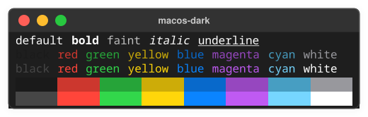
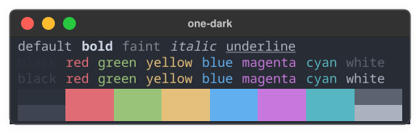

[](https://github.com/guitarrapc/scenetake/actions/workflows/build.yaml)

[](LICENSE.md)
[](https://www.nuget.org/packages/scenetake)
[](https://www.npmjs.com/package/scenetake)

# scenetake

English | [日本語](README-ja.md)

scenetake records terminal demos from commands you write in a YAML scenario.


## Why scenetake?

Terminal demos recorded by hand go stale when your tool changes. Re-recording means retyping every command, waiting for the output, and avoiding typos, and it gets tedious fast.

scenetake makes re-recording easy. Write the commands in a YAML scenario, and scenetake types them for you. It presses the keys you list in TUIs and interactive apps, and hides tokens and your user name. Steps whose output did not change record exactly as before, so a re-recorded demo differs only where something changed.

## Gallery

| [fastfetch](samples/showcase/fetch.yaml) | [bat, git, and jq](samples/showcase/devtools.yaml) |
| --- | --- |
|  |  |
| [figlet, lolcat, and toilet](samples/showcase/logo.yaml) | [sl](samples/showcase/sl.yaml) |
|  |  |
| [vim and git diff, typed by `keys`, on an image background](samples/showcase/vim.yaml) | [Tokens and passwords, masked](samples/showcase/secrets.yaml) |
|  |  |


## How it works

scenetake runs the commands in your steps for real. It types each one at the speed you set and records the actual output. Steps with `pty: true` run in a pseudo-terminal, so TUIs and progress bars draw just as they do in your terminal.

The recording is an asciinema v3 cast, which you can turn into SVG, PNG, mp4, or GIF. Commit the cast to git, and you can redraw it in another format or theme without running the commands again.

## Example

This scenario, [samples/basic.yaml](samples/basic.yaml), records as below.

```yaml
title: "Basic Demo"
width: 80
height: 24
shell: bash

settings:
  prompt: "$ "
  typing-speed: 0.02 # average seconds per keystroke
  typing-jitter: 0.01 # random variance (±) per keystroke
  pre-delay: 0.4 # pause before typing starts
  post-delay: 1.0 # pause after output before next step

steps:
  - echo "Hello, World!"
  - name: Name of the step
    run: echo "Current directory:"
  - name: Coloring stdout
    run: curl -sI https://google.com
    highlight:
      - color: green
        at:
          - "1"
      - color: gray
        at:
          - "2-12"
  - echo "Wait for 2 seconds..."
  - run: sleep 2
    execution-duration: 1.0
  - echo "stderr output is red by default" 1>&2
  - echo "Done!"
```

| GIF | SVG |
| --- | --- |
|  |  |

## Getting started

### Install

Download a binary for Linux, macOS, or Windows from [Releases](https://github.com/guitarrapc/scenetake/releases), or install it with one of these. You do not need asciinema or a .NET runtime.

```sh
# dotnet tool
dotnet tool install -g scenetake

# npm
npm install -g scenetake

# scoop
scoop bucket add guitarrapc https://github.com/guitarrapc/scoop-bucket
scoop install scenetake
```

mp4 and GIF need [ffmpeg](https://ffmpeg.org/). Install it with `winget install Gyan.FFmpeg`, `brew install ffmpeg`, or `sudo apt install ffmpeg`.

### Record a demo


Make a starter scenario, scenario.yaml:

```sh
scenetake init
```

Run the scenario and record it as scenario.svg. scenario.cast is written too:

```sh
scenetake --format svg scenario.yaml
```

Record one command without a scenario, or keep it as a scenario to add steps to:

```sh
scenetake capture -- git log --oneline -5
scenetake capture --save-scenario help.yaml -- mycli --help
```

Record every scenario in a folder:

```sh
scenetake --format svg demos/*.yaml
```

Make an mp4 from the cast, without running the commands again:

```sh
scenetake mp4 scenario.cast
```

See every option:

```sh
scenetake --help
```

### Editors and AI agents

Specify the [scenario schema](schema/scenario.schema.json) for your scenetake version on the first line of the scenario file. In VS Code with the [YAML extension](https://marketplace.visualstudio.com/items?itemName=redhat.vscode-yaml), or another editor that uses yaml-language-server, you get completion for keys and values, a description of each key, and errors for misspelled keys and invalid values.

Install the scenetake skill for coding agents, and the agent can work out how to write a scenario, record it, check the result, and tune it.

```sh
npx skills add guitarrapc/scenetake
```

## CLI reference

The tables below say what each command and option is for. `scenetake --help` and `scenetake <command> --help` show their ranges and defaults.

### Commands

| Command | Use it to |
| --- | --- |
| `scenetake <scenario.yaml> [output]` | Run a scenario and record it. `[output]` names the files: `out` writes out.cast and out.svg |
| `scenetake <scenario.yaml>...` | Record several demos in one run, such as `docs/*.yaml` in CI |
| `scenetake svg\|mp4\|png\|gif <input.cast> [output]` | Make another format from a cast without running the commands again |
| `scenetake capture -- <command>` | Record one command without writing a scenario |
| `scenetake init [scenario.yaml]` | Start a scenario from a commented template |
| `scenetake --version` | See which version you have |

### Options

`capture` takes the options of a scenario, except `--save-keys`, `--save-outputs`, `--replay`, and `--rerun`. The svg, mp4, png, and gif commands take the options for the look and for their format.

| Option | Use it to |
| --- | --- |
| **Recording** | |
| `--format cast\|svg\|mp4\|png\|gif` | Write one format besides the cast. Without it, a scenario writes the files its `outputs` lists, and `capture` writes an SVG |
| `--strict` | Stop with an error when a step's command fails, so CI does not keep a broken demo |
| `--save-keys FILE` | Save what you type in `interactive: true` steps, so later recordings type it for you |
| `--save-outputs FILE` | Save what each step printed, for `--replay` |
| `--replay FILE` | Change the look, the timing, or the format without running the commands again |
| `--rerun` | Run every step, also those with `rerun: false` |
| `--verbose` | See which phase is running, and the details of an error that stops the run |
| **Look** (overrides the scenario's `render`, or what the cast stores) | |
| `--theme NAME` | Pick a color theme, such as a light one for a light page |
| `--font-size N`, `--font-family FAMILIES` | Make the text easier to read, or use your own font |
| `--window none\|macos\|windows`, `--window-title TEXT` | Draw a title bar, so the recording looks like a terminal window |
| `--background VALUE` | Put a color, a gradient, or an image around the window |
| `--opacity N`, `--blur N` | Show the background through the window, and blur it |
| `--margin N`, `--padding N` | Change the space around the window and around the text |
| `--fit none\|height\|width\|both` | Leave out the empty rows below the output (the default), or keep the whole terminal with `none` |
| `--crop-top N`, `--crop-bottom N`, `--crop-left N`, `--crop-right N` | Cut rows or columns that you do not want to show from an edge |
| **Animation and stills** | |
| `--no-loop`, `--loop` | Play an SVG or a GIF once and stop on the final screen, or loop when the scenario or the cast says not to |
| `--end-hold N` | Give viewers time to read the final screen before the animation starts again or ends |
| `--fade-out N` | End with the text fading out instead of a cut |
| `--speed N` | Make the SVG, mp4, or GIF shorter (`1.5`) or slower (`0.5`) without recording again |
| `--length N` | Fit the SVG, mp4, or GIF into at most N seconds without recording again |
| `--max-fps N` | Make the SVG of a fast-changing screen smaller |
| `--at TIME` | Make a still SVG or PNG of one moment: seconds, `end` for the final screen, or a step's `id` for the screen right after that step |
| **mp4, GIF, and PNG** | |
| `--fps N` | Balance smooth motion and file size for mp4 and GIF. The default rises with `--speed` to keep motion smooth |
| `--crf N` | Balance mp4 quality and file size |
| `--max-size WxH` | Stay under a site's upload limit, such as `1280x1024` for X |
| `--size WxH` | Make a video of an exact size, such as `1920x1080` |
| `--size W:H` | Make a video of a shape, such as `16:9`, at the terminal's own size |
| `--font-file PATH` | Use a font file that is not installed. mp4, GIF, and PNG draw the text themselves, and an SVG uses the viewer's fonts |
| **capture** | |
| `--width N`, `--height N` | Set the terminal size |
| `--shell NAME` | Run the command in a shell other than the default |
| `--pipe` | Record the output as a pipe gets it, which most tools print without colors |
| `--timeout N` | Stop a command that does not end by itself, such as `tail -f` |
| `-o, --output NAME` | Name the files: `-o demo` writes demo.cast and demo.svg |
| `--save-scenario FILE` | Keep the command as a scenario, to add steps and record it again |
| **init** | |
| `--shell bash\|pwsh\|powershell` | Write the template's steps for that shell |

To use an ffmpeg that is not on PATH, set `SCENETAKE_FFMPEG` to its path.

### Output formats

| Format | How | Notes |
| --- | --- | --- |
| `.cast` | `scenetake scenario.yaml` | asciinema v3. Also plays in `asciinema play` and converts with [agg](https://docs.asciinema.org/manual/agg/) |
| `.svg` | `--format svg`, `scenetake svg scenario.cast` | Animated. `--at` makes a still of one screen |
| `.png` | `--format png`, `scenetake png scenario.cast` | A still of one screen |
| `.mp4` | `--format mp4`, `scenetake mp4 scenario.cast` | Needs [ffmpeg](https://ffmpeg.org/) |
| `.gif` | `--format gif`, `scenetake gif scenario.cast` | Needs [ffmpeg](https://ffmpeg.org/) |

To write several formats in one run, use the `outputs` key.

```yaml
outputs:
  - format: svg                # demo.svg, for the README
  - format: svg
    theme: github-light
    file: demo-light.svg
  - format: gif                # For Zenn (under 3 MB)
    font-size: 12
    fps: 10
  - format: mp4                # For X
    max-size: 1280x1024
```

### Exit codes

| Code | Meaning |
| --- | --- |
| `0` | Recorded. Without `--strict`, a step's command that fails does not change it |
| `1` | An error in the scenario, an option, or a file, ffmpeg is missing, a step failed with `--strict`, or one of several scenarios was not recorded |
| Other | A `pre` or `post` command failed, and scenetake returns its exit code |

## Scenario format

Only the `steps` key is required. Quote a command that contains `: `, for example `run: 'echo "answer: $a"'`. See [spec_scenario.md](.github/docs/spec_scenario.md) for every key.

| Key | Default | What it sets |
| --- | --- | --- |
| `title` | — | The cast's title, and the title bar's text unless `window-title` sets it |
| `width`, `height` | `80`, `24` | Terminal columns and rows |
| `cwd` | the current folder | The folder the commands run in. A relative path starts at the scenario's folder |
| `shell` | `$SHELL` or bash, `pwsh` on Windows | `bash`, `pwsh`, `powershell`, or a path |
| `render` | — | The look: see [Customize the look](#customize-the-look) |
| `outputs` | — | Files to write besides the cast: see [Output formats](#output-formats) |
| `settings` | — | Defaults for every step: the prompt, typing speed, pauses, and masking |
| `pre`, `post` | — | Commands that run before and after the steps, not recorded |
| `steps` | required | The commands to record |

### Output modes

#### Ordinary output

The output follows the typed command. `highlight` adds colors.

```yaml
steps:
  - name: comment color is cyan
    run: echo hello
  - name: run color override
    run: date
    run-highlight: "bold underline green"
```

| GIF | SVG |
| --- | --- |
|  |  |

#### Stream output

`stream-output: true` plays the output at its real timing.

```yaml
steps:
  - run: ping -n 4 127.0.0.1
    stream-output: true
```

| GIF | SVG |
| --- | --- |
|  |  |

#### TUI output

`pty: true` records a TUI or a progress bar.

```yaml
steps:
  - run: matrix --duration 5
    pty: true
```

| GIF | SVG |
| --- | --- |
|  |  |

`highlight` colors the lines of a `pty: true` step too, on top of the program's own colors.

```yaml
steps:
  - run: git log --oneline -5
    pty: true
    highlight:
      - color: "bold bg:blue"
        at: "1"             # the newest commit
```

`keys` sends keystrokes to the TUI, and `timeout` sets when to stop it.

```yaml
steps:
  - run: vim greet.py
    pty: true
    timeout: 30             # Ctrl+C after 30 seconds
    keys:
      - wait: "greet.py"    # Wait until the output shows this text
        type: "/return\n"   # Typed one character at a time. A line break is Enter
      - key: escape         # enter, tab, up, f1, ctrl+c, alt+x...
      - type: ":wq\n"
```

#### Interactive application output

`interactive: true` records you using the app.

```yaml
steps:
  - run: vim README.md
    pty: true
    interactive: true
```

| GIF | SVG |
| --- | --- |
|  |  |

Save your keys with `--save-keys`, and later recordings play them back for you. On Windows, a password is saved too.

```bash
scenetake --save-keys keys.yaml demo.yaml
```

### Across steps

With bash, zsh, or PowerShell, a `cd` or an `export` carries to the steps after it.

```yaml
steps:
  - run: cd app && npm install
    show: none              # Run without recording it
  - run: npm run dev
    background: true        # Keep it running and go on
    wait: "Local:"          # Go on when the output shows this
  - curl -s localhost:5173/api/hello
  - clear: true             # Clear the screen
```

### Title cards and the prompt

A `card` step shows an opening screen, centered in the window. With `{dir}` in `prompt`, each step shows the name of its folder.

```yaml
settings:
  prompt:
    - text: "{dir}"
      color: "fg:cyan"
    - " $ "
steps:
  - card:
      - "[bold fg:bright-cyan]my-app"
      - "Fast JSON diffs in your terminal"
    post-delay: 2.5
  - my-app diff a.json b.json
  - card: "[fg:yellow]npm install -g my-app"
```

### Customize the look

Set these with a `render` key in the scenario, or with the flag of the same name, such as `--window macos`.

| Key | What it sets |
| --- | --- |
| `window`, `window-title` | A title bar (`macos` / `windows`) and its text |
| `background` | Around the window: a color, a gradient (`"#1e3c72 #2a5298"`), or an image |
| `opacity`, `blur` | Show an image background through the window, and blur it |
| `margin`, `padding` | Space in pixels |
| `loop`, `end-hold`, `fade-out` | Play once (`--no-loop`), seconds on the final screen, seconds to fade the text out |
| `speed` | How many times as fast as recorded the SVG, mp4, and GIF play, `0.25`–`4` |
| `length` | The most seconds the SVG, mp4, and GIF play. Not with `speed` |

`speed` makes typing, pauses, and output faster together.

```yaml
outputs:
  - format: svg              # for the README, as recorded
  - format: mp4              # 1.5 times as fast
    speed: 1.5
```

`end-hold` and `fade-out` stay seconds of the output at any speed, and `--at` names a moment of the recording. To keep motion smooth, the default `--fps` of mp4 and GIF rises with the speed.

| As recorded | `speed: 2` ([speed.yaml](samples/speed.yaml)) |
| --- | --- |
|  |  |

`length` sets how many seconds an output plays. scenetake fits the demo into that time, so you do not tune typing speed and pauses yourself. It shortens waits in a command's output first, then the pauses between steps, then typing. A demo that is already shorter stays as it is, and when a demo still does not fit, scenetake warns and names the steps that take the longest.

```yaml
outputs:
  - format: svg              # for the README, as recorded
  - format: mp4              # for X, at most 15 seconds
    length: 15
```

Each recording also prints how long each step takes, split into typing, output, and pauses, so you can see which step or which setting makes a demo long.

| macOS | Windows |
| --- | --- |
|  |  |

By default, empty rows below the output are left out. To keep the video at the full resolution, use `--fit none`. With `--fit none`, the default `80×24` is 820×488 as mp4 and 829.6×504 as SVG. For a 1920×1080 video, raise `--font-size`: the text is easier to read, and the size comes close to the resolution.

Many services take an mp4 up to 3:1, so an mp4 wider than that gets space above and below, with the terminal in the middle. For 16:9, use `--size 16:9`.

Set the color theme with `render.theme.preset` or `--theme`.

| Dark background | |
| --- | --- |
|  |  |
|  |  |
|  |  |
|  |  |
|  |  |
| Light background | |
|  |  |
|  |  |

### Full example

A runnable scenario with a comment on each key, [samples/scenario_format.yaml](samples/scenario_format.yaml):


```yaml
# yaml-language-server: $schema=https://raw.githubusercontent.com/guitarrapc/scenetake/v1.5.0/schema/scenario.schema.json
# Scenario format reference — runnable demo (samples/scenario_format.yaml).
# Required: steps only. Everything else is optional.

title: "Scenario Format Demo"  # Optional cast title
width: 80                        # Default: 80
height: 24                       # Default: 24
# cwd: /your/project             # Optional working directory for all commands
shell: bash                      # bash | pwsh | powershell | path. Windows: Git Bash when bash

render:                          # Optional display metadata for cast header and SVG
  font-size: 16
  font-family: ui-monospace, monospace
  theme:
    preset: dark                 # dark, light, nord, dracula, and more, with optional fg / bg / palette overrides
  window: macos                  # none | macos | windows
  window-title: "scenario_format.yaml"  # title bar text; default: the top-level title, "" for none
  background: "#0f2027 #2c5364"  # one color, 2-4 colors for a gradient, or a .png/.jpg/.gif/.webp file
  margin: 24                     # px around the window (default 8, 12 with a window, 32 with a background)
  padding: 12                    # px between the terminal edge and its text (default from font-size)

# outputs:                       # Files to write besides the cast, when no --format is given
#   - format: svg
#   - format: svg                # A light copy, for a README that follows the reader's light or dark mode
#     theme: light
#     file: scenario_format-light.svg
#   - format: gif                # Needs ffmpeg
#     fps: 10

settings:                        # Defaults for all steps; map-form steps can override per key
  prompt:                        # Text ("$ "), or parts with a color each. {dir} is the folder the step starts in
    - text: "{dir}"
      color: cyan
    - " $ "
  typing-speed: 0.04             # Average seconds per typed character
  typing-jitter: 0.01            # Random variance (+/- seconds) per character
  pre-delay: 0.5                 # Pause before typing each step
  post-delay: 1.0                # Pause after output before the next step
  # end-prompt: false            # When true, end with the prompt after the last output
  execution-duration: 0.1        # Cast wait after command execution
  stderr-color: red              # When stderr has no ANSI SGR sequences
  # stream-output: false         # When true, replay captured chunk times in the cast
  # max-duration: 15             # Cap step output timeline, and also enables stream emit
  # silence-threshold: 2.0       # Stream mode: collapse idle gaps longer than this (seconds)
  # max-idle: 0.2                # Stream mode: collapsed idle gap duration (seconds)
  # mask:                        # Texts to hide wherever the recording shows them, as *
  #   - "internal.example.com"
  # mask-auto: true              # Also hide tokens, secret KEY=value values, URL passwords, secret env values

# Optional setup; runs before steps, not recorded in cast
pre:
  - echo "environment check (not recorded)"

steps:
  # A card shows centered lines on a cleared screen and runs nothing: a title, or an install line at the end
  - card:
      - "[bold fg:bright-cyan]Scenario Format Demo"
      - "every key, recorded"
    post-delay: 2

  # String form - uses settings defaults
  - echo "Hello, World!"

  # Map form - comment line, per-step timing
  - name: "[cyan]Project status"
    run: printf 'name\tversion\nscenetake\t1.0\n'
    post-delay: 1.5

  - name: "Per-step timing overrides"
    run: printf 'typing slowly...\n'
    typing-speed: 0.12
    pre-delay: 0.8
    post-delay: 1.2

  - name: "execution-duration"
    run: sleep 1
    execution-duration: 0.5

  - name: "instant emit (ping, one blob)"
    run: bash -c 'case "$(uname -s)" in MINGW*|MSYS*|CYGWIN*) ping -n 4 127.0.0.1 ;; *) ping -c 4 127.0.0.1 ;; esac'
    execution-duration: 0.2

  - name: "stream-output (ping, staggered replay)"
    run: bash -c 'case "$(uname -s)" in MINGW*|MSYS*|CYGWIN*) ping -n 4 127.0.0.1 ;; *) ping -c 4 127.0.0.1 ;; esac'
    stream-output: true
    silence-threshold: 2.0
    max-idle: 0.2

  - name: "pty demo"
    run: echo "This command runs in a PTY, so output appears immediately and can include interactive features like colors and progress bars."
    pty: true

  - name: "keys and timeout"
    run: read -r -p "Your name? " name; echo "Hello, $name"
    pty: true                    # keys need a PTY to type into
    timeout: 10                  # seconds; then Ctrl+C, as a person would press it
    keys:                        # sleep (seconds), then type (text) or key (enter, up, esc, ctrl+c, f1...)
      - sleep: 0.5
        type: "scenetake"
      - key: enter

  - name: "run-highlight colors the typed command"
    run: printf 'done\n'
    run-highlight: bright-cyan

  - name: "stdout highlight"
    run: printf 'line1 alpha\nline2 beta gamma\nline3\n'
    highlight:
      - color: yellow
        at: "1"
      - color: red
        at: "2:7-10"
      - color: bright-cyan
        at: "2:12-"
      - color: underline fg:bright-white bg:blue
        at: "3"

  - name: "stderr (default red)"
    run: echo "plain stderr" 1>&2

  - name: "stderr-color override"
    run: echo "bright yellow stderr" 1>&2
    stderr-color: bright-yellow

  - echo "Done!"

# Optional teardown; runs last, not recorded
post:
  - echo "demo complete (not recorded)"
```

## Masking secrets

scenetake replaces tokens, `API_KEY=…` values, passwords in URLs, private keys, and the values of secret environment variables such as `GITHUB_TOKEN` with `*`. Specify other texts to hide with `mask`.

```yaml
settings:
  mask:
    - "internal.example.com"
```

It also hides who recorded the demo: your user name in `ls -l`, your computer's name, and your git name and email in `git log`. Your home folder's path shows as `~`, so `pwd` prints `~/src/app`. Your name in a web address, such as `github.com/<name>/tool`, stays. To show them, set `mask-personal: false`.

```yaml
settings:
  mask-personal: false
```

To show the folder the steps run in as the same path on every machine, CI included, give it with `cwd-as`. `pwd`, errors, and stack traces then print it, and the prompt's `{dir}` shows `my-app`.

```yaml
cwd: ./demo
cwd-as: ~/my-app
```

## Recording again

When the tool changes, record the scenario again. These make that quick, and keep the diff to what changed.

### Change only the look, without running again

Combine `--save-outputs` and `--replay` to reuse the outputs of one recording and change only the theme or the format.

```bash
scenetake --save-outputs demo.outputs.json demo.yaml
scenetake --replay demo.outputs.json --format mp4 --theme dracula demo.yaml
```

### Record again without noise

When you record again, a step whose output did not change reuses the earlier recording. To reuse the earlier output even for output that changes every run, such as `date`, set `keep-output: true`.

```text
Compared with the earlier cast: 4 of 5 steps printed the same, 1 changed
  changed: step 3: npm test
```

To keep a step from running again, such as a slow build, a deploy, or a command that costs money on every run, set `rerun: false`. The step shows its output from the earlier cast without running, so its `cd` or `export` does not happen either. It runs when the earlier cast does not have it, and `--rerun` runs every step.

```yaml
steps:
  - run: npm run build      # slow, and its files stay
    rerun: false
  - npx my-app --help
```

### CI

Record the demos again in GitHub Actions when your product changes. A demo whose output did not change gives the same files, so only the demos that changed show in the diff.

```yaml
# .github/workflows/demos.yaml
name: Update demos
on:
  workflow_dispatch:
  release:
    types: [published]
permissions:
  contents: write
  pull-requests: write
jobs:
  record:
    runs-on: ubuntu-24.04
    steps:
      - uses: actions/checkout@9c091bb21b7c1c1d1991bb908d89e4e9dddfe3e0 # v7.0.0
        with:
          # A release would check out its tag, which a pull request cannot start from.
          ref: ${{ github.event_name == 'release' && github.event.repository.default_branch || github.ref }}
      # Install the product that the demos show here.
      - run: sudo apt-get update && sudo apt-get install -y ffmpeg # only for gif and mp4 outputs
      - run: npx -y scenetake --strict docs/demos/*.yaml
      # Needs "Allow GitHub Actions to create and approve pull requests" in the repository settings.
      - uses: peter-evans/create-pull-request@3ffccacd46053766916f087ce41d627c0b8cf2d1 # v8.1.3
        with:
          title: Update demos
          branch: update-demos
```

To fail a pull request whose demos are out of date, record them and compare the casts. `git add -N` makes a cast that was never committed show in the diff too:

```bash
npx -y scenetake --strict docs/demos/*.yaml
git add -N docs/demos
git diff --exit-code -- 'docs/demos/*.cast'
```

- Record locally in the shell that CI uses, such as bash on Linux. A demo recorded with pwsh on Windows changes completely on its first CI run.
- Compare the casts, not GIFs or mp4s, whose bytes change with the ffmpeg version.
- Steps with `interactive: true` cannot run in CI. Steps with `keys` can, and so can an interactive step with `rerun: false` that the committed cast has.
- `--strict` makes a non-zero exit from a step's command an error. Set `continue-on-error: true` on a step that is meant to fail.

## Development

Needs the .NET 10 SDK.

```sh
# Build
dotnet build

# Run the tests. Tests of the binary are skipped unless SCENETAKE_BIN names a published one
dotnet test

# Publish a Native AOT binary for this machine
dotnet publish src/Scenetake/Scenetake.csproj -c Release -p:PublishAot=true
```

The specifications are in [.github/docs](.github/docs/spec_index.md).

## License

MIT. See [LICENSE.md](LICENSE.md).
