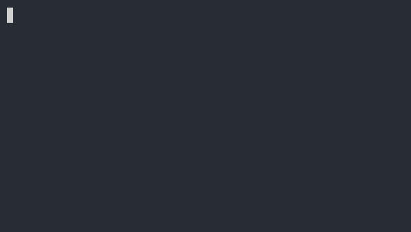
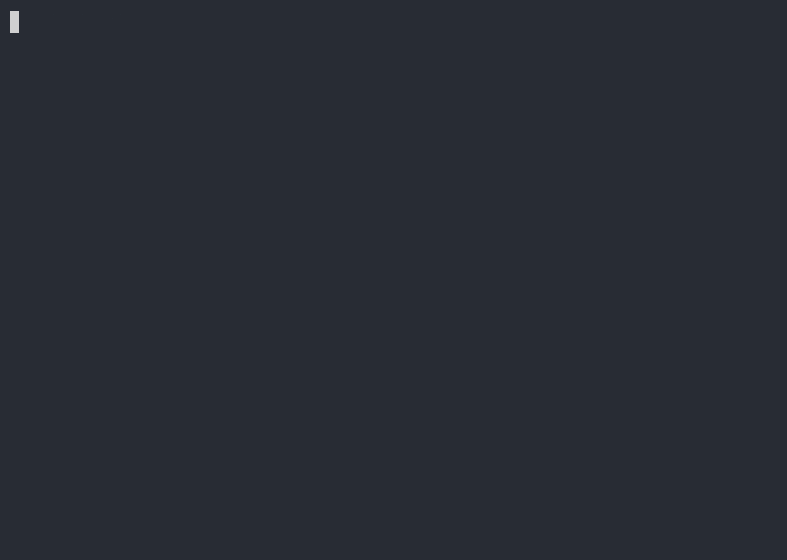

[](https://github.com/guitarrapc/scenetake/actions/workflows/build.yaml)

[](LICENSE)
[](https://www.nuget.org/packages/scenetake)
[](https://www.npmjs.com/package/scenetake)

# scenetake

English | [日本語](README-ja.md)

Run a YAML **scenario** and record a terminal scene take [asciinema v3 `.cast`](https://docs.asciinema.org/manual/asciicast/v3/), animated `.svg`. You do not need to install or launch `asciinema` to record. Write a YAML scenario with steps, and this tool executes those steps and records the output as `.cast` (and optionally `.svg`)—ordinary steps get simulated typing; steps with `pty: true` capture the terminal stream in real time.

Sample scenario `samples/basic.yaml` generates `.cast` and `.svg` output like below. You don't have to struggle with typing, and since the commands are actually executed, you can easily create realistic terminal recordings.

```yaml
title: "Basic Demo"
width: 80
height: 24
shell: bash

settings:
  prompt: "$ "
  typing-speed: 0.02 # average seconds per keystroke
  typing-jitter: 0.01 # random variance (±) per keystroke
  pre-delay: 0.4 # pause before typing starts
  post-delay: 1.0 # pause after output before next step

steps:
  - echo "Hello, World!"
  - name: Name of the step
    run: echo "Current directory:"
  - name: Coloring stdout
    run: curl -I https://google.com
    highlight:
      - color: green
        at:
          - "1"
      - color: gray
        at:
          - "2-12"
  - echo "Wait for 2 seconds..."
  - run: sleep 2
    execution-duration: 1.0
  - echo "stderr output is red by default" 1>&2
  - echo "Done!"
```

| GIF | SVG |
| --- | --- |
|  |  |

SVG output supports custom font, light/dark theme, and optional window chrome (`macos` / `windows`).

| macOS | Windows |
| --- | --- |
|  |  |

## Motivation

I wanted a tool that could capture commands without making me type them all out by hand, and that is the motivation behind scenetake. There are many tools around asciinema, but they often miss the mark: some are tied to shell scripts, some assume asciinema itself as a dependency, some leak execution paths into the cast output, and some only fake the output instead of running real commands. What I want is something I can describe in a straightforward scenario, have the listed commands actually executed, and generate a cast file directly from the results.

scenetake is a cross-platform tool that records those scenarios as `.cast` files, optionally with `.svg`, without going through asciinema at all.

1. Write the commands to run in the scenario.
2. For ordinary steps, generate cast events as if the commands were typed at a steady pace; for `pty: true` steps, record the terminal byte stream as it runs.
3. Execute the commands for real and write their output into the cast.

## Quick Start

Download the asset for your OS from GitHub Releases, then place `scenetake` (or `scenetake.exe` on Windows) where you want.

```sh
# .NET global tool (.NET 10 SDK required; .NET 10 runtime required to run)
dotnet tool install -g scenetake

# npm
npm install -g scenetake

# Windows (Scoop)
scoop bucket add guitarrapc https://github.com/guitarrapc/scoop-bucket
scoop install scenetake
```


```bash
# On macOS/Linux, add execute permission if needed.
chmod +x ./scenetake

# Create a starter scenario file in the current directory
scenetake init

# Run the scenario to generate a cast file
scenetake scenario.yaml

# Generate cast and animated SVG in one command
scenetake --format svg scenario.yaml

# SVG styling: font, theme, window chrome, frame cap
scenetake --format svg scenario.yaml --font-size 20 --font-family "'Noto Sans Mono', ui-monospace" --theme light --window macos

# Convert an existing cast file to SVG (v2 or v3)
scenetake svg scenario.cast

# Same styling flags work on the svg subcommand
scenetake svg scenario.cast --theme light --window windows --max-fps 30

# Convert a cast file to mp4 (H.264, needs ffmpeg) — best for full-screen TUIs and sharing
scenetake mp4 scenario.cast

# Fit X (Twitter) video upload limits
scenetake mp4 scenario.cast --max-size 1280x1024

# Generate cast and mp4 in one command
scenetake --format mp4 scenario.yaml

# Show normal pre/post execution logs while generating a cast file
scenetake --verbose scenario.yaml

# Play with asciinema
asciinema play scenario.cast

# Convert to gif with agg (Linux/macOS) — requires agg 1.6.0+ for v3 cast files
docker run --rm -v "${PWD}:/data" ghcr.io/asciinema/agg /data/scenario.cast /data/scenario.gif --font-size 20 --last-frame-duration 0

# Convert to gif with agg (Windows PowerShell)
# Write the GIF inside the container and copy it out: Docker Desktop on Windows can corrupt a GIF written straight to a bind mount
$id = docker create -v "$($PWD.Path):/data:ro" ghcr.io/asciinema/agg /data/scenario.cast /tmp/scenario.gif --font-size 20 --last-frame-duration 0
docker start -a $id
docker cp "${id}:/tmp/scenario.gif" scenario.gif
docker rm $id
```

**Usage**

```bash
# Initialize a new scenario file
scenetake init [scenario.yaml]

# Run scenario to generate cast (default), cast + SVG, or cast + mp4
scenetake [--verbose] [--format cast|svg|mp4]
  [--font-size N] [--font-family FAMILIES] [--theme dark|light]
  [--window none|macos|windows] [--max-fps N]
  [--fps N] [--crf N] [--max-size WxH] [--font-file PATH]
  scenario.yaml [output]

# Convert an existing cast file to SVG
scenetake svg [--font-size N] [--font-family FAMILIES] [--theme dark|light]
  [--window none|macos|windows] [--max-fps N]
  <input.cast> [output.svg]

# Convert an existing cast file to mp4
scenetake mp4 [--font-size N] [--font-family FAMILIES] [--font-file PATH] [--theme dark|light]
  [--window none|macos|windows] [--fps N] [--crf N] [--max-size WxH]
  <input.cast> [output.mp4]
```

`--max-fps` caps SVG animation frame rate (`0` = off, use full cast timing). It applies when `--format svg` is set or on the `svg` subcommand.

mp4 options apply with `--format mp4` or on the `mp4` subcommand: `--fps` sets the frame rate (default `30`, max `60`), `--crf` sets quality (default `23`; higher is smaller), `--max-size` downscales to fit (for example `1280x1024` for X), and `--font-file` picks the font file.

**SVG or mp4**

SVG is usually the smallest for typing and short output (often half the size of mp4), embeds in a README, and stays sharp at any zoom. Full-screen TUIs that redraw every frame (`matrix`, `btop`, …) make SVG and GIF very large; use mp4 for those, and for sharing on X or Slack. For example, `matrix --fps 60` at 200×60 for 7.5 seconds is 17.0MB as SVG and 8.0MB as mp4 (3.9MB with `--max-size 1280x1024`). scenetake warns when an SVG is over 10MB.

mp4 output runs [ffmpeg](https://ffmpeg.org/) with libx264 as a separate program. Install it with `winget install Gyan.FFmpeg` or `scoop install ffmpeg` (Windows), `brew install ffmpeg` (macOS), or `sudo apt install ffmpeg` (Debian/Ubuntu). Set `SCENETAKE_FFMPEG` to use a specific binary. mp4 uses fonts installed on your machine: the `font-family` list first, then CJK and symbol fonts. Pass `--font-file` to pin one. `--window` adds the same title bar as SVG, without the outer margin and shadow.

**Notes**

- `shell`:
  - Linux/macOS default shell is `$SHELL`, with `bash` as fallback.
  - Windows default shell is `pwsh`, with `powershell` as fallback. On Windows, `shell: bash` uses Git Bash / MSYS `bash` when available.
  - On Windows a path such as `C:/tools/pwsh-preview/pwsh.exe` starts that file. WSL `bash` is not used, even by path.
- `settings` provides defaults for prompt and timing.
- `render` controls cast header display metadata (`st:font-size` tag, `term.theme`) and SVG output. See [.github/docs/spec_cast.md](.github/docs/spec_cast.md) and [.github/docs/spec_svg.md](.github/docs/spec_svg.md).
- `pre` / `post` run setup and teardown commands outside the recording flow. Their stdout/stderr are printed to the CLI, but are never written to the cast file.
- `steps`:
  - Steps are executed for real, so use caution with commands that modify files or affect external systems.
  - Commands that need a terminal can opt into pseudo-terminal capture with `pty: true`. See [PTY recording](#pty-recording).
  - For long-running commands, use `execution-duration` to keep playback readable.
  - For natural replay of long output (`docker build`, staged `sleep`, …), set `stream-output: true` and optionally `max-duration` on that step. Default pipe emit stays instant for typing and short demos.

**CJK text in GIFs**

The `ghcr.io/asciinema/agg` image has no CJK font, and agg draws nothing for a character that none of its fonts has, so Japanese, Chinese, and Korean text (for example full-width katakana) comes out as empty cells. Put a CJK font in a folder such as `fonts/`, pass it with `--font-dir`, and add its family name after the Latin monospace font in `--text-font-family`. The first family sets the cell width.

```bash
# Linux/macOS
docker run --rm -v "${PWD}:/data" ghcr.io/asciinema/agg /data/scenario.cast /data/scenario.gif --font-size 20 --last-frame-duration 0 --font-dir /data/fonts --text-font-family "JetBrains Mono,BIZ UDGothic"

# Windows PowerShell
# Copy the font folder into the container: Docker Desktop on Windows fails to read a font from a bind mount (Input/output error)
$id = docker create -v "$($PWD.Path):/data:ro" ghcr.io/asciinema/agg /data/scenario.cast /tmp/scenario.gif --font-size 20 --last-frame-duration 0 --font-dir /fonts --text-font-family "JetBrains Mono,BIZ UDGothic"
docker cp .\fonts "${id}:/fonts"
docker start -a $id
docker cp "${id}:/tmp/scenario.gif" scenario.gif
docker rm $id
```

`BIZ UDGothic` (OFL, available on Google Fonts) is one example. Any CJK font works when you pass its family name.

## Output modes

There are four output modes: ordinary output, stream output, TUI output, and interactive application output. You can switch mode per step.

### Ordinary output

Ordinary steps capture command stdout/stderr and record them with simulated typing. This mode is suitable for one-shot commands and commands that do not require a TTY. Even if output has no color, you can apply color with `highlight` and `stderr-color`. Output appears instantly regardless of how long the real command took to print.

```yaml
steps:
  - name: comment color is cyan
    run: echo hello
  - name: "[yellow] comment color override"
    run: echo world
  - name: run & stdout color default
    run: date
  - name: run color override
    run: date
    run-highlight: "bold underline green"
```

| GIF | SVG |
| --- | --- |
|  |  |

### Stream output

For commands that emit output intermittently, set `stream-output: true` to replay output at captured timing. If you set `max-duration`, the step output timeline is capped and long idle gaps can be compressed by stream emit.

```yaml
steps:
  - name: "stream-output (ping, staggered replay)"
    run: ping -n 4 127.0.0.1
    stream-output: true
```

| GIF | SVG |
| --- | --- |
|  |  |

### TUI output

To capture terminal UIs or real-time animation (`matrix`, progress bars, etc.), set `pty: true`. PTY mode records the terminal byte stream while the child process is running. PTY size comes from the scenario `width` / `height`.

```yaml
steps:
  - run: matrix --duration 5
    pty: true               # Capture TTY-dependent output in real time; enough when no interaction is needed
```

| GIF | SVG |
| --- | --- |
|  |  |

> [!WARNING] With `pty: true`, stdout and stderr are merged into one byte stream, so `stderr-color` and pipe-style `highlight` do not apply to that step. See [samples/pty.yaml](samples/pty.yaml) and [spec_pty.md](.github/docs/spec_pty.md).

scenetake runs every command with `COLORTERM=truecolor`, so tools that pick their color depth from the environment will use true color.

### Interactive application output

For interactive applications (`vim`, `copilot`, etc.), set both `pty: true` and `interactive: true`. PTY is enabled and interactive child-process input becomes possible. If you set `normalize-typing: true`, banners/help output keeps real timing while only user typing is re-timed for readability.

```yaml
steps:
  - name: "Copilot CLI with banner"
    run: copilot --banner
    pty: true               # Capture TTY-dependent output in real time
    interactive: true       # For interactive applications
    normalize-typing: true  # Keep banner timing; re-time typed input only for readability

  - name: "edit in vim"
    run: vim README.md
    pty: true               # Capture TTY-dependent output in real time
    interactive: true       # For interactive applications
```

| GIF | SVG |
| --- | --- |
|  |  |

> [!WARNING] With `pty: true`, stdout and stderr are merged into one byte stream, so `stderr-color` and pipe-style `highlight` do not apply to that step. See [samples/interactive-pty.yaml](samples/interactive-pty.yaml) and Interactive PTY in [spec_pty.md](.github/docs/spec_pty.md).

## Scenario Format

Only `steps` is required; all other top-level keys are optional. The example below is a runnable scenario — source of truth: [samples/scenario_format.yaml](samples/scenario_format.yaml). For full field definitions see [.github/docs/spec_scenario.md](.github/docs/spec_scenario.md). Coloring and style syntax: [spec_highlight.md](.github/docs/spec_highlight.md). Pre/post behavior: [spec_pre_post.md](.github/docs/spec_pre_post.md). More color examples: [samples/highlight.yaml](samples/highlight.yaml).


```yaml
# Scenario format reference — runnable demo (samples/scenario_format.yaml).
# Required: steps only. Everything else is optional.

title: "Scenario Format Demo"  # Optional cast title
width: 80                        # Default: 120
height: 24                       # Default: 24
# cwd: /your/project             # Optional working directory for all commands
shell: bash                      # bash | pwsh | powershell | path. Windows: Git Bash when bash

render:                          # Optional display metadata for cast header and SVG
  font-size: 16
  font-family: ui-monospace, monospace
  theme:
    preset: dark                 # dark | light; optional fg / bg / palette overrides
  window: macos                  # none | macos | windows

settings:                        # Defaults for all steps; map-form steps can override per key
  prompt: "$ "
  typing-speed: 0.04             # Average seconds per typed character
  typing-jitter: 0.01            # Random variance (+/- seconds) per character
  pre-delay: 0.5                 # Pause before typing each step
  post-delay: 1.0                # Pause after output before the next step
  execution-duration: 0.1        # Cast wait after command execution
  stderr-color: red              # When stderr has no ANSI SGR sequences
  # stream-output: false         # When true, replay captured chunk times in the cast
  # max-duration: 15             # Cap step output timeline; also enables stream emit
  # silence-threshold: 2.0       # Stream mode: collapse idle gaps longer than this (seconds)
  # max-idle: 0.2                # Stream mode: collapsed idle gap duration (seconds)

# Optional setup; runs before steps, not recorded in cast
pre:
  - echo "environment check (not recorded)"

steps:
  # String form - uses settings defaults
  - echo "Hello, World!"

  # Map form - comment line, per-step timing
  - name: "[cyan]Project status"
    run: printf 'name\tversion\nscenetake\t1.0\n'
    post-delay: 1.5

  - name: "Per-step timing overrides"
    run: printf 'typing slowly...\n'
    typing-speed: 0.12
    pre-delay: 0.8
    post-delay: 1.2

  - name: "execution-duration"
    run: sleep 1
    execution-duration: 0.5

  - name: "instant emit (ping, one blob)"
    run: bash -c 'case "$(uname -s)" in MINGW*|MSYS*|CYGWIN*) ping -n 4 127.0.0.1 ;; *) ping -c 4 127.0.0.1 ;; esac'
    execution-duration: 0.2

  - name: "stream-output (ping, staggered replay)"
    run: bash -c 'case "$(uname -s)" in MINGW*|MSYS*|CYGWIN*) ping -n 4 127.0.0.1 ;; *) ping -c 4 127.0.0.1 ;; esac'
    stream-output: true
    silence-threshold: 2.0
    max-idle: 0.2

  - name: "pty demo"
    run: echo "This command runs in a PTY, so output appears immediately and can include interactive features like colors and progress bars."
    pty: true

  - name: "run-highlight colors the typed command"
    run: printf 'done\n'
    run-highlight: bright-cyan

  - name: "stdout highlight"
    run: printf 'line1 alpha\nline2 beta gamma\nline3\n'
    highlight:
      - color: yellow
        at: "1"
      - color: red
        at: "2:7-10"
      - color: bright-cyan
        at: "2:12-"
      - color: underline fg:bright-white bg:blue
        at: "3"

  - name: "stderr (default red)"
    run: echo "plain stderr" 1>&2

  - name: "stderr-color override"
    run: echo "bright yellow stderr" 1>&2
    stderr-color: bright-yellow

  - echo "Done!"

# Optional teardown; runs last, not recorded
post:
  - echo "demo complete (not recorded)"
```

## Development

Use `dotnet` for local development, debugging, or publishing.

- .NET 10 SDK (file-based C# app)

```bash
# Local run
dotnet run scenetake.cs -- <scenario.yaml> [output.cast]
dotnet run scenetake.cs -- svg <scenario.cast> [output.svg]

# build
dotnet publish scenetake.cs --self-contained true -p:PublishAot=true -p:StripSymbols=true -p:DebugType=None
```

See [samples/README.md](samples/README.md) for each scenario’s purpose and preview (GIF / SVG).

Regenerate samples cast/svg files:

```bash
dotnet run samples/regenerate.cs
# GIFs are written inside the container and copied out; see the Windows agg note in Quick Start
foreach ($file in Get-ChildItem samples/*.cast) {
  $id = docker create -v "$($PWD.Path):/data:ro" ghcr.io/asciinema/agg /data/samples/$($file.BaseName).cast /tmp/out.gif --last-frame-duration 0
  docker start -a $id
  docker cp "${id}:/tmp/out.gif" samples/$($file.BaseName).gif
  docker rm $id
}
```

### Release

Before tagging, bump `Directory.Build.props` and all npm packages under `npm/packages/` together. The script uses the latest `v*` git tag as the base version (falls back to the current files when no tags exist).

```bash
dotnet run scripts/set_version.cs -- patch   # e.g. v1.3.0 -> 1.3.1
dotnet run scripts/set_version.cs -- minor   # e.g. v1.3.0 -> 1.4.0
dotnet run scripts/set_version.cs -- major   # e.g. v1.3.0 -> 2.0.0
```

Commit the version bump, then create and push a tag matching the new version (for example `v1.4.0`). Pushing the tag starts the release workflow, which builds native binaries, creates a GitHub Release, and stages npm packages (`scenetake` plus `@scenetake/*` platform binaries).

After the workflow finishes, approve the staged npm packages locally with 2FA:

```bash
npm stage list
npm stage approve <stage-id>
```

The first npm release must be published manually (`npm publish`), because staged publishing requires the package to already exist on the registry. Platform packages (`@scenetake/linux-x64`, etc.) must be approved before the main `scenetake` package.
