# Sample scenarios

[English](README.md) | 日本語

scenetakeのサンプルシナリオです。`scenetake --format svg samples/basic.yaml`のように録画できます。

| シナリオ | 内容 | ファイル |
| --- | --- | --- |
| [basic](#basic) | 入門。タイピング、ハイライト、sleep、stderrの色 | [yaml](basic.yaml) · [cast](basic.cast) · [gif](basic.gif) · [svg](basic.svg) |
| [scenario-format](#scenario-format) | READMEに載せているシナリオ形式のリファレンス | [yaml](scenario_format.yaml) · [cast](scenario_format.cast) · [svg](scenario_format.svg) |
| [demo](#demo) | YAMLからcast、GIFを作るまでの流れ | [yaml](demo.yaml) · [cast](demo.cast) · [gif](demo.gif) · [svg](demo.svg) |
| [git](#git) | 実際の`git`コマンドの出力 | [yaml](git.yaml) · [cast](git.cast) · [gif](git.gif) · [svg](git.svg) |
| [highlight](#highlight) | コメント、入力したコマンド、stdout、stderrの色付け | [yaml](highlight.yaml) · [cast](highlight.cast) · [gif](highlight.gif) · [svg](highlight.svg) |
| [pty](#pty) | `pty: true`で`matrix`を録画 | [yaml](pty.yaml) · [cast](pty.cast) · [gif](pty.gif) · [svg](pty.svg) |
| [interactive-pty](#interactive-pty) | `interactive: true`で操作しながら録画 | [yaml](interactive-pty.yaml) · [cast](interactive-pty.cast) · [gif](interactive-pty.gif) · [svg](interactive-pty.svg) |
| [password-prompt](#password-prompt) | `sudo`のパスワードを録画に残さない（Linux / macOS） | [yaml](password-prompt.yaml) · [cast](password-prompt.cast) · [gif](password-prompt.gif) · [svg](password-prompt.svg) |
| [theme](#theme) | lightテーマ、16色と256色、グラデーションの背景 | [yaml](theme.yaml) · [cast](theme.cast) · [gif](theme.gif) · [svg](theme.svg) |
| [theme-macos](#theme-macos) | macOSのウィンドウ枠を、透けるグラデーションの上に | [yaml](theme-macos.yaml) · [cast](theme-macos.cast) · [gif](theme-macos.gif) · [svg](theme-macos.svg) |
| [theme-windows](#theme-windows) | Windowsのウィンドウ枠を、グラデーションの上に | [yaml](theme-windows.yaml) · [cast](theme-windows.cast) · [gif](theme-windows.gif) · [svg](theme-windows.svg) |
| [translucent](#translucent) | 画像の上に、半透明でぼかしたウィンドウ | [yaml](translucent.yaml) · [cast](translucent.cast) · [gif](translucent.gif) · [svg](translucent.svg) |
| [speed](#speed) | 1つの録画を、録画どおりと2倍速で。`outputs`から書き出す | [yaml](speed.yaml) · [cast](speed.cast) · [gif](speed.gif) · [svg](speed.svg) · [svg 2倍速](speed-2x.svg) |
| [resize](#resize) | ターミナルのリサイズ（castのみ） | [cast](resize.cast) · [gif](resize.gif) · [svg](resize.svg) |

## ショーケース

よく知られたターミナルツールのデモです。READMEのギャラリーとプレイグラウンドで使っています。

| シナリオ | 内容 | ファイル |
| --- | --- | --- |
| fetch | PTYで`fastfetch`、macOSのウィンドウ枠 | [yaml](showcase/fetch.yaml) · [cast](showcase/fetch.cast) · [svg](showcase/fetch.svg) |
| devtools | `bat`、`git log --graph`、`jq`のカラー出力、Windowsのウィンドウ枠 | [yaml](showcase/devtools.yaml) · [cast](showcase/devtools.cast) · [svg](showcase/devtools.svg) |
| logo | `figlet`と動く`lolcat`、`toilet` | [yaml](showcase/logo.yaml) · [cast](showcase/logo.cast) · [svg](showcase/logo.svg) |
| sl | cursesで描くSL | [yaml](showcase/sl.yaml) · [cast](showcase/sl.cast) · [svg](showcase/sl.svg) |
| nyancat | 全画面のトゥルーカラーアニメーションを`timeout`で停止 | [yaml](showcase/nyancat.yaml) · [cast](showcase/nyancat.cast) · [svg](showcase/nyancat.svg) |
| vim | `keys`で`vim`を編集し、`git diff`で確認 | [yaml](showcase/vim.yaml) · [cast](showcase/vim.cast) · [svg](showcase/vim.svg) |
| secrets | ダミーのトークン、URL中のパスワード、`settings.mask`のホスト名を隠す | [yaml](showcase/secrets.yaml) · [cast](showcase/secrets.cast) · [svg](showcase/secrets.svg) |
| welcome | プレイグラウンドの最初の画面 | [yaml](showcase/welcome.yaml) · [cast](showcase/welcome.cast) · [svg](showcase/welcome.svg) |

## basic

| GIF | SVG |
| --- | --- |
|  |  |

## scenario-format


## demo

| GIF | SVG |
| --- | --- |
| 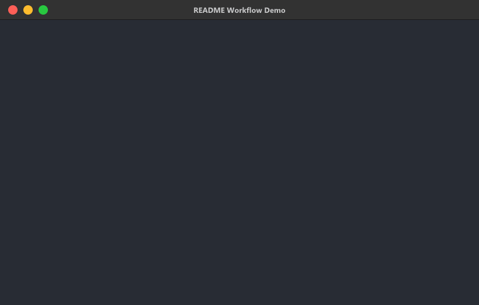 |  |

## git

| GIF | SVG |
| --- | --- |
|  |  |

## highlight

| GIF | SVG |
| --- | --- |
|  |  |

## pty

再生成には[`matrix`](https://github.com/guitarrapc/matrix)が必要です。

| GIF | SVG |
| --- | --- |
| 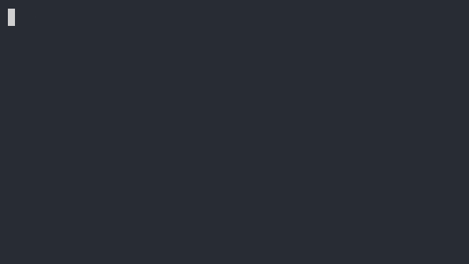 |  |

## interactive-pty

実際のターミナルで`vim`を操作して録画するので、再生成は手動です。

| GIF | SVG |
| --- | --- |
|  |  |

## password-prompt

`sudo`はエコーを切るので、パスワードは録画に残りません。実際のターミナルと`sudo`を使えるアカウントが必要なので、再生成は手動です。

| GIF | SVG |
| --- | --- |
|  |  |

## theme

| GIF | SVG |
| --- | --- |
| 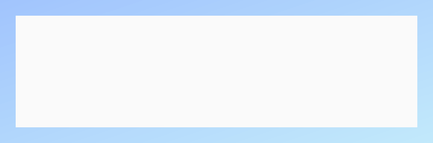 |  |

## theme-macos

| GIF | SVG |
| --- | --- |
| 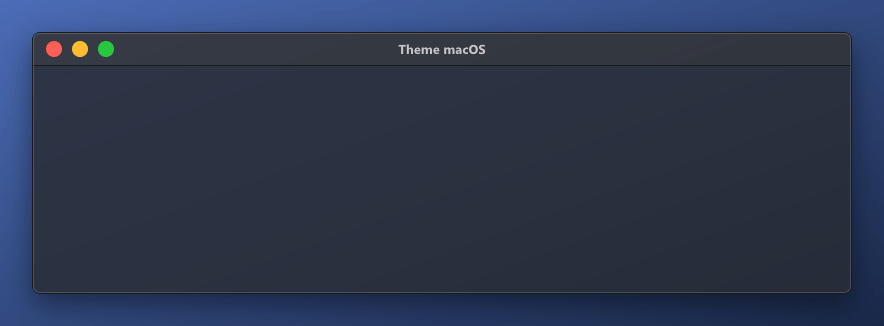 |  |

## theme-windows

| GIF | SVG |
| --- | --- |
| 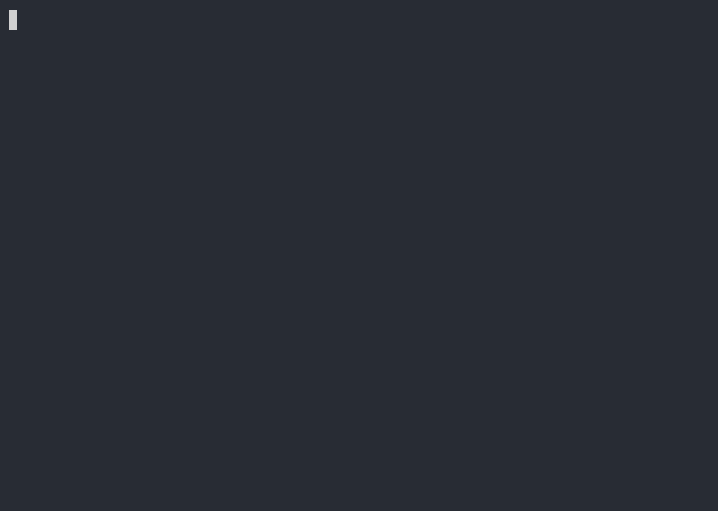 |  |

## translucent

| GIF | SVG |
| --- | --- |
| 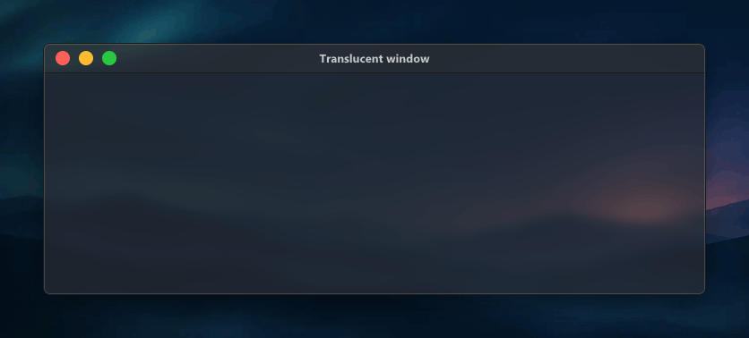 |  |

## speed

`--format`を付けずに録画すると、`outputs`の一覧どおり2つのSVGを書き出します: `scenetake samples/speed.yaml`。castには録画したときの時間が残り、`speed: 2`は同じ録画を2倍の速さで再生します。

| 録画どおり | `speed: 2` |
| --- | --- |
|  |  |

## resize

YAMLはなく、`scenetake svg samples/resize.cast`で変換します。

| GIF | SVG |
| --- | --- |
| 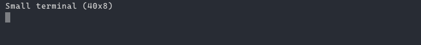 |  |

## 再生成

リポジトリのルートで実行します。GIFの作成にはffmpegが必要です。

```bash
# すべてのシナリオからcast、SVG、カラーテーマの見本、GIFを作り直す
dotnet run samples/regenerate.cs

# カラーテーマの見本だけ作る
dotnet run samples/regenerate.cs -- --theme-presets

# 今あるcastからGIFだけ作る
dotnet run samples/regenerate.cs -- --gifs
```

ショーケースはLinuxのツールを使うので、`showcase/record.sh`がコンテナの中で録画します。LinuxかDockerのあるWSLで、linux-x64のscenetakeを置いたフォルダを渡して実行します。

```bash
dotnet publish src/Scenetake/Scenetake.csproj -c Release -r linux-x64 --self-contained -p:PublishAot=false -p:PublishSingleFile=true -o ~/scenetake-linux
bash samples/showcase/record.sh ~/scenetake-linux            # すべて
bash samples/showcase/record.sh ~/scenetake-linux fetch sl   # 指定したものだけ
```
