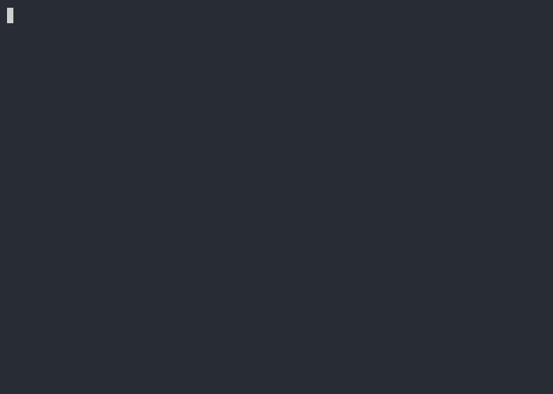
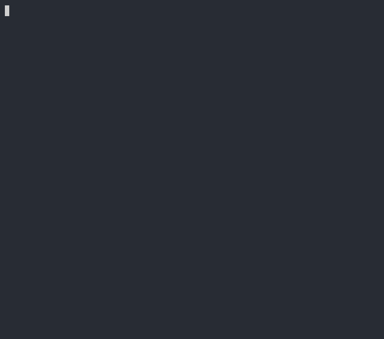
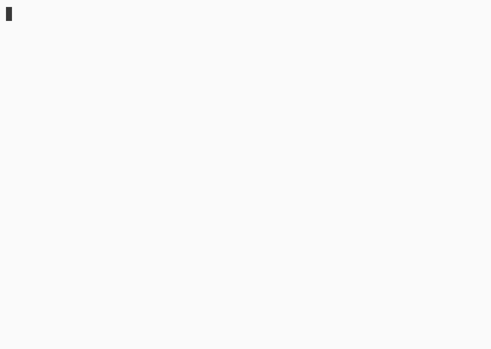
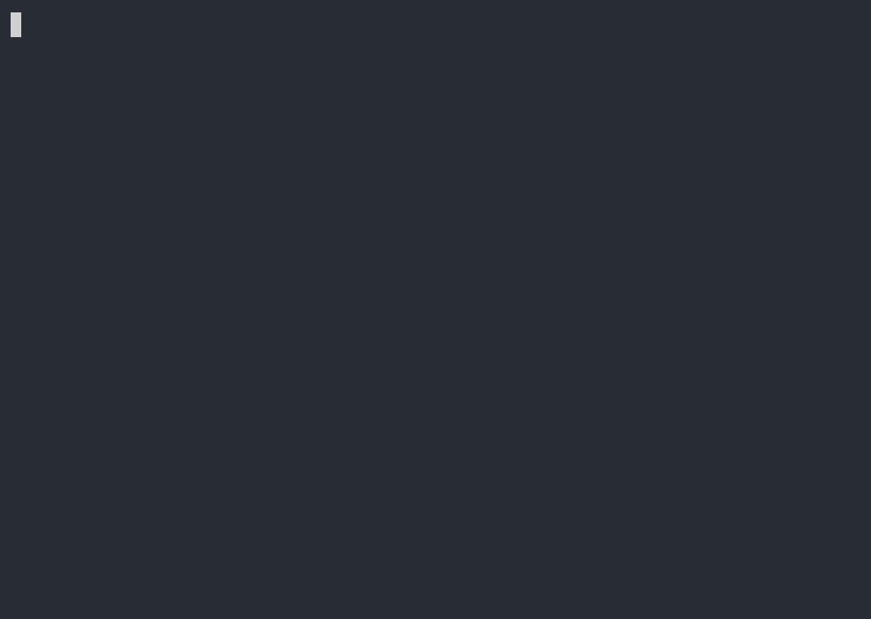
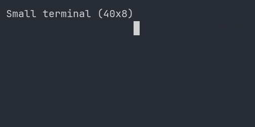

# Sample scenarios

English | [日本語](README-ja.md)

Sample scenarios for scenetake. Use this page to quickly see each scenario’s **purpose** and **outputs** (GIF / SVG).

## Index

| Scenario | Purpose | Input | Outputs |
|----------|---------|-------|---------|
| [basic](#basic) | Getting started — typing, highlights, sleep | [basic.yaml](basic.yaml) | [cast](basic.cast) · [gif](basic.gif) · [svg](basic.svg) |
| [scenario-format](#scenario-format) | Full scenario format reference (README embed) | [scenario_format.yaml](scenario_format.yaml) | [cast](scenario_format.cast) · [svg](scenario_format.svg) |
| [demo](#demo) | README workflow (YAML → cast → GIF) | [demo.yaml](demo.yaml) | [cast](demo.cast) · [gif](demo.gif) · [svg](demo.svg) |
| [git](#git) | Real `git` command demo | [git.yaml](git.yaml) | [cast](git.cast) · [gif](git.gif) · [svg](git.svg) |
| [highlight](#highlight) | Comment, stdout, and stderr coloring | [highlight.yaml](highlight.yaml) | [cast](highlight.cast) · [gif](highlight.gif) · [svg](highlight.svg) |
| [pty](#pty) | TTY-dependent command with `pty: true` (`matrix`) | [pty.yaml](pty.yaml) | [cast](pty.cast) · [gif](pty.gif) · [svg](pty.svg) |
| [interactive-pty](#interactive-pty) | Host-terminal interactive session (`interactive: true`) | [interactive-pty.yaml](interactive-pty.yaml) | manual only |
| [theme](#theme) | Light theme, 16 / 256 colors | [theme.yaml](theme.yaml) | [cast](theme.cast) · [gif](theme.gif) · [svg](theme.svg) |
| [theme-macos](#theme-macos) | macOS window chrome | [theme-macos.yaml](theme-macos.yaml) | [cast](theme-macos.cast) · [gif](theme-macos.gif) · [svg](theme-macos.svg) |
| [theme-windows](#theme-windows) | Windows window chrome | [theme-windows.yaml](theme-windows.yaml) | [cast](theme-windows.cast) · [gif](theme-windows.gif) · [svg](theme-windows.svg) |
| [resize](#resize) | Terminal resize events (cast only) | [resize.cast](resize.cast) | [gif](resize.gif) · [svg](resize.svg) |

## Regenerate

Run from the repository root:

```bash
# Regenerate .cast and .svg from every *.yaml
dotnet run samples/regenerate.cs

# GIFs require agg (Docker example; use ghcr.io/asciinema/agg for v3 casts)
docker run --rm -v "$PWD:/data" ghcr.io/asciinema/agg \
  /data/samples/basic.cast /data/samples/basic.gif --last-frame-duration 0
```

---

## basic

**Purpose:** Introductory sample covering core scenetake features.

- Step name comments, typing animation, line highlights on `curl` output
- `sleep` pause and default stderr color (red)

| GIF | SVG |
|-----|-----|
|  |  |

```bash
scenetake --format svg samples/basic.yaml
```

---

## scenario-format

**Purpose:** Runnable reference for the scenario YAML format embedded in the main README.

- All top-level sections: metadata, `settings`, `render`, harmless `pre`/`post`, string and map `steps`
- `run-highlight`, `highlight`, `stderr-color`, and a minimal `pty: true` echo step with fixed `printf` output (no git or file changes)
- `render.window: macos` for README preview

| SVG |
|-----|
|  |

```bash
scenetake --format svg samples/scenario_format.yaml
```

---

## demo

**Purpose:** Reproduce the README workflow from YAML through cast to GIF.

- Show scenario with `cat` → generate cast with `scenetake` → GIF with `agg` (Docker)

| GIF | SVG |
|-----|-----|
|  |  |

```bash
scenetake --format svg samples/demo.yaml
```

---

## git

**Purpose:** Repository-style demo using real `git` command output.

- `git status` / `log` / `branch` / `diff --stat`
- Per-step `post-delay` and `typing-speed` tuning

| GIF | SVG |
|-----|-----|
|  |  |

```bash
scenetake --format svg samples/git.yaml
```

---

## highlight

**Purpose:** Comprehensive sample of scenetake coloring (SGR injected into cast events).

- Comment line styles (`[style]` in `name`)
- `run-highlight` (typed command color)
- `highlight` (stdout line / range rules)
- `stderr-color` (named colors and SGR literals)
- 256-color index and true color

| GIF | SVG |
|-----|-----|
|  |  |

```bash
scenetake --format svg samples/highlight.yaml
```

---

## pty

**Purpose:** Record a TTY-dependent command in a real pseudo-terminal (`pty: true`).

- Intro step with typing animation, then `matrix 5` with `pty: true` (simulated typing of the command, then PTY capture)
- [`matrix`](https://github.com/guitarrapc/matrix) output also exercises SVG **Matrix rain contextual tint** (white highlights beside green render as bright green)
- Requires the `matrix` CLI on `PATH` when regenerating
- For a minimal `pty: true` example without extra dependencies, see the [pty demo step in scenario-format](#scenario-format)

| GIF | SVG |
|-----|-----|
|  |  |

```bash
scenetake --format svg samples/pty.yaml
```

---

## interactive-pty

**Purpose:** Record a step where **you** operate the TUI on the host terminal (`pty: true` + `interactive: true`).

- Simulated typing of `run` is emitted on the cast timeline before the session starts
- Wall-clock PTY output is buffered while you interact; step ends when the child exits (`:wq`, etc.)
- **Manual only** — requires a real stdin/stdout TTY and tools such as `vim` on `PATH`. No pre-generated cast/SVG.

```bash
scenetake --format svg samples/interactive-pty.yaml out/interactive-pty
```

---

## theme

**Purpose:** **`render.theme`** in the SVG / cast header (light preset) and ANSI color rendering.

- `render.font-size` / `theme.preset: light`
- 16-color and 256-color `printf` output

| GIF | SVG |
|-----|-----|
|  |  |

```bash
scenetake --format svg samples/theme.yaml
```

---

## theme-macos

**Purpose:** **`render.window: macos`** window chrome with the dark theme.

| GIF | SVG |
|-----|-----|
|  |  |

```bash
scenetake --format svg samples/theme-macos.yaml
```

---

## theme-windows

**Purpose:** **`render.window: windows`** window chrome with the dark theme.

| GIF | SVG |
|-----|-----|
|  |  |

```bash
scenetake --format svg samples/theme-windows.yaml
```

---

## resize

**Purpose:** See how SVG handles cast **`r` (resize)** events.

- No YAML — hand-edited [resize.cast](resize.cast) only (40×8 → 80×12 → 50×6)
- Viewport clipping on shrink and chrome resize behavior

| GIF | SVG |
|-----|-----|
|  |  |

```bash
scenetake svg samples/resize.cast
```
