# Sample scenarios

English | [日本語](README-ja.md)

Sample scenarios for scenetake. Record one with a command such as `scenetake --format svg samples/basic.yaml`.

| Scenario | What it shows | Files |
| --- | --- | --- |
| [basic](#basic) | Getting started: typing, highlights, sleep, stderr color | [yaml](basic.yaml) · [cast](basic.cast) · [gif](basic.gif) · [svg](basic.svg) |
| [scenario-format](#scenario-format) | The scenario format reference shown in the README | [yaml](scenario_format.yaml) · [cast](scenario_format.cast) · [svg](scenario_format.svg) |
| [demo](#demo) | From YAML to a cast and a GIF | [yaml](demo.yaml) · [cast](demo.cast) · [gif](demo.gif) · [svg](demo.svg) |
| [git](#git) | Real `git` command output | [yaml](git.yaml) · [cast](git.cast) · [gif](git.gif) · [svg](git.svg) |
| [highlight](#highlight) | Colors for comments, typed commands, stdout, and stderr | [yaml](highlight.yaml) · [cast](highlight.cast) · [gif](highlight.gif) · [svg](highlight.svg) |
| [pty](#pty) | `matrix` recorded with `pty: true` | [yaml](pty.yaml) · [cast](pty.cast) · [gif](pty.gif) · [svg](pty.svg) |
| [interactive-pty](#interactive-pty) | Recording while you operate the app, with `interactive: true` | [yaml](interactive-pty.yaml) · [cast](interactive-pty.cast) · [gif](interactive-pty.gif) · [svg](interactive-pty.svg) |
| [password-prompt](#password-prompt) | A `sudo` password kept out of the recording (Linux / macOS) | [yaml](password-prompt.yaml) · [cast](password-prompt.cast) · [gif](password-prompt.gif) · [svg](password-prompt.svg) |
| [theme](#theme) | The light theme, 16 and 256 colors, a gradient background | [yaml](theme.yaml) · [cast](theme.cast) · [gif](theme.gif) · [svg](theme.svg) |
| [theme-macos](#theme-macos) | A macOS window over a gradient that shows through it | [yaml](theme-macos.yaml) · [cast](theme-macos.cast) · [gif](theme-macos.gif) · [svg](theme-macos.svg) |
| [theme-windows](#theme-windows) | A Windows window over a gradient | [yaml](theme-windows.yaml) · [cast](theme-windows.cast) · [gif](theme-windows.gif) · [svg](theme-windows.svg) |
| [translucent](#translucent) | A translucent, blurred window over an image | [yaml](translucent.yaml) · [cast](translucent.cast) · [gif](translucent.gif) · [svg](translucent.svg) |
| [resize](#resize) | Terminal resizes (cast only) | [cast](resize.cast) · [gif](resize.gif) · [svg](resize.svg) |

## Showcase

Demos of well-known terminal tools, used in the README gallery and the playground.

| Scenario | What it shows | Files |
| --- | --- | --- |
| fetch | `fastfetch` in a PTY, in a macOS window | [yaml](showcase/fetch.yaml) · [cast](showcase/fetch.cast) · [svg](showcase/fetch.svg) |
| devtools | `bat`, `git log --graph`, and `jq` in color, in a Windows window | [yaml](showcase/devtools.yaml) · [cast](showcase/devtools.cast) · [svg](showcase/devtools.svg) |
| logo | `figlet` with animated `lolcat`, and `toilet` | [yaml](showcase/logo.yaml) · [cast](showcase/logo.cast) · [svg](showcase/logo.svg) |
| sl | The steam locomotive, drawn with curses | [yaml](showcase/sl.yaml) · [cast](showcase/sl.cast) · [svg](showcase/sl.svg) |
| nyancat | A full-screen truecolor animation, stopped by `timeout` | [yaml](showcase/nyancat.yaml) · [cast](showcase/nyancat.cast) · [svg](showcase/nyancat.svg) |
| vim | `vim` edited by `keys`, then `git diff` | [yaml](showcase/vim.yaml) · [cast](showcase/vim.cast) · [svg](showcase/vim.svg) |
| secrets | A dummy token, a password in a URL, and a host name in `settings.mask`, hidden | [yaml](showcase/secrets.yaml) · [cast](showcase/secrets.cast) · [svg](showcase/secrets.svg) |
| welcome | The playground's first screen | [yaml](showcase/welcome.yaml) · [cast](showcase/welcome.cast) · [svg](showcase/welcome.svg) |

## basic

| GIF | SVG |
| --- | --- |
|  |  |

## scenario-format


## demo

| GIF | SVG |
| --- | --- |
| 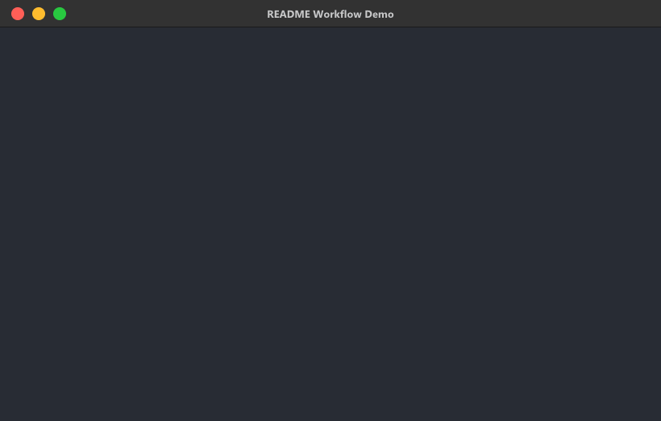 |  |

## git

| GIF | SVG |
| --- | --- |
| 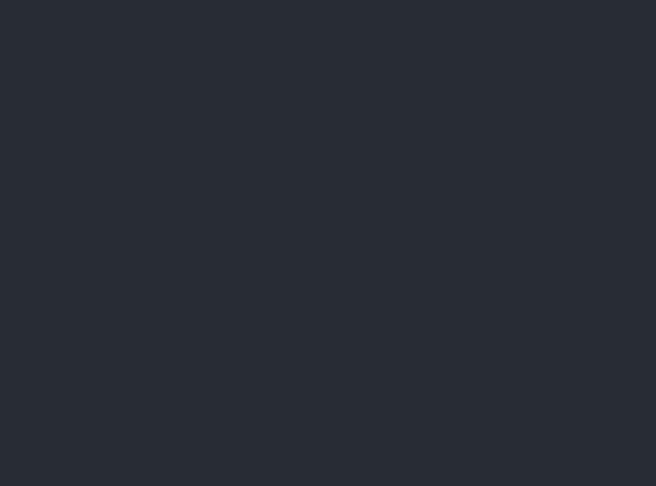 |  |

## highlight

| GIF | SVG |
| --- | --- |
|  |  |

## pty

Recording it again needs [`matrix`](https://github.com/guitarrapc/matrix).

| GIF | SVG |
| --- | --- |
| 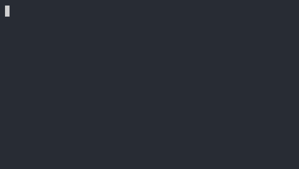 |  |

## interactive-pty

You operate `vim` in a real terminal to record it, so it is recorded again by hand.

| GIF | SVG |
| --- | --- |
|  |  |

## password-prompt

`sudo` turns echo off, so the password stays out of the recording. Recording it again needs a real terminal and an account that may use `sudo`, so it is done by hand.

| GIF | SVG |
| --- | --- |
|  |  |

## theme

| GIF | SVG |
| --- | --- |
| 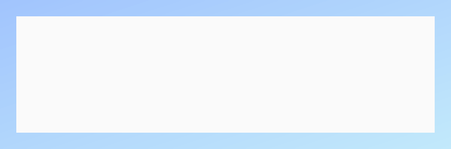 |  |

## theme-macos

| GIF | SVG |
| --- | --- |
| 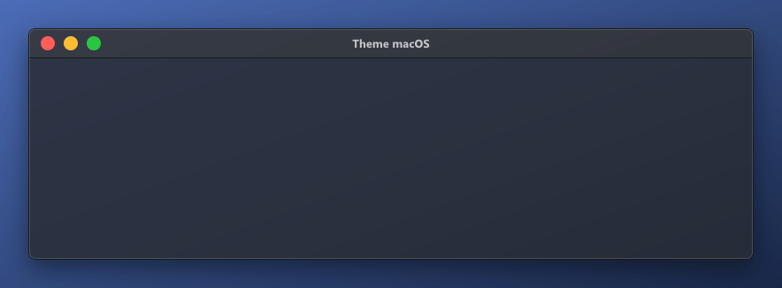 |  |

## theme-windows

| GIF | SVG |
| --- | --- |
| 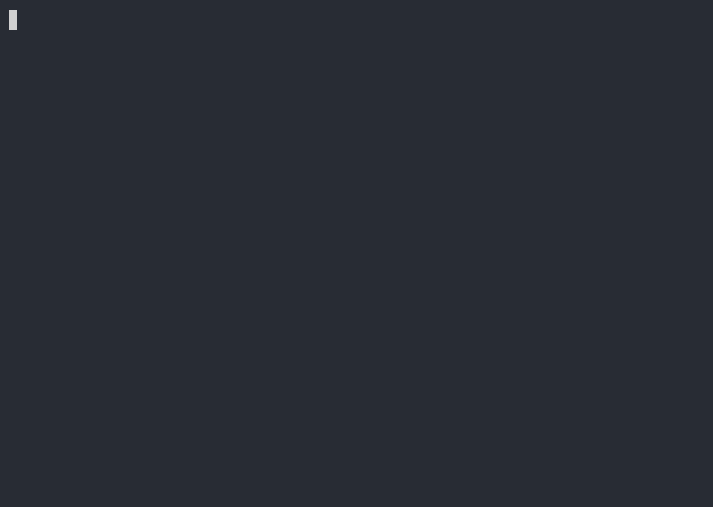 |  |

## translucent

| GIF | SVG |
| --- | --- |
| 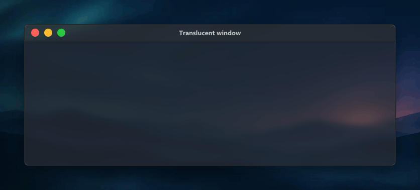 |  |

## resize

There is no YAML. Convert it with `scenetake svg samples/resize.cast`.

| GIF | SVG |
| --- | --- |
| 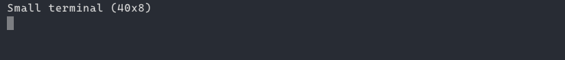 |  |

## Regenerate

Run these from the repository root. The GIFs need ffmpeg.

```bash
# Make the casts, SVGs, color theme previews, and GIFs again from every scenario
dotnet run samples/regenerate.cs

# Only the color theme previews
dotnet run samples/regenerate.cs -- --theme-presets

# Only the GIFs, from the casts as they are
dotnet run samples/regenerate.cs -- --gifs
```

The showcase uses Linux tools, so `showcase/record.sh` records it in a container. Run it on Linux or in WSL with Docker, and pass a folder that holds a linux-x64 scenetake.

```bash
dotnet publish src/Scenetake/Scenetake.csproj -c Release -r linux-x64 --self-contained -p:PublishAot=false -p:PublishSingleFile=true -o ~/scenetake-linux
bash samples/showcase/record.sh ~/scenetake-linux            # every showcase scenario
bash samples/showcase/record.sh ~/scenetake-linux fetch sl   # only these
```
